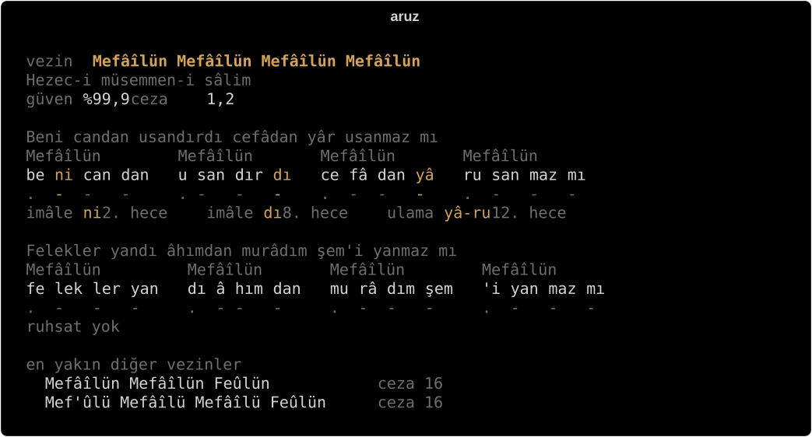
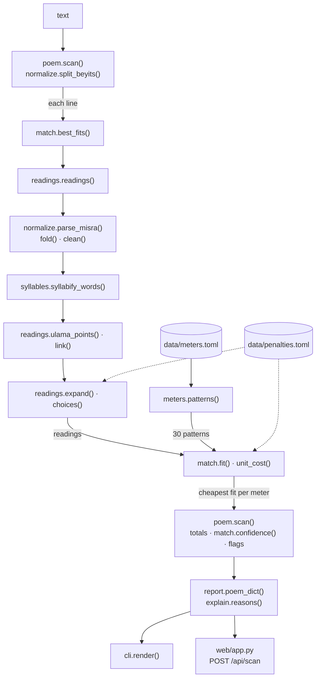
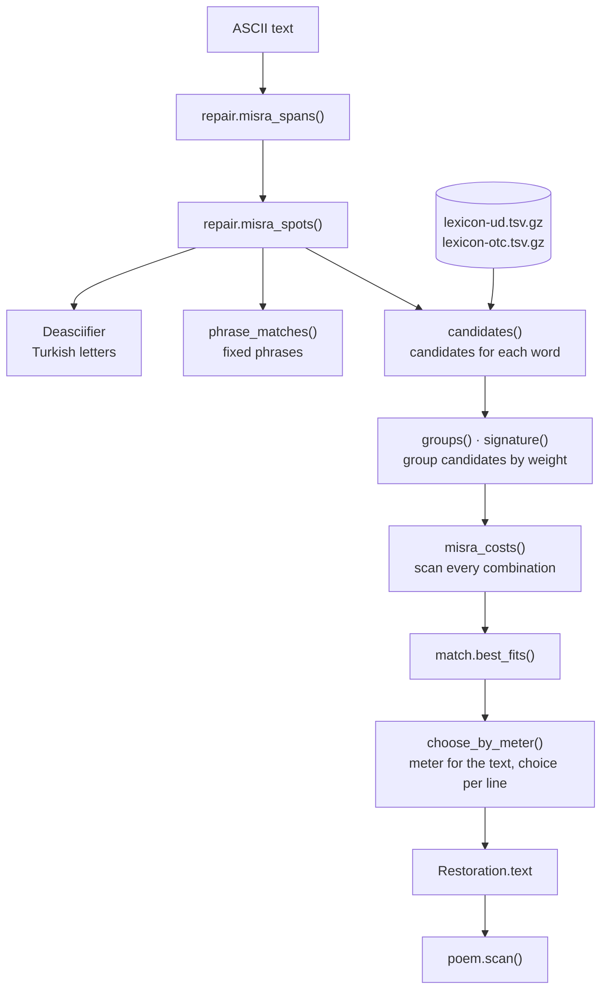

# aruz

A tool that finds the meter of an Ottoman Divan poem written in Latin script, weighs every syllable, and shows the reason behind each decision.

[Türkçe](README.md) · **English**

[](#installation)
[](LICENSE)



I wrote this tool so that, given a line, a couplet or a whole ghazal in Latin transcription, it finds the meter on its own. I split each line into syllables, mark every syllable short (`.`) or long (`-`), and try to fit the result to each of the 20 meters in the library. Then I pick the meter that needs the fewest licenses, line the syllables up under its feet, and list every prosodic license the reading took (imâle, zihaf, med, ulama), together with the syllable where it applies. Every mark can also say why it is there.

You can use it from the command line or from a single-page web interface. The web page speaks Turkish and English; the terminal output is in Turkish.

## Contents

1. [What it does](#what-it-does)
2. [What is aruz?](#what-is-aruz)
3. [Installation](#installation)
4. [Usage](#usage)
5. [How the algorithm works](#how-the-algorithm-works)
   - [The whole pipeline](#the-whole-pipeline)
   - [Step 1: Normalizing the text](#step-1-normalizing-the-text)
   - [Step 2: Splitting words into syllables](#step-2-splitting-words-into-syllables)
   - [Step 3: Weights and readings](#step-3-weights-and-readings)
   - [Step 4: Matching readings against patterns](#step-4-matching-readings-against-patterns)
   - [Step 5: One meter for the whole poem](#step-5-one-meter-for-the-whole-poem)
   - [Why imâle and zihaf are not branches](#why-imâle-and-zihaf-are-not-branches)
   - [Penalty table](#penalty-table)
   - [The journey of one syllable](#the-journey-of-one-syllable)
6. [Smart text repair](#smart-text-repair)
7. [Explain mode](#explain-mode)
8. [Meter library](#meter-library)
9. [Accuracy](#accuracy)
10. [Data sources and licenses](#data-sources-and-licenses)
11. [Known limitations](#known-limitations)
12. [Project layout](#project-layout)
13. [Development and contributing](#development-and-contributing)
14. [License](#license)
15. [Acknowledgements and references](#acknowledgements-and-references)

## What it does

- Splits each line into syllables: `be ni can dan u san dır dı ...`
- Marks every syllable short (`.`) or long (`-`).
- Finds the best fit among 20 meters (30 patterns once the variants are counted) and lines the syllables up under the feet.
- Lists every license the reading needed: imâle, zihaf, med, ulama, and izafet or conjunction vowels read long, each with its syllable number.
- Reports a penalty, a confidence score and the two closest rival meters.
- Reads a whole ghazal in a single meter and flags the couplets that fit it badly.
- Explains every mark and every license: as a table with `--explain` in the terminal, as small notes on hover or tap in the web interface.
- Repairs text typed without Turkish letters or circumflexes before scanning it. Where a word has more than one plausible spelling, the meter decides which one is right.
- Prints the result as JSON on request. The HTTP API behind the web interface returns the same data.

A quick example:

```sh
uv run aruz "Hüsn olmasa ışkı zâhir olmaz"
```

```text
  vezin  Mef'ûlü Mefâilün Feûlün
         Hezec-i müseddes-i ahreb-i makbûz-ı mahzûf
  güven %99,3   ceza 0

  Hüsn olmasa ışkı zâhir olmaz
  Mef'ûlü      Mefâilün      Feûlün
  hüs nol ma   sa ış kı zâ   hi rol maz
  -   -   .    .  -  .  -    .  -   -
  ulama hüs-nol 1. hece   ulama hi-rol 8. hece

  en yakın diğer vezinler
    Fâilâtün Mefâilün Fe'ilün               ceza 5
    Mefâîlün Mefâîlün Mefâîlün Mefâîlün     ceza 8
```

The terminal speaks Turkish: *vezin* is the meter, *güven* the confidence, *ceza* the penalty, *hece* a syllable, and the list at the bottom holds the closest other meters. Numbers use a decimal comma. This line by Fuzûlî fits Mef'ûlü Mefâilün Feûlün with two liaisons and nothing else: `hüsn olmasa` is read `hüs-nol-ma-sa`, and `zâhir olmaz` is read `zâ-hi-rol-maz`.

## What is aruz?

### A note on terms

Aruz has its own vocabulary, and several Turkish terms have no exact English match. This is how I use them:

| term | what it means here | closest English |
| --- | --- | --- |
| aruz | the quantitative meter of classical Arabic, Persian and Ottoman Turkish poetry | ʿarūḍ, quantitative meter |
| vezin | the meter of a poem | meter |
| kalıp | one concrete sequence of feet, variants included | pattern |
| tef'ile | one metrical foot, such as Mefâîlün | foot |
| açık hece (`.`) | a short syllable | short (light) syllable |
| kapalı hece (`-`) | a long syllable | long (heavy) syllable |
| medli hece (`- .`) | an overlong syllable that counts as long plus short | overlong syllable |
| imâle | reading a short syllable as long | lengthening |
| zihaf | reading a long syllable as short | shortening |
| med | counting an overlong syllable as one and a half | no fixed English term |
| ulama | carrying a word's final consonant over to the vowel that opens the next word | liaison |
| izafet | the Persian linking vowel (`-i`, `-ı`) between a noun and its modifier | ezafe |
| atıf vâvı | the Persian conjunction `u / ü / vü`, "and" | conjunction |
| beyit | two lines that belong together | couplet |
| mısra | one line, half of a couplet | line, hemistich |
| gazel | a lyric form kept in one meter throughout | ghazal |
| redif | the word or words repeated at the end of every couplet | refrain (radif) |
| takti | scanning a line | scansion |
| ruhsat | a license the poet may take to fit the meter | prosodic license |

Two of these need a word of warning:

- Turkish handbooks call a short syllable *açık* (open) and a long one *kapalı* (closed). The words describe weight, not spelling: `fâ` ends in a vowel, yet its long vowel makes it *kapalı*. The English notes in the web interface keep this convention and say open and closed. In this README I say short and long.
- In Arabic prosody, *zihâf* names a whole family of changes to the feet. Turkish handbooks use the word in a narrower sense, a long syllable read short, and that narrow sense is the only one this tool knows.

The tool prints the Turkish terms (vezin, imâle, zihaf, med, ulama, izafet, beyit, mısra and the foot names) as they are, so I keep them as terms here too.

### Weight, not syllable count

Aruz grew out of Arabic poetry and came to Ottoman Turkish by way of Persian. Turkish folk verse counts syllables. Aruz arranges them by weight: every syllable is either short or long, and a line is defined by the order of the two.

| kind | mark | when | example |
| --- | --- | --- | --- |
| short | `.` | ends in a short vowel | be, ni, u |
| long | `-` | ends in a consonant | can, dan, maz |
| long | `-` | carries a long vowel (â, î, û), even at the end | fâ, yâ, rî |
| overlong | `- .` | a long vowel plus a consonant, or two final consonants; counts as one and a half syllables | yâr, dost, cevr |

An overlong syllable counts as a long syllable followed by half a short one. A poet may also read it as a plain long syllable, and the tool keeps both readings open.

### Feet

Patterns are built from small units called feet (*tef'ile*). The names are mnemonic words, and each name, read aloud, sounds out its own pattern: me-fâ-î-lün is `. - - -`. The library uses 15 feet:

| foot | weights | foot | weights | foot | weights |
| --- | --- | --- | --- | --- | --- |
| Mefâîlün | `. - - -` | Fâilâtün | `- . - -` | Fâilün | `- . -` |
| Mefâîlü | `. - - .` | Fâilâtü | `- . - .` | Fe'ilün | `. . -` |
| Mefâilün | `. - . -` | Fe'ilâtün | `. . - -` | Fa'lün | `- -` |
| Feûlün | `. - -` | Fe'ilâtü | `. . - .` | Mef'ûlü | `- - .` |
| Feûl | `. -` | Müstef'ilün | `- - . -` | Müfte'ilün | `- . . -` |

### Meters, couplets and ghazals

A meter is a fixed row of feet. "Mefâîlün Mefâîlün Mefâîlün Mefâîlün" is a sixteen-syllable line in the shape `. - - -` four times over. The long names describe the meter. Remel-i müsemmen-i mahzûf, for example, means: from the remel family, eight feet per couplet (four per line), with the last foot cut short (Fâilün instead of Fâilâtün).

A couplet (*beyit*) is two lines. A ghazal (*gazel*) is a run of couplets in a single meter from the first couplet to the last, so the tool reads a whole ghazal in one meter as well.

### Why Turkish is hard to scan

Arabic and Persian have long vowels; Turkish does not. Ottoman poets had to stretch and squeeze Turkish words to make them fit foreign patterns, and most of what makes scansion hard comes from that mismatch. The freedoms they took are called licenses:

- **Imâle:** a short syllable read long. Very common in Turkish words, above all on their last syllable: `be-nî`.
- **Zihaf:** a long syllable read short. Rare, and counted as a flaw.
- **Med:** an overlong syllable counted as one and a half: `yâr` becomes `- .`
- **Ulama:** when a word ends in a consonant and the next one starts with a vowel, the consonant carries over and the syllable boundary moves: `yâr usanmaz` becomes `yâ-ru-san-maz`.
- The vowels of the izafet and of the conjunction (`-i`, `u / ü`) can be short or long, as the meter needs.
- The last syllable of a line always counts as long.

The line below shows several of these at once. Weighed as written, three syllables clash with the pattern; read the way the meter wants, the line fits:

| | Mefâîlün | Mefâîlün | Mefâîlün | Mefâîlün |
| --- | --- | --- | --- | --- |
| syllables | be ni can dan | u san dır dı | ce fâ dan yâ | ru san maz mı |
| as written | `. . - -` | `. - - .` | `. - - -` | `. - - .` |
| as read | `. - - -` | `. - - -` | `. - - -` | `. - - -` |

`ni` and `dı` are lengthened by imâle, `yâr usanmaz` becomes `yâ-ru` through liaison, and the final `mı` counts as long by rule. [Further down](#how-the-algorithm-works) I go through how the algorithm gets there, step by step.

## Installation

### Requirements

| | version | why |
| --- | --- | --- |
| Python | 3.11 or newer | the code uses `tomllib`, which arrived in 3.11 |
| Git | any | the deasciifier dependency is installed from GitHub, pinned to a commit |
| uv | recommended | installs the exact versions recorded in `uv.lock` |

### 1. Install uv

The shortest way:

```sh
pip install uv
```

Or one of uv's official installers:

```powershell
powershell -ExecutionPolicy ByPass -c "irm https://astral.sh/uv/install.ps1 | iex"
```

```sh
curl -LsSf https://astral.sh/uv/install.sh | sh
```

> If `uv` is not found after `pip install uv` (on Windows this happens when Python's `Scripts` folder is not on PATH), write `python -m uv` instead of `uv` in every command in this README: `python -m uv sync`, `python -m uv run aruz ...` and so on. That is how I run it on my own machine.

### 2. Get the code

```sh
git clone https://github.com/lilbatus/aruz-olcusu.git
cd aruz-olcusu
```

If you would rather not use Git here, **Code > Download ZIP** on the GitHub page works too. Git still has to be installed for the next step.

### 3. Install the dependencies

```sh
uv sync
```

This creates a `.venv` virtual environment in the project folder, installs `aruz` in editable mode, and adds these dependencies at the versions in `uv.lock`:

- to run: `rich` (terminal output), `fastapi` and `uvicorn` (web interface), `turkish-deasciifier` (Turkish letter repair)
- to develop: `pytest`, `httpx2` (web tests)

### 4. Try it

```sh
uv run aruz "Hüsn olmasa ışkı zâhir olmaz"
uv run pytest
```

The first command should print the example above, and every test should pass.

### Without uv, using pip

```sh
python -m venv .venv
```

Activate the environment. On Windows:

```powershell
.venv\Scripts\activate
```

On macOS and Linux:

```sh
source .venv/bin/activate
```

Then:

```sh
pip install -e .
pip install --group dev
aruz "Hüsn olmasa ışkı zâhir olmaz"
pytest
```

`--group` needs pip 25.1 or later. With the environment active you do not need `uv run`; the `aruz` and `aruz-web` commands work directly.

### Troubleshooting

| symptom | fix |
| --- | --- |
| `uv` is not found | use `python -m uv` instead of `uv` |
| a Git error while installing `turkish-deasciifier` | install Git; this package comes from GitHub, not PyPI |
| `aruz-web` will not start because port 8000 is taken | run `uv run uvicorn aruz.web.app:app --port 8080` and open `http://127.0.0.1:8080` |
| on Windows, text piped in with `\|` scans as garbage, or redirecting the output to a file fails | run Python in UTF-8 mode: `$env:PYTHONUTF8 = "1"` in PowerShell, `set PYTHONUTF8=1` in cmd. Or pass the text with `--file` and take JSON with `--json`; both always use UTF-8 |
| on Windows, Turkish letters come out mangled in the API example | use the PowerShell example in [HTTP API](#http-api); it sends the body as UTF-8 bytes |

## Usage

### Command line

| option | short | what it does |
| --- | --- | --- |
| `TEXT` | | a couplet or a line; separate the lines with ` / ` or a line break |
| `--file FILE` | `-f` | read a whole ghazal from a file, with a blank line between couplets |
| `--json` | | print the result as JSON |
| `--explain` | | add a table that explains why each syllable counts as short or long |
| `--repair` | | restore missing Turkish letters and circumflexes before scanning |
| `--help` | `-h` | show the help text (in Turkish) |

Examples:

```sh
uv run aruz "Hüsn olmasa ışkı zâhir olmaz"
uv run aruz "Beni candan usandırdı cefâdan yâr usanmaz mı / Felekler yandı âhımdan murâdım şem'i yanmaz mı"
uv run aruz --file examples/fuzuli-olmasun.txt
uv run aruz --explain "Beni candan usandırdı cefâdan yâr usanmaz mı"
uv run aruz --repair "Haddeden gecmis nezaket yal u bal olmus sana"
uv run aruz --json "Hüsn olmasa ışkı zâhir olmaz"
uv run aruz --repair --json "Haddeden gecmis nezaket yal u bal olmus sana"
```

With neither text nor `--file`, the tool reads standard input:

```sh
cat examples/fuzuli-olmasun.txt | uv run aruz
```

On Windows, turn on UTF-8 mode before piping (see [Troubleshooting](#troubleshooting)), or simply use `--file`.

#### How to write the input

| input | how it is read |
| --- | --- |
| `Beni candan ... / Felekler ...` | ` / ` or a line break separates the lines |
| a blank line | separates couplets in a file; without blank lines, lines are paired two by two |
| `â î û` | long vowels |
| `ā ī ū` | folded into circumflexes: `cefā` becomes `cefâ` |
| `ô ê` | become plain `o`, `e` |
| `ʿ ʾ ' ’ ‘ ´ ʼ` and the backtick | ayn or hamza; counted as a consonant and kept as `'`: `maʿnâ` becomes `ma'nâ` |
| `ḥ ṣ ż ṭ` | the dot under the letter is dropped: `ḥüsn` becomes `hüsn` |
| `dil-i`, `bâde-yi` | `i ı u ü yi yı yu yü` after a hyphen is an izafet |
| `zâr u`, `Leylâ vü` | a separate `u ü vu vü` is the conjunction |
| `bî-rahm`, `gül-gûn` | a hyphen splits words |
| punctuation, digits | ignored |
| capitals | lowered the Turkish way: `I` becomes `ı`, `İ` becomes `i` |

#### Reading the output

Here is the output for a couplet by Fuzûlî:

```sh
uv run aruz "Beni candan usandırdı cefâdan yâr usanmaz mı / Felekler yandı âhımdan murâdım şem'i yanmaz mı"
```

```text
  vezin  Mefâîlün Mefâîlün Mefâîlün Mefâîlün
         Hezec-i müsemmen-i sâlim
  güven %99,9   ceza 1,2

  Beni candan usandırdı cefâdan yâr usanmaz mı
  Mefâîlün        Mefâîlün       Mefâîlün       Mefâîlün
  be ni can dan   u san dır dı   ce fâ dan yâ   ru san maz mı
  .  -  -   -     . -   -   -    .  -  -   -    .  -   -   -
  imâle ni 2. hece   imâle dı 8. hece   ulama yâ-ru 12. hece

  Felekler yandı âhımdan murâdım şem'i yanmaz mı
  Mefâîlün         Mefâîlün       Mefâîlün        Mefâîlün
  fe lek ler yan   dı â hım dan   mu râ dım şem   'i yan maz mı
  .  -   -   -     .  - -   -     .  -  -   -     .  -   -   -
  ruhsat yok

  en yakın diğer vezinler
    Mefâîlün Mefâîlün Feûlün           ceza 16
    Mef'ûlü Mefâîlü Mefâîlü Feûlün     ceza 16
```

| line | meaning |
| --- | --- |
| `vezin  Mefâîlün ...` | the meter found, by its feet |
| `Hezec-i müsemmen-i sâlim` | the meter's name |
| `güven %99,9   ceza 1,2` | confidence (*güven*) and the total penalty of the text (*ceza*) |
| dimmed line | the line as typed |
| foot headers | the foot each column falls under; for meters with variants, the variant that actually matched |
| syllable row | the syllables, with their boundaries after liaison (`yâ ru`) |
| mark row | how each syllable is read in the meter, so a lengthened syllable shows `-` here. In the terminal, syllables that took a license are highlighted |
| `~` | the second half of an overlong syllable |
| `imâle ni 2. hece ...` | the licenses used and the syllables they fall on (*2. hece* is syllable 2) |
| `ruhsat yok` | the line fit without any license |
| `en yakın diğer vezinler` | the next two meters by penalty; meters with equal penalties keep their library order |

A few more Turkish labels turn up in other outputs: *uzun izafet* and *uzun bağlaç* (izafet or conjunction vowel read long), *beyit 6 vezne zor uyuyor* (couplet 6 fits the meter poorly), *bu mısra hiçbir kalıba oturmadı* (this line fits no pattern), and *onarılan metin* (restored text).

The second line needs no license at all. The rivals score 16 because neither line fits them: every line that fails to fit costs 8 points.

#### Annotated output: `--explain`

`--explain` adds a table of reasons under each line. When more than one rule applied to a syllable, all of them are listed in order. The terminal prints the reasons in Turkish; the web interface shows them in English when switched to EN. Three of the reasons from this line, as the English interface words them:

| syllable | reason | text |
| --- | --- | --- |
| 2 `ni` | imâle | “ni” is normally open (.), but the meter needs a closed syllable (-) here, so the short syllable is drawn out. |
| 12 `yâ` | ulama | “yâr” ends in a consonant and the next word starts with a vowel, so the consonant moves over to the next syllable (yâ-ru). This syllable is then read closed (-). |
| 16 `mı` | final syllable | “mı” ends in a vowel, so it would normally be open (.). But it is the last syllable of the mısra, and in aruz the last syllable always counts as closed (-). |

<details>
<summary>Full output of <code>uv run aruz --explain "Beni candan usandırdı cefâdan yâr usanmaz mı"</code></summary>

```text
  vezin  Mefâîlün Mefâîlün Mefâîlün Mefâîlün
         Hezec-i müsemmen-i sâlim
  güven %99,8   ceza 1,2

  Beni candan usandırdı cefâdan yâr usanmaz mı
  Mefâîlün        Mefâîlün       Mefâîlün       Mefâîlün
  be ni can dan   u san dır dı   ce fâ dan yâ   ru san maz mı
  .  -  -   -     . -   -   -    .  -  -   -    .  -   -   -
  imâle ni 2. hece   imâle dı 8. hece   ulama yâ-ru 12. hece

   1  be   .  açık hece    “be” kısa bir ünlüyle bitiyor. Kısa ünlüyle biten hece aruzda açık (.) sayılır.
   2  ni   -  açık hece    “ni” kısa bir ünlüyle bitiyor. Kısa ünlüyle biten hece aruzda açık (.) sayılır.
              imâle        “ni” normalde açıktır (.), ama vezin burada kapalı (-) bir hece istiyor. Kısa hece uzatılarak okunur.
   3  can  -  kapalı hece  “can” ünsüzle bitiyor. Ünsüzle biten hece aruzda kapalı (-) sayılır.
   4  dan  -  kapalı hece  “dan” ünsüzle bitiyor. Ünsüzle biten hece aruzda kapalı (-) sayılır.
   5  u    .  açık hece    “u” kısa bir ünlüyle bitiyor. Kısa ünlüyle biten hece aruzda açık (.) sayılır.
   6  san  -  kapalı hece  “san” ünsüzle bitiyor. Ünsüzle biten hece aruzda kapalı (-) sayılır.
   7  dır  -  kapalı hece  “dır” ünsüzle bitiyor. Ünsüzle biten hece aruzda kapalı (-) sayılır.
   8  dı   -  açık hece    “dı” kısa bir ünlüyle bitiyor. Kısa ünlüyle biten hece aruzda açık (.) sayılır.
              imâle        “dı” normalde açıktır (.), ama vezin burada kapalı (-) bir hece istiyor. Kısa hece uzatılarak okunur.
   9  ce   .  açık hece    “ce” kısa bir ünlüyle bitiyor. Kısa ünlüyle biten hece aruzda açık (.) sayılır.
  10  fâ   -  uzun ünlü    “fâ” uzun bir ünlü (â, î, û) taşıyor. Uzun ünlülü hece, ünlüyle bitse de kapalı (-) sayılır.
  11  dan  -  kapalı hece  “dan” ünsüzle bitiyor. Ünsüzle biten hece aruzda kapalı (-) sayılır.
  12  yâ   -  ulama        “yâr” ünsüzle bitiyor, sonraki kelime ünlüyle başlıyor. Ünsüz sonraki heceye bağlanır (yâ-ru) ve bu hece kapalı (-) okunur.
              uzun ünlü    “yâ” uzun bir ünlü (â, î, û) taşıyor. Uzun ünlülü hece, ünlüyle bitse de kapalı (-) sayılır.
  13  ru   .  açık hece    “ru” kısa bir ünlüyle bitiyor. Kısa ünlüyle biten hece aruzda açık (.) sayılır.
  14  san  -  kapalı hece  “san” ünsüzle bitiyor. Ünsüzle biten hece aruzda kapalı (-) sayılır.
  15  maz  -  kapalı hece  “maz” ünsüzle bitiyor. Ünsüzle biten hece aruzda kapalı (-) sayılır.
  16  mı   -  son hece     “mı” ünlüyle bittiği için normalde açıktır (.), ama mısranın son hecesi. Aruzda son hece her zaman kapalı (-) sayılır.

  en yakın diğer vezinler
    Mefâîlün Mefâîlün Feûlün           ceza 8
    Mef'ûlü Mefâîlü Mefâîlü Feûlün     ceza 8
```

</details>

With a single line, a rival that does not fit costs 8 rather than 16, because there is only one line to miss. That is also why the confidence drops from 99.9% to 99.8%: the gaps being compared are smaller.

#### Repaired output: `--repair`

A line typed without Turkish letters and circumflexes is repaired first and scanned after. The restored text comes first:

```sh
uv run aruz --repair "Haddeden gecmis nezaket yal u bal olmus sana"
```

```text
  onarılan metin
  Haddeden geçmiş nezâket yâl ü bâl olmuş sana

  vezin  Fâilâtün Fâilâtün Fâilâtün Fâilün
         Remel-i müsemmen-i mahzûf
  güven %99,9   ceza 0

  Haddeden geçmiş nezâket yâl ü bâl olmuş sana
  Fâilâtün         Fâilâtün        Fâilâtün       Fâilün
  had de den geç   miş ne zâ ket   yâ lü bâ lol   muş sa na
  -   .  -   -     -   .  -  -     -  .  -  -     -   .  -
  ulama bâ-lol 11. hece

  en yakın diğer vezinler
    Mefâîlün Mefâîlün Mefâîlün Mefâîlün     ceza 8
    Mefâîlün Mefâîlün Feûlün                ceza 8
```

In the terminal, restored letters are highlighted, and words that even the meter could not settle are underlined. [Smart text repair](#smart-text-repair) explains how the repair works.

#### A whole ghazal

`examples/fuzuli-olmasun.txt` holds six couplets from Fuzûlî's ghazal with the refrain "olmasun yâ Rab". The couplets are separated by blank lines:

```sh
uv run aruz --file examples/fuzuli-olmasun.txt
```

All twelve lines are read in one meter: Hezec-i müsemmen-i sâlim, total penalty 11.3, confidence 99.8%. The sixth couplet is flagged as a poor fit:

```text
  beyit 6   vezne zor uyuyor
  Cefâ vü cevr ile mu'tâdem anlarsuz nolur hâlüm
  Mefâîlün       Mefâîlün       Mefâîlün         Mefâîlün
  ce fâ vü cev   ri le mu' tâ   de man lar suz   no lur hâ lüm
  .  -  -  -     .  -  -   -    .  -   -   -     .  -   -  -
  uzun bağlaç vü 3. hece   ulama cev-ri 4. hece   imâle le 6. hece   ulama de-man 9. hece

  Cefâsına had ü cevrine pâyân olmasun yâ Rab
  Mefâîlün      Mefâîlün       Mefâîlün       Mefâîlün
  ce fâ sı na   ha dü cev ri   ne pâ yân ol   ma sun yâ rab
  .  -  -  -    .  -  -   -    .  -  -   -    .  -   -  -
  imâle sı 3. hece   imâle na 4. hece   uzun bağlaç dü 6. hece   imâle ri 8. hece
```

Its second line costs 4.4, above the flagging threshold of 2.5. I work out where that number comes from in [Step 5](#step-5-one-meter-for-the-whole-poem).

<details>
<summary>Full output for the ghazal</summary>

```text
  vezin  Mefâîlün Mefâîlün Mefâîlün Mefâîlün
         Hezec-i müsemmen-i sâlim
  güven %99,8   ceza 11,3

  beyit 1
  Menüm tek hîç kim zâr u perîşân olmasun yâ Rab
  Mefâîlün         Mefâîlün      Mefâîlün       Mefâîlün
  me nüm tek hîç   ~ kim zâ ru   pe rî şân ol   ma sun yâ rab
  .  -   -   -     . -   -  -    .  -  -   -    .  -   -  -
  med hîç 4. hece   uzun bağlaç ru 7. hece

  Esîr-i derd-i ışk u dâğ-ı hicrân olmasun yâ Rab
  Mefâîlün      Mefâîlün      Mefâîlün        Mefâîlün
  e sî ri der   di ış ku dâ   ğı hic rân ol   ma sun yâ rab
  . -  -  -     .  -  -  -    .  -   -   -    .  -   -  -
  uzun izafet ri 3. hece   uzun bağlaç ku 7. hece

  beyit 2
  Dem-â-dem cevrlerdür çekdügüm bî-rahm bütlerden
  Mefâîlün         Mefâîlün        Mefâîlün         Mefâîlün
  de mâ dem cevr   ~ ler dür çek   dü güm bî rahm   ~ büt ler den
  .  -  -   -      . -   -   -     .  -   -  -      . -   -   -
  ulama de-mâ 1. hece   med cevr 4. hece   med rahm 11. hece

  Bu kâfirler esîri bir müselmân olmasun yâ Rab
  Mefâîlün        Mefâîlün      Mefâîlün        Mefâîlün
  bu kâ fir ler   e sî ri bir   mü sel mân ol   ma sun yâ rab
  .  -  -   -     . -  -  -     .  -   -   -    .  -   -  -
  imâle ri 7. hece

  beyit 3
  Görüp endîşe-i katlümde ol mâhı budur derdüm
  Mefâîlün       Mefâîlün       Mefâîlün      Mefâîlün
  gö rüp en dî   şe i kat lüm   de ol mâ hı   bu dur der düm
  .  -   -  -    .  - -   -     .  -  -  -    .  -   -   -
  uzun izafet i 6. hece   imâle hı 12. hece

  Ki bu endîşeden ol meh peşîmân olmasun yâ Rab
  Mefâîlün      Mefâîlün        Mefâîlün       Mefâîlün
  ki bu en dî   şe den ol meh   pe şî mân ol   ma sun yâ rab
  .  -  -  -    .  -   -  -     .  -  -   -    .  -   -  -
  imâle bu 2. hece

  beyit 4
  Çıkarmak etseler tenden çeküp peykânın ol servün
  Mefâîlün        Mefâîlün         Mefâîlün        Mefâîlün
  çı kar mak et   se ler ten den   çe küp pey kâ   nı nol ser vün
  .  -   -   -    .  -   -   -     .  -   -   -    .  -   -   -
  ulama nı-nol 13. hece

  Çıkan olsun dil-i mecrûh peykân olmasun yâ Rab
  Mefâîlün        Mefâîlün        Mefâîlün       Mefâîlün
  çı kan ol sun   di li mec rûh   ~ pey kân ol   ma sun yâ rab
  .  -   -  -     .  -  -   -     . -   -   -    .  -   -  -
  uzun izafet li 6. hece   med rûh 8. hece

  beyit 5
  Demen kim adli yoh yâ zulmü çoh her hâl ile olsa
  Mefâîlün        Mefâîlün        Mefâîlün        Mefâîlün
  de men kim ad   li yoh yâ zul   mü çoh her hâ   li le ol sa
  .  -   -   -    .  -   -  -     .  -   -   -    .  -  -  -
  ulama hâ-li 12. hece   imâle le 14. hece

  Gönül tahtına andan özge sultân olmasun yâ Rab
  Mefâîlün        Mefâîlün       Mefâîlün        Mefâîlün
  gö nül tah tı   na an dan öz   ge sul tân ol   ma sun yâ rab
  .  -   -   -    .  -  -   -    .  -   -   -    .  -   -  -
  imâle tı 4. hece

  beyit 6   vezne zor uyuyor
  Cefâ vü cevr ile mu'tâdem anlarsuz nolur hâlüm
  Mefâîlün       Mefâîlün       Mefâîlün         Mefâîlün
  ce fâ vü cev   ri le mu' tâ   de man lar suz   no lur hâ lüm
  .  -  -  -     .  -  -   -    .  -   -   -     .  -   -  -
  uzun bağlaç vü 3. hece   ulama cev-ri 4. hece   imâle le 6. hece   ulama de-man 9. hece

  Cefâsına had ü cevrine pâyân olmasun yâ Rab
  Mefâîlün      Mefâîlün       Mefâîlün       Mefâîlün
  ce fâ sı na   ha dü cev ri   ne pâ yân ol   ma sun yâ rab
  .  -  -  -    .  -  -   -    .  -  -   -    .  -   -  -
  imâle sı 3. hece   imâle na 4. hece   uzun bağlaç dü 6. hece   imâle ri 8. hece

  en yakın diğer vezinler
    Mefâîlün Mefâîlün Feûlün     ceza 96
    Mef'ûlü Mefâilün Feûlün      ceza 96
```

</details>

#### JSON output: `--json`

`--json` prints everything the terminal and the web page show. In the example below I kept only the first item of the `feet`, `licenses` and `syllables` lists and removed the `tips` and `i18n` fields.

<details>
<summary><code>uv run aruz --json "Hüsn olmasa ışkı zâhir olmaz"</code> (shortened)</summary>

```json
{
  "meter": {
    "id": "hezec-6-ahreb-makbuz",
    "name": "Hezec-i müseddes-i ahreb-i makbûz-ı mahzûf",
    "feet": "Mef'ûlü Mefâilün Feûlün",
    "penalty": 0.0
  },
  "confidence": 0.993,
  "alternatives": [
    {"id": "hafif-6-mahbun", "name": "Hafîf-i müseddes-i mahbûn-ı mahzûf", "feet": "Fâilâtün Mefâilün Fe'ilün", "penalty": 5.0},
    {"id": "hezec-8-salim", "name": "Hezec-i müsemmen-i sâlim", "feet": "Mefâîlün Mefâîlün Mefâîlün Mefâîlün", "penalty": 8.0}
  ],
  "beyits": [
    {
      "index": 1,
      "flagged": false,
      "misras": [
        {
          "text": "Hüsn olmasa ışkı zâhir olmaz",
          "fit": {
            "pattern": "Mef'ûlü Mefâilün Feûlün",
            "penalty": 0.0,
            "feet": [
              {
                "name": "Mef'ûlü",
                "units": [
                  {"text": "hüs", "mark": "-", "license": "ulama", "tail": false, "syllable": 1},
                  {"text": "nol", "mark": "-", "license": null, "tail": false, "syllable": 2},
                  {"text": "ma", "mark": ".", "license": null, "tail": false, "syllable": 3}
                ]
              }
            ],
            "licenses": [
              {
                "kind": "ulama",
                "name": "ulama",
                "syllable": 1,
                "text": "hüs-nol",
                "tip": {
                  "name": "ulama",
                  "text": "“hüsn” ünsüzle bitiyor, sonraki kelime ünlüyle başlıyor. Ünsüz sonraki heceye bağlanır (hüs-nol) ve bu hece kapalı (-) okunur."
                }
              }
            ],
            "syllables": [
              {
                "position": 1,
                "text": "hüs",
                "word": "hüsn",
                "mark": "-",
                "reasons": [
                  {"code": "ulama", "syllable": "hüs", "word": "hüsn", "position": 1, "before": "-", "after": "-", "detail": "hüs-nol", "name": "ulama", "text": "“hüsn” ünsüzle bitiyor, sonraki kelime ünlüyle başlıyor. Ünsüz sonraki heceye bağlanır (hüs-nol) ve bu hece kapalı (-) okunur."},
                  {"code": "closed_consonant", "syllable": "hüs", "word": "hüsn", "position": 1, "before": null, "after": "-", "detail": "", "name": "kapalı hece", "text": "“hüs” ünsüzle bitiyor. Ünsüzle biten hece aruzda kapalı (-) sayılır."}
                ]
              }
            ]
          }
        }
      ]
    }
  ]
}
```

</details>

The `name` and `text` fields default to Turkish. Every reason, license and repaired word also carries an `i18n` object with both languages, for example `reasons[0].i18n.en.text`.

### Web interface

```sh
uv run aruz-web
```

Then open `http://127.0.0.1:8000` in a browser. On the page you can:

- Paste a line, a couplet or a whole ghazal and press **Scan** (or Ctrl+Enter, Cmd+Enter on a Mac). The result fades in below the text.
- Turn repair on or off with the **Smart text repair** switch. It is on by default, and the browser remembers your choice.
- Switch the whole page between Turkish and English with **TR / EN** in the top right corner. Your input and the result stay where they are, and every string changes at once, the notes included. On a first visit the page follows the browser language, falling back to Turkish when it is neither Turkish nor English.
- Hover any `.` or `-` mark, any license label, the penalty, the confidence, the meter found or a rival meter: a short note explains how that decision came about. The numbers in the penalty and confidence notes come from the current result.
- See restored letters with a thin underline and undecided words with a dotted one. Clicking a restored word steps to its next candidate form and scans again.
- Use the keyboard: Tab moves between the marks and the restored words, Enter or Space changes a restored word's form, and Escape closes the note.
- On a phone, the first tap on a mark or a word opens its note, and a second tap on a restored word changes its form. The Scan button and the repair switch act on a normal tap as before; their notes open on a long press.
- The notes open after about 120 ms with a short fade and a slight upward slide. Only one is open at a time, and none ever leaves the screen. If your system asks for reduced motion, they fade without sliding.

### HTTP API

The web page talks to a single endpoint, and your own programs can use it too.

| method | path | what it does |
| --- | --- | --- |
| `GET` | `/` | the web page |
| `POST` | `/api/scan` | scans the text and returns the result as JSON |

Request body:

| field | type | default | meaning |
| --- | --- | --- | --- |
| `text` | string | required | the line, couplet or ghazal to scan |
| `repair` | boolean | `false` | repair the text before scanning |
| `choices` | object | `{}` | word choices for the repair: `{"word index": candidate index}` |

Top-level fields of the response:

| field | content |
| --- | --- |
| `meter` | the meter found: `id`, `name`, `feet`, `penalty` |
| `confidence` | confidence between 0 and 1 |
| `alternatives` | the two closest meters, in the same shape as `meter` |
| `beyits` | for each couplet: `index`, `flagged` and its lines; each line has `text` and `fit` (`null` if it fits nothing). `fit` holds `pattern`, `penalty`, `feet[].units[]`, `licenses[]` and `syllables[]` with the reasons for every syllable |
| `tips` | notes for the penalty, the confidence, the meter and the rivals, under `tr` and `en` |
| `repair` | only with `repair: true`: the restored text, its segments, and for each restored word its candidates, choice, source and note |

An empty text gets a `400` with `{"detail": "Metin boş. Bir beyit ya da mısra girin."}`.

With curl on macOS and Linux:

```sh
curl -s -X POST http://127.0.0.1:8000/api/scan \
  -H "Content-Type: application/json" \
  -d '{"text": "Haddeden gecmis nezaket yal u bal olmus sana", "repair": true}'
```

In Windows PowerShell the body has to go out as UTF-8 bytes and the answer has to be decoded as UTF-8; otherwise Windows PowerShell 5.1 mangles the Turkish letters:

```powershell
$body = '{"text": "Hüsn olmasa ışkı zâhir olmaz"}'
$response = Invoke-WebRequest -Uri http://127.0.0.1:8000/api/scan -Method Post -ContentType "application/json; charset=utf-8" -Body ([Text.Encoding]::UTF8.GetBytes($body)) -UseBasicParsing
$result = [Text.Encoding]::UTF8.GetString($response.RawContentStream.ToArray()) | ConvertFrom-Json
$result.meter
```

The `choices` field is what a click in the web page sends. The word index counts every word of the text from 0; the candidate index is the position in `repair.words[].candidates`. In the curl example the words run `Haddeden` (0), `gecmis` (1), `nezaket` (2), and the candidates for `nezaket` are `["nezaket", "nezâket"]`. Sending `{"2": 0}` picks the form without the circumflex: the line becomes `Haddeden geçmiş nezaket yâl ü bâl olmuş sana`, and its penalty in the same meter rises to 1.0 (imâle on `za`).

### From Python

```python
from aruz.poem import scan

poem = scan("Beni candan usandırdı cefâdan yâr usanmaz mı\nFelekler yandı âhımdan murâdım şem'i yanmaz mı")
print(poem.best.meter.name)
print(poem.best.meter.label)
print(round(poem.best.cost, 2), round(poem.confidence, 3), poem.flagged)
print([a.meter.label for a in poem.alternatives])
for fit in poem.best.fits:
    print(fit.pattern.label, round(fit.cost, 2), [(lic.kind, lic.text) for lic in fit.licenses])
```

```text
Hezec-i müsemmen-i sâlim
Mefâîlün Mefâîlün Mefâîlün Mefâîlün
1.2 0.999 []
['Mefâîlün Mefâîlün Feûlün', "Mef'ûlü Mefâîlü Mefâîlü Feûlün"]
Mefâîlün Mefâîlün Mefâîlün Mefâîlün 1.2 [('imale', 'ni'), ('imale', 'dı'), ('ulama', 'yâ-ru')]
Mefâîlün Mefâîlün Mefâîlün Mefâîlün 0.0 []
```

For the repair:

```python
from aruz.repair import restore

restoration = restore("Haddeden gecmis nezaket yal u bal olmus sana")
print(restoration.text)
for spot in restoration.spots:
    if spot.text != spot.original:
        print(spot.original, "->", spot.text, spot.source, spot.by_meter)
```

```text
Haddeden geçmiş nezâket yâl ü bâl olmuş sana
gecmis -> geçmiş lexicon False
nezaket -> nezâket lexicon True
yal -> yâl phrase False
u -> ü phrase False
bal -> bâl phrase False
olmus -> olmuş lexicon False
```

For a dictionary ready to dump as JSON, use `aruz.report.poem_dict(scan(text))`; it is the same thing `--json` prints.

## How the algorithm works

At its core the tool is a pipeline of five steps: I normalize the text, split it into syllables, work out every plausible reading, match those readings against the patterns, and then decide for the poem as a whole. Each step lives in its own module, and the output of one is the input of the next. Below I walk through all of them on the same line, with the tool's real intermediate output:

> Beni candan usandırdı cefâdan yâr usanmaz mı (Fuzûlî)

### The whole pipeline



In short: `poem.scan()` splits the text into couplets and lines and sends each line to `match.best_fits()`. `best_fits()` first asks `readings.readings()` for every plausible reading of the line. To build them, the line is split into words by `normalize.parse_misra()` and into syllables by `syllables.syllabify_words()`; the places where liaison can happen are found, and `choices()` opens up the weight options of every syllable. Each reading is then tried in `match.fit()` against the 30 patterns that `meters.patterns()` provides, and the cheapest fit for each meter is kept. `scan()` adds those results up over all lines, picks the cheapest meter, computes the confidence and flags the couplets that fit badly. `report.poem_dict()` turns the result into JSON and attaches a reason to every syllable through `explain.reasons()`. The terminal and the web page both display that same dictionary.

### Step 1: Normalizing the text

Code: [`src/aruz/normalize.py`](src/aruz/normalize.py)

Transcriptions disagree. One writes `cefâ`, another `cefā`; one marks the ayn with `ʿ`, another with `'`, a third not at all. The first thing I do is bring the text into one comparable form with `fold()`:

1. I lowercase Turkish capitals correctly: `I` becomes `ı` and `İ` becomes `i`. Python's own `lower()` does not know this and turns `IŞIK` into `işik`.
2. I split the text into letters and marks with Unicode NFD, turn macrons into circumflexes, and turn every sign used for ayn or hamza into `'`.
3. I keep the circumflex, the cedilla (ç, ş), the breve (ğ) and the diaeresis (ö, ü), and drop every other mark, such as dots under letters.
4. I recompose the text with NFC and flatten `ô` and `ê` to `o` and `e`.

| input | `fold()` output |
| --- | --- |
| `IŞIK İçin` | `ışık için` |
| `cefā` | `cefâ` |
| `dīn ū` | `dîn û` |
| `maʿnâ`, `ma’nâ`, `maʾnâ` | `ma'nâ` |
| `ḥüsn ṣabr żulm` | `hüsn sabr zulm` |
| `çeşm-i gönül ağlar` | `çeşm-i gönül ağlar` (unchanged) |

Next, `clean()` turns punctuation and digits into spaces, keeping letters, `'` and `-`. `parse_misra()` also splits words at hyphens and gives each word a kind:

- `i ı u ü yi yı yu yü` after a hyphen: **izafet** (`izafet`)
- a standalone `u ü vu vü` that is not the first word of the line: **conjunction** (`conjunction`)
- everything else: **plain word** (`plain`)

`dil-i şeydâ bâde-yi gül-gûn` comes apart like this:

| word | kind |
| --- | --- |
| dil | plain |
| i | izafet |
| şeydâ | plain |
| bâde | plain |
| yi | izafet |
| gül | plain |
| gûn | plain |

The kinds matter because an izafet or conjunction vowel can be short or long as the meter requires, and it always links to a consonant before it. `gûn` follows a hyphen but is not an izafet, because it is not one of the izafet endings.

`split_beyits()` divides the text into couplets. Blank lines separate blocks; within a block, every line and every piece between ` / ` becomes a line of verse, and lines are paired two by two:

| input (`\n` is a line break) | couplets |
| --- | --- |
| `a b\nc d\n\ne f\ng h` | `[a b, c d]`, `[e f, g h]` |
| `a b / c d` | `[a b, c d]` |
| `a\nb\nc\nd` | `[a, b]`, `[c, d]` |

Our line leaves this step as seven plain words: `beni candan usandırdı cefâdan yâr usanmaz mı`.

### Step 2: Splitting words into syllables

Code: [`src/aruz/syllables.py`](src/aruz/syllables.py)

Every Turkish syllable has exactly one vowel. So I first find the vowels of a word (`a e ı i o ö u ü â î û`), then count the consonants between each pair of vowels. All of them but the last stay with the syllable before; the last one opens the next syllable:

| consonants between two vowels | rule | example |
| --- | --- | --- |
| 0 | the syllables split between the vowels | şâ-ir |
| 1 | the consonant opens the next syllable | be-ni, ce-fâ-dan |
| 2 | one stays, one moves on | can-dan, u-san-dır-dı |
| 3 | the first two stay | dost-lar |

Consonants at the end of a word all stay in its last syllable: `dost`, `kand`. I count the apostrophe, that is the ayn or hamza, as a consonant: `ma'-nâ`, `nef-'î`. A word like `'aşk` therefore starts with a consonant, and in the next step you will see that this is what blocks liaison.

I store each syllable as `Syllable(onset, vowel, coda, word)`: the consonants before the vowel, the vowel, the consonants after it, and the word it belongs to. Every decision about weight comes from these four fields. If `coda` is not empty, the syllable is closed; if the vowel is one of `â î û`, it has a long vowel; if `coda` holds two consonants, or a long vowel is followed by a consonant, the syllable is overlong.

The 16 syllables of our line:

| # | syllable | onset | vowel | coda | word |
| --- | --- | --- | --- | --- | --- |
| 1 | be | b | e | | beni |
| 2 | ni | n | i | | beni |
| 3 | can | c | a | n | candan |
| 4 | dan | d | a | n | candan |
| 5 | u | | u | | usandırdı |
| 6 | san | s | a | n | usandırdı |
| 7 | dır | d | ı | r | usandırdı |
| 8 | dı | d | ı | | usandırdı |
| 9 | ce | c | e | | cefâdan |
| 10 | fâ | f | â | | cefâdan |
| 11 | dan | d | a | n | cefâdan |
| 12 | yâr | y | â | r | yâr |
| 13 | u | | u | | usanmaz |
| 14 | san | s | a | n | usanmaz |
| 15 | maz | m | a | z | usanmaz |
| 16 | mı | m | ı | | mı |

### Step 3: Weights and readings

Code: [`src/aruz/readings.py`](src/aruz/readings.py)

What I call a reading is one way of syllabifying the line together with one sequence of weights. Each element of that sequence is a unit (`Unit`). A syllable's weight is not always fixed, so wherever it is uncertain I branch, and every branch has a cost.

#### The options for each syllable: `choices()`

For each syllable I try these rules in order, and the first one that applies wins:

| order | case | options and costs |
| --- | --- | --- |
| 1 | last syllable of the line | `-` only |
| 2 | izafet or conjunction vowel, open and short | `.` (0) or `-` (izafet 0.1, conjunction 0.2) |
| 3 | overlong, ending in a long vowel and `n` (`cân`, `dîn`) | `-` (0) or `- .` (0.8) |
| 4 | overlong (long vowel and consonant, or two consonants) | `- .` (0) or `-` (read without med, 0.3) |
| 5 | long vowel or closed | `-` only |
| 6 | everything else (open, short vowel) | `.` only |

Rule 3 comes from the classical handbooks: no med after a long vowel followed by `n`. Poets did not always keep to it, so I do not forbid it; I only make it dearer.

An overlong syllable produces two units (`-` and `.`). I mark both as fixed so that the next step cannot change them with imâle or zihaf. An overlong syllable is either read with both halves or read without med at all.

#### Liaison

`ulama_points()` finds the places where a word ending in a consonant is followed by a word starting with a vowel. At those places `link()` moves the last consonant on the left into the first syllable on the right:

| input | without liaison | with liaison | what changes |
| --- | --- | --- | --- |
| `yâr usanmaz` | yâr u san maz | yâ ru san maz | the overlong `yâr` becomes a plain long `yâ` |
| `gönül alır` | gö nül a lır | gö nü la lır | the closed `nül` becomes an open, short `nü` |
| `gül-i ra'nâ` | | gü li ra' nâ | liaison is compulsory before an izafet |
| `dil 'aşk` | dil 'aşk | | the written ayn blocks liaison |

Liaison before an izafet or a conjunction is compulsory: `gül-i` is always `gü-li`, and it is not listed as a separate license. Every other liaison is optional and free (`ulama = 0`). Poets use it freely, so it costs nothing. It is still a separate reading, because it changes which patterns can fit.

A line with k optional liaison points has 2^k syllabifications. I build each one with `link()`, and `expand()` opens up the syllables' options one syllable at a time. After each syllable I sort the readings by cost and keep the cheapest 512 (`beam_width`, a beam search). That is only a safety limit; real lines stay far below it. Over the 124 lines of the test set, the median number of readings is 6 and the highest is 72.

#### The readings of our line

Our line has two liaison points: `candan | usandırdı` and `yâr | usanmaz`. Both are optional, which gives four syllabifications. Since `yâr` is overlong, the syllabifications without liaison on it give it two options: `- .` (med) or `-` (without med, 0.3). With liaison, the `r` moves to the next word and `yâ` is a plain long syllable. That makes six readings in all:

| # | liaison | yâr | weights | units | reading cost |
| --- | --- | --- | --- | --- | --- |
| 1 | none | med | `. . - - . - - . . - - - . . - - -` | 17 | 0 |
| 2 | yâ-ru | | `. . - - . - - . . - - - . - - -` | 16 | 0 |
| 3 | da-nu | med | `. . - . . - - . . - - - . . - - -` | 17 | 0 |
| 4 | da-nu, yâ-ru | | `. . - . . - - . . - - - . - - -` | 16 | 0 |
| 5 | none | without med | `. . - - . - - . . - - - . - - -` | 16 | 0.3 |
| 6 | da-nu | without med | `. . - . . - - . . - - - . - - -` | 16 | 0.3 |

There is no imâle or zihaf anywhere in this table. They are not readings; they are costs paid while placing a reading on a pattern.

Small examples show the same effect of liaison, izafet and conjunction on weight:

| input | possible weight sequences |
| --- | --- |
| `dost gelür` | `- . . -` (med) and `- . -` (without med) |
| `şeb ü rûz` | `. . -` and `. - -` (conjunction short or long) |
| `gül-i ra'nâ` | `. . - -` and `. - - -` (izafet short or long) |

### Step 4: Matching readings against patterns

Code: [`src/aruz/meters.py`](src/aruz/meters.py), [`src/aruz/match.py`](src/aruz/match.py)

#### Patterns live in a data file

The meters are data, not code: they live in [`src/aruz/data/meters.toml`](src/aruz/data/meters.toml). The file has three parts: the weights of the feet, the sources, and the meters. A meter can also list the accepted variants of its first and last foot:

```toml
[feet]
"Fâilâtün" = "-.--"
"Fe'ilâtün" = "..--"
"Fe'ilün" = "..-"
"Fa'lün" = "--"

[[meter]]
id = "remel-8-mahbun"
name = "Remel-i müsemmen-i mahbûn-ı mahzûf"
feet = ["Fe'ilâtün", "Fe'ilâtün", "Fe'ilâtün", "Fe'ilün"]
first = ["Fâilâtün"]
last = ["Fa'lün"]
sources = ["wiki", "cafer"]
```

That is an excerpt; the full file has 15 feet and 20 meters. For every meter, `patterns()` builds all combinations of the first-foot and last-foot options. This meter gives four patterns:

- Fe'ilâtün Fe'ilâtün Fe'ilâtün Fe'ilün
- Fe'ilâtün Fe'ilâtün Fe'ilâtün Fa'lün
- Fâilâtün Fe'ilâtün Fe'ilâtün Fe'ilün
- Fâilâtün Fe'ilâtün Fe'ilâtün Fa'lün

That is how 20 meters turn into 30 patterns. The variant that fit shows in the foot headers of the output. Three lines from the test set:

| line | pattern that fit | penalty |
| --- | --- | --- |
| Yine ol mâhı menüm aldı karârum bu gece | Fe'ilâtün Fe'ilâtün Fe'ilâtün Fe'ilün | 0 |
| Gamdan öldüm demedüm hâl-i dil-i zârı sana | Fâilâtün Fe'ilâtün Fe'ilâtün Fe'ilün | 0.1 |
| Dilerin hüsni gibi hulkı güzel cânânı | Fe'ilâtün Fe'ilâtün Fe'ilâtün Fa'lün | 0.6 |

#### Placing a reading on a pattern: `fit()`

`fit()` first checks the length: if the reading has a different number of units than the pattern has slots, that reading cannot fit that pattern. If the lengths agree, it compares the units with the pattern one by one and takes a cost from `unit_cost()` for every mismatch:

| case | result | cost |
| --- | --- | --- |
| the unit has the weight the pattern wants | fits | 0 |
| one half of an overlong syllable does not match | this reading cannot fit this pattern | |
| the pattern wants `-`, the syllable is `.`; the word has â, î, û or ' | imâle | 1.6 |
| the pattern wants `-`, the syllable is `.`; it is the word's last syllable | imâle | 0.6 |
| the pattern wants `-`, the syllable is `.`; inside the word | imâle | 1.0 |
| the pattern wants `.`, the syllable is `-`; the syllable is closed | zihaf | 4.0 |
| the pattern wants `.`, the syllable is `-`; open, with a long vowel | zihaf | 2.5 |

Here is why the costs run in this order. Imâle is common and natural in Turkish words, above all at the end of a word, so it is cheapest there. Arabic and Persian words already have their long vowels fixed, and imâle is rarer in them. Without a dictionary I cannot tell that a word is a loan, so I take a written circumflex or ayn as a rough sign of it. Good poets almost never use zihaf, and some critics call it a fault; it is the most expensive license, and more so on a closed syllable.

I never compare the last slot of the pattern. The last syllable of a line counts as long by rule, so the reading's last unit is already `-`.

For every meter, `best_fits()` tries all readings against all of that meter's patterns and keeps the cheapest fit. The total cost of a fit is the reading cost (the med, izafet and conjunction choices) plus the placement cost (imâle and zihaf).

#### Our line under Mefâîlün ×4

Put reading 2 under the pattern, and only two slots disagree:

| | Mefâîlün | Mefâîlün | Mefâîlün | Mefâîlün |
| --- | --- | --- | --- | --- |
| syllables | be ni can dan | u san dır dı | ce fâ dan yâ | ru san maz mı |
| reading | `. . - -` | `. - - .` | `. - - -` | `. - - -` |
| pattern | `. - - -` | `. - - -` | `. - - -` | `. - - -` |
| cost | ni: imâle 0.6 | dı: imâle 0.6 | | |

`ni` and `dı` are both the last syllable of their word, and neither word has a long vowel or an ayn, so each pays the cheapest imâle, 0.6. The final `mı` is already `-` in the reading. The total is 1.2.

How the six readings do under this pattern:

| # | reading | under Mefâîlün ×4 |
| --- | --- | --- |
| 1 | no liaison, med | does not fit: 17 units for 16 slots |
| 2 | yâ-ru | **1.2**: imâle on ni and dı |
| 3 | da-nu, med | does not fit: 17 units |
| 4 | da-nu, yâ-ru | 1.8: imâle on ni, da and dı |
| 5 | no liaison, without med | 1.5: 0.3 for skipping med, plus imâle on ni and dı |
| 6 | da-nu, without med | 2.1 |

Readings 2 and 5 have the same weights; the only difference is how `yâr u` is read. Liaison is free and skipping med costs 0.3, so reading 2 wins, and the tool reports a liaison on this line.

The line can fit only three of the 20 meters:

| meter | cheapest fit |
| --- | --- |
| Hezec-i müsemmen-i sâlim | 1.2 |
| Remel-i müsemmen-i meşkûl | 15.6 (four zihaf, three imâle) |
| Recez-i müsemmen-i sâlim | 21.8 |

In the other 17, no reading has the right length, or every reading would have to split an overlong syllable.

### Step 5: One meter for the whole poem

Code: [`src/aruz/poem.py`](src/aruz/poem.py)

A ghazal is written in a single meter from start to finish, so I do not choose a meter for each line on its own. Instead, for every meter, I add up the cheapest fits of all lines. A line that does not fit a meter at all counts 8 points (`unmatched`). The meter with the lowest total wins, and the next two are listed as rivals. This way the lines that fit easily make the decision for the ambiguous ones that could go either way.

For our couplet:

| meter | line 1 | line 2 | total |
| --- | --- | --- | --- |
| Hezec-i müsemmen-i sâlim | 1.2 | 0 | **1.2** |
| Hezec-i müseddes-i mahzûf | no fit (8) | no fit (8) | 16 |
| Hezec-i müsemmen-i ahreb-i mekfûf-ı mahzûf | no fit (8) | no fit (8) | 16 |

The second line (`Felekler yandı âhımdan murâdım şem'i yanmaz mı`) has a single reading, and it fits Mefâîlün ×4 without any license. The ayn in `şem'i` blocks liaison, so there is nothing to branch on there.

#### Confidence

The confidence compares the best meter with its two closest rivals, using the average penalty per line. Let a₁ be the average of the best meter, a₂ and a₃ those of the rivals, and T the temperature (`confidence_temperature = 1`):

$$
\text{confidence} = \frac{1}{1 + e^{-(a_2 - a_1)/T} + e^{-(a_3 - a_1)/T}}
$$

This is a softmax. Every point of difference shrinks a rival's share by a factor of about e ≈ 2.7. For our couplet the averages are 0.6, 8 and 8:

$$
\frac{1}{1 + 2e^{-7.4}} \approx 0.9988
$$

The tool prints this as 99.9%. The confidence is not a calibrated probability; it measures the best meter against its two nearest rivals. If nothing fits, all three tie and the confidence drops to a third.

#### Couplets that fit badly

If any line of a couplet does not fit the chosen meter at all, or costs more than 2.5 (`gazel_bad_fit`), I flag the couplet. The line penalties in Fuzûlî's ghazal:

| couplet | line 1 | line 2 |
| --- | --- | --- |
| 1 | 0.2 | 0.3 |
| 2 | 0 | 1.6 |
| 3 | 1.7 | 0.6 |
| 4 | 0 | 0.1 |
| 5 | 0.6 | 1.0 |
| 6 | 0.8 | **4.4** |

The total is 11.3. The second line of the sixth couplet, `Cefâsına had ü cevrine pâyân olmasun yâ Rab`, needs four licenses: two imâle in `Cefâsına` (1.6 + 1.6), the conjunction `ü` read long (0.2), and one imâle inside `cevrine` (1.0). The two imâle in `Cefâsına` actually fall on the Turkish suffix (`-sı-na`), but the word carries an `â`, so it pays the loanword rate. This is one of the places where the loanword heuristic is too coarse; I list it under [Known limitations](#known-limitations) as well.

The rivals score 96, which is 12 × 8: none of the twelve lines fits them.

### Why imâle and zihaf are not branches

If I tried every syllable as both `.` and `-`, a sixteen-syllable line would give 2^16 = 65,536 weight sequences, and med and liaison would multiply that further. Instead, I branch only where the weight is genuinely open (med, liaison, izafet, conjunction) and price imâle and zihaf slot by slot during matching. In the test set that means at most 72 readings × 30 patterns per line.

I also never scan the same line twice: `best_fits()` is cached by the text of the line (`lru_cache`, 4096 lines). This pays off most in the repair, which scans dozens of spellings of the same line, and in the web page, where changing one word's form does not recompute the lines that did not change. On my machine the whole 62-couplet test set scans in under 0.1 seconds from a cold cache.

### Penalty table

Every cost and threshold lives in [`src/aruz/data/penalties.toml`](src/aruz/data/penalties.toml). Changing a cost means editing this file, not the code.

| key | value | what it does | where it is used |
| --- | --- | --- | --- |
| `imale` | 1.0 | a short syllable read long inside a word | `match.unit_cost()` |
| `imale_word_final` | 0.6 | imâle on the last syllable of a word | `match.unit_cost()` |
| `imale_foreign` | 1.6 | imâle in a word that carries â, î, û or ' | `match.unit_cost()` |
| `zihaf` | 2.5 | an open syllable with a long vowel read short | `match.unit_cost()` |
| `zihaf_closed` | 4.0 | a closed syllable read short | `match.unit_cost()` |
| `med_skipped` | 0.3 | an overlong syllable read as a plain long one | `readings.choices()` |
| `med_after_n` | 0.8 | med on a syllable ending in a long vowel and `n` (`cân`, `dîn`) | `readings.choices()` |
| `ulama` | 0.0 | each optional liaison | `readings.readings()` |
| `izafet_long` | 0.1 | an izafet vowel read long | `readings.choices()` |
| `conjunction_long` | 0.2 | the conjunction (`u / ü`) read long | `readings.choices()` |
| `unmatched` | 8.0 | the cost of a line that fits no pattern of a meter | `poem.scan()`, `repair.choose_by_meter()` |
| `confidence_temperature` | 1.0 | the softmax temperature in the confidence | `match.confidence()` |
| `gazel_bad_fit` | 2.5 | a couplet is flagged when one of its lines costs more than this | `poem.scan()` |
| `beam_width` | 512 | the most partial readings kept while growing syllable by syllable | `readings.expand()`, `readings.readings()` |
| `repair_rare_form` | 0.15 | repair: the cost of choosing a less common form | `repair.misra_costs()` |
| `repair_min_share` | 0.1 | repair: forms rarer than this share of the top form are dropped | `repair.candidates()` |
| `repair_uncertain_ratio` | 0.25 | repair: a word is undecided if the runner-up is at least this common | `repair.contested()` |
| `repair_max_ambiguous` | 6 | repair: the most ambiguous words searched together in one line | `repair.misra_costs()` |
| `repair_izafet_min` | 3 | repair: corpus counts needed before they override vowel harmony for an izafet | `repair.izafet_from_corpus()` |

I set these values by hand, from the rules of prosody, before I collected the test set; they were not fitted to it. The only rule I added afterwards was `med_after_n`; it came from one of the sources and did not change the results.

### The journey of one syllable

To see how the pieces connect, follow a single syllable, the second syllable of our line, `ni`, from the text to the note on screen:

1. `normalize.fold()` leaves the text as it is; `parse_misra()` returns `beni` as a plain word.
2. `syllables.syllabify("beni")` gives two syllables; the second is `Syllable(onset="n", vowel="i", coda="", word=0)`.
3. `readings.choices()` runs through its rules: not the last syllable, not an izafet or conjunction, not overlong, neither long-voweled nor closed. Only one option is left: `.`. In all six readings, `ni` is short.
4. `match.fit()` places reading 2 on the Mefâîlün ×4 pattern. Slot 2 wants `-`; `ni` is `.`.
5. `match.unit_cost()` sees that the unit is not fixed. The pattern wants `-`, so this is imâle. `beni` has no â, î, û or ', and `ni` is the last syllable of the word. The cost is 0.6.
6. `fit()` adds `License("imale", 1, "ni")` to the fit (1 is the syllable index, counted from zero).
7. `match.best_fits()` keeps this fit as the cheapest for Hezec-i müsemmen-i sâlim, and `poem.scan()` picks that meter once all lines are added up.
8. `explain.reasons()` writes two reasons for the syllable: first its own kind (`open_short_vowel`, `.`), then the imâle (`imale`, `.` to `-`).
9. `explain.describe()` fills the `REASON_TEXTS["imale"]` template in [`strings.py`](src/aruz/strings.py). In English: “ni” is normally open (.), but the meter needs a closed syllable (-) here, so the short syllable is drawn out.
10. `report.misra_dict()` places all of this in `fit.licenses[]` and `fit.syllables[1].reasons[]`, with the text in both languages under `i18n`.
11. The terminal prints `imâle ni 2. hece`; the web page shows the same sentence when you hover the `-` under `ni`.

## Smart text repair

Code: [`src/aruz/repair.py`](src/aruz/repair.py), [`src/aruz/lexicon.py`](src/aruz/lexicon.py)

Most transcriptions online are typed on keyboards without Turkish letters, and without circumflexes: `Haddeden gecmis nezaket yal u bal olmus sana`. Scanned as written, that line gets the wrong weights, because Nedîm wrote `nezâket`, and `zâ` is long. With repair switched on, I restore the text before scanning it:

```text
Haddeden gecmis nezaket yal u bal olmus sana
Haddeden geçmiş nezâket yâl ü bâl olmuş sana
```

The difference shows in the scan. The unrepaired line fits Remel-i müsemmen-i mahzûf at a cost of 1.6 (imâle on `za` and `ya`); the repaired line fits the same meter at 0, and its only license is a free liaison (`bâ-lol`).



### 1. Turkish letters

Each line first goes through Deniz Yüret's deasciifier. It decides between `c/ç`, `s/ş`, `g/ğ`, `i/ı`, `o/ö` and `u/ü` from the surrounding letters. Our line comes out of this step as `Haddeden geçmiş nezaket yal u bal olmuş sana`. I only change words typed entirely in ASCII. A word that already has a Turkish letter or a circumflex is left exactly as typed: whoever typed it made a decision there.

### 2. Candidates for each word

`candidates()` looks for a word's candidate forms in this order, and the first source that applies wins:

| order | source | when | result |
| --- | --- | --- | --- |
| 1 | `typed` | the word already has a Turkish letter or a circumflex | kept as typed |
| 2 | `phrase` | the word is part of a fixed phrase | the form in the phrase |
| 3 | `rule` | `i` or `yi` after a hyphen, a standalone `u` or `vu`, `mi` or `mu` | the vowel the rule picks; the other vowel as second candidate |
| 4 | `lexicon` | the word itself is in the lexicon | the lexicon's forms, by frequency |
| 5 | `stem` | the word is not, but a root of at least four letters is, with a marked form | the root's marked form plus the deasciified ending |
| 6 | `deasciifier` | none of the above | the deasciifier's guess |

Hovering a restored word in the web page also names this source, for example "The form comes from a lexicon built from Ottoman texts."

### 3. The lexicon

The lexicon is made of forms counted in transliterated Ottoman texts. It comes as two gzipped TSV files (`key`, `form`, `count`, `kind`); when the program starts I merge them in memory and add their counts. The key is the word in lowercase ASCII, without circumflexes or apostrophes. There are three kinds of rows:

| kind | content | rows |
| --- | --- | --- |
| `form` | word forms | 205,692 (174,329 distinct keys) |
| `lemma` | roots (from the UD treebanks) | 6,329 |
| `izafet` | how the izafet is written after a given word | 10,033 |

Forms rarer than 10% of the most common one (`repair_min_share`) do not become candidates. The deasciifier's guess is appended with a count of zero if it is not already on the list:

| typed | in the lexicon | left after the threshold |
| --- | --- | --- |
| `nezaket` | nezaket 131, nezâket 22 | both (threshold 13.1) |
| `sana` | sana 3484, şana 41, şâna 20, şan'a 13, san'a 8 | sana only (threshold 348.4) |
| `olmus` | olmuş 6214, ölmüş 195 | olmuş only (threshold 621.4) |

For inflected words the lexicon does not hold, the stem fallback steps in. `lexicon.stem()` looks for the longest leading part of the word, at least four letters long, that is a root with a marked form:

| typed | root found | result |
| --- | --- | --- |
| `kafirlerimiz` | kâfir | kâfirlerimiz |
| `divanelerimiz` | dîvân | dîvânelerimiz |
| `sultanlarimizin` | sultân | sultânlarımızın |

`merge()` fits a candidate to what was typed: capitals and the typist's own apostrophes are kept, and an ayn from the lexicon is added.

| lexicon form | typed | result |
| --- | --- | --- |
| nezâket | Nezaket | Nezâket |
| ma'nâ | mana | ma'nâ |
| şem | sem' | şem' |
| ışk | ISK | IŞK |
| işk | Isk | İşk |

### 4. Small words

**The conjunction.** `vu` always becomes `vü`. `u` follows the last vowel of the word before it: `u` after a back vowel (a, ı, o, u, â, û), `ü` after a front one. Examples: `âh u`, `sabr u`, `derd ü`, `sîm ü`, `Leylâ vü`, `bende vü`.

**The izafet.** I read the izafet vowel from the corpus first: if the izafet after the previous word was written at least three times, and the two vowels are not tied, the majority wins. When the corpus is silent I fall back on vowel harmony (after a word ending in `a` or `e`, a plain `i` stays `i`):

| word | in the corpus | result | by vowel harmony |
| --- | --- | --- | --- |
| hâl | i: 1900, ı: 41 | hâl-i | hâl-ı |
| dâğ | ı: 157 | dâğ-ı | dâğ-ı |
| cân | ı: 105 | cân-ı | cân-ı |

`hâl-i` shows why the corpus comes first: harmony alone would get it wrong.

**The question particle.** `mı / mi / mu / mü` follows four-way vowel harmony: `usanmaz mı`, `gelir mi`, `olur mu`, `gelür mü`, `gördün mü`.

**Fixed phrases.** A short list in [`phrases.toml`](src/aruz/data/phrases.toml) overrides all of the above. Every entry names its source in the file:

| phrase | source |
| --- | --- |
| yâl ü bâl | Nedîm, first line of the ghazal with the refrain "olmuş sana" |
| Leylâ vü Mecnûn | Ekrem Câfer, Fuzûlî Şiirinin Vezni, p. 174 |
| Beng ü Bâde | Ekrem Câfer, Fuzûlî Şiirinin Vezni, p. 185 |
| Hüsn ü Aşk | title of Şeyh Gâlib's mesnevi (TDV İslâm Ansiklopedisi) |

A phrase only applies when all of its words were typed in ASCII and nothing but whitespace stands between them.

### 5. The key idea: let the meter choose

The lexicon knows that `nezaket` and `nezâket` are both real spellings. In its sources the plain form is more common, 131 against 22, and a restorer that only counts would pick `nezaket`. But the two forms do not weigh the same, and the line has a meter:

| candidate | weights | in Nedîm's line (Fâilâtün ×3, Fâilün) |
| --- | --- | --- |
| nezaket | `. . -` | 1.0: the slot under `za` is long, so it needs imâle |
| nezâket | `. - -` | 0 |

I turned this into a general method:

1. **I group the candidates by weight.** For every syllable of a form, `signature()` records four things: is it closed, does it have a long vowel, does it end in two consonants, does it start with a consonant. Those are exactly the features that decide weight and liaison. Forms with the same signature are interchangeable for the meter; `dâğ` and `dâg`, for instance, fall in the same group. The meter only chooses between groups; within a group, frequency decides.
2. **I scan every combination in each line.** `misra_costs()` takes the words with more than one group and builds every combination of group choices. For each combination it rewrites the line and scans it with `best_fits()`. Choosing any group other than the most common one costs 0.15 (`repair_rare_form`). If a line has more than six ambiguous words (`repair_max_ambiguous`), I search the six whose top two groups are closest in frequency.
3. **First I choose the meter of the whole text.** For each meter I add up, line by line, the cheapest combination (meter penalty plus choice cost); the cheapest meter wins. That is the same one-meter-per-poem rule as in a normal scan.
4. **Then, in each line, I take the cheapest combination under that meter.** I also test each word on its own: with the other words held fixed, what does each of this word's groups do to the meter penalty? If exactly one group gives the lowest penalty, the word is marked as chosen by the meter (`by_meter`).

In our line only `nezaket` has two groups, which gives two combinations:

| combination | Remel-i müsemmen-i mahzûf penalty | choice cost | total |
| --- | --- | --- | --- |
| nezaket | 1.0 (imâle on `za`) | 0 | 1.0 |
| nezâket | 0 | 0.15 | **0.15** |

`nezâket` wins and is marked as chosen by the meter. The choice cost of 0.15 is far below the cheapest imâle (0.6), so a form that saves a license nearly always wins, and the cost mostly just breaks ties. Where the meter does not care, as with `cân` and `can` before a consonant, frequency decides.

### 6. Words that stay undecided

If two common forms are left and the meter cannot tell them apart, I keep the more common one and mark the word as undecided. "Common" means the runner-up appears at least 25% as often as the top form (`repair_uncertain_ratio`). An example: `Haddeden gecmis nezaket yal u bal olmus yar`. The lexicon has `yar` 979 times and `yâr` 420 times. The word is the last syllable of the line, and the last syllable always counts as long anyway, so the meter cannot separate the two. Since 420 is more than 25% of 979, the word stays undecided: `yar` is kept, with a dotted underline in the web page.

### 7. You can change the choice yourself

Clicking a restored word in the web page steps to its next candidate. The choice goes to the API as `choices`; that word is then fixed (`by_user`) and the meter search leaves it alone. Words that come from a rule (izafet, conjunction, question particle) never enter the meter search, but you can still click through to their second candidate.

### 8. Repair accuracy

I measured the repair on the same 62 couplets. I stripped every Turkish letter and circumflex from each couplet (`Perîşân` becomes `Perisan`; apostrophes and hyphens stay), restored it, and compared the result with the printed text word by word. A word counts only if it comes back exactly as the edition prints it, capitals included.

```sh
uv run python scripts/restore_accuracy.py
```

| mode | all words (788) | words that carried marks (493) |
| --- | --- | --- |
| deasciifier only | 386 (49.0%) | 104 (21.1%) |
| lexicon, no meter | 509 (64.6%) | 224 (45.4%) |
| lexicon + meter | 613 (77.8%) | 324 (65.7%) |

Choosing by meter adds 13 points over all words and 20 points on the words that carried marks. Most of the remaining errors fall into two groups:

- **The edition spells it differently.** The Fuzûlî lines follow an edition close to Azerbaijani Turkish (`oldugum`, `etdügümdendür`, `çoh`). Some editions write `dâg` and others `dâğ`, some `Ferhâd-i` and others `Ferhâd-ı`. The repair returns the more common spelling, and these count as errors.
- **The meter cannot tell two forms apart.** `öldüm` and `oldum`, `la'l` and `lâl`, `bâde` and `ba'de` weigh the same in the line, and the more frequent form wins.

I kept the test lines out of the lexicon. Any source sentence or line that quotes one of the 124 test lines was dropped (one OTC line matched). Forms seen fewer than three times in OTC were not kept. After a first run, I read the errors one by one and fixed four general problems:

1. Duplicate candidates split a word's count.
2. Modern apostrophes in names (`Huda'dur`) leaked into the lexicon.
3. The izafet vowel was guessed instead of read from the corpus.
4. The question particle ignored vowel harmony.

These fixes moved the last row from 77.2% to 77.8%. No word or phrase from the test set was added to any data file.

## Explain mode

Code: [`src/aruz/explain.py`](src/aruz/explain.py), texts in [`src/aruz/strings.py`](src/aruz/strings.py)

Every syllable mark and every license label can say why the tool decided as it did. The reasons are data, not prose: for each syllable I record one or more reason codes, each with the syllable, its word, its position in the line, and the weight before and after the rule. The sentences are templates in `strings.py`, filled from that context, so the page itself holds no explanation text.

| code | Turkish name | English name | when |
| --- | --- | --- | --- |
| `open_short_vowel` | açık hece | open syllable | the syllable ends in a short vowel: `.` |
| `closed_consonant` | kapalı hece | closed syllable | the syllable ends in a consonant: `-` |
| `long_vowel` | uzun ünlü | long vowel | the syllable has â, î or û: `-` |
| `final_syllable_rule` | son hece | final syllable | an open last syllable counted as `-` |
| `med` | med | med | an overlong syllable read as `- .` |
| `med_skipped` | medsiz okuma | without med | an overlong syllable read as a single `-` |
| `izafet` | izafet | izafet | an izafet vowel, `.` or `-` as the meter needs |
| `conjunction` | bağlaç | conjunction | the conjunction `u / ü`, `.` or `-` |
| `ulama` | ulama | ulama | a final consonant moved to the next word |
| `imale` | imâle | imâle | a short syllable read long |
| `zihaf` | zihaf | zihaf | a long syllable read short |

A syllable's reasons always come in the same order: liaison first if there was one, then the syllable's own kind, and imâle or zihaf last. Three syllables from our line:

| syllable | reasons |
| --- | --- |
| 2: `ni` | `open_short_vowel`, `imale` |
| 12: `yâ` | `ulama` (`yâ-ru`), `long_vowel` |
| 16: `mı` | `final_syllable_rule` |

The syllable's own kind comes from `classify()`, which follows the rules of [Step 3](#step-3-weights-and-readings) in the same order. That is why an explanation cannot contradict the code that made the decision. The tests check that every syllable in the test set has at least one reason and that every license is explained.

In the API response the reasons sit in `fit.syllables[].reasons`, with their texts in both languages under `i18n`. In the terminal, `--explain` prints the same reasons as a table under each line.

## Meter library

The library lives in [`src/aruz/data/meters.toml`](src/aruz/data/meters.toml). I checked every pattern against a published source before adding it: the Turkish Wikipedia list of common aruz patterns, Ekrem Câfer's study of Fuzûlî's meters, and the aruz page of turkedebiyati.org. Each meter in the file records the sources that confirm it.

| meter | feet |
| --- | --- |
| Hezec-i müsemmen-i sâlim | Mefâîlün Mefâîlün Mefâîlün Mefâîlün |
| Hezec-i müseddes-i mahzûf | Mefâîlün Mefâîlün Feûlün |
| Hezec-i müsemmen-i ahreb-i mekfûf-ı mahzûf | Mef'ûlü Mefâîlü Mefâîlü Feûlün |
| Hezec-i müsemmen-i ahreb | Mef'ûlü Mefâîlün Mef'ûlü Mefâîlün |
| Hezec-i müseddes-i ahreb-i makbûz-ı mahzûf | Mef'ûlü Mefâilün Feûlün |
| Remel-i müsemmen-i mahzûf | Fâilâtün Fâilâtün Fâilâtün Fâilün |
| Remel-i müseddes-i mahzûf | Fâilâtün Fâilâtün Fâilün |
| Remel-i müsemmen-i mahbûn-ı mahzûf | (Fâilâtün / Fe'ilâtün) Fe'ilâtün Fe'ilâtün (Fe'ilün / Fa'lün) |
| Remel-i müseddes-i mahbûn-ı mahzûf | (Fâilâtün / Fe'ilâtün) Fe'ilâtün (Fe'ilün / Fa'lün) |
| Remel-i müsemmen-i meşkûl | Fe'ilâtü Fâilâtün Fe'ilâtü Fâilâtün |
| Muzâri-i müsemmen-i ahreb | Mef'ûlü Fâilâtün Mef'ûlü Fâilâtün |
| Muzâri-i müsemmen-i ahreb-i mekfûf-ı mahzûf | Mef'ûlü Fâilâtü Mefâîlü Fâilün |
| Müctess-i müsemmen-i mahbûn-ı mahzûf | Mefâilün Fe'ilâtün Mefâilün (Fe'ilün / Fa'lün) |
| Hafîf-i müseddes-i mahbûn-ı mahzûf | (Fâilâtün / Fe'ilâtün) Mefâilün (Fe'ilün / Fa'lün) |
| Recez-i müsemmen-i sâlim | Müstef'ilün Müstef'ilün Müstef'ilün Müstef'ilün |
| Recez-i murabba-ı sâlim | Müstef'ilün Müstef'ilün |
| Mütekârib-i müsemmen-i sâlim | Feûlün Feûlün Feûlün Feûlün |
| Mütekârib-i müsemmen-i maksûr | Feûlün Feûlün Feûlün Feûl |
| Münserih-i müsemmen | Müfte'ilün Fâilün Müfte'ilün Fâilün |
| Serî-i müseddes | Müfte'ilün Müfte'ilün Fâilün |

Fâilâtün Fe'ilâtün Fe'ilâtün Fe'ilün and Fe'ilâtün Fe'ilâtün Fe'ilâtün Fe'ilün are the same meter with a different first foot. I store them as one entry with a variant, and the foot columns of each line show the variant that actually matched.

### Adding a meter

Adding a `[[meter]]` block to `meters.toml` is all it takes. A real entry from the library:

```toml
[[meter]]
id = "mutekarib-8-maksur"
name = "Mütekârib-i müsemmen-i maksûr"
feet = ["Feûlün", "Feûlün", "Feûlün", "Feûl"]
sources = ["wiki", "cafer"]
```

- `id`: a short ASCII identifier; the test corpus and the JSON output use it.
- `name`: the meter's name, shown as is.
- `feet`: the feet; each must be defined in the `[feet]` table. If one is missing, add it there first, with its weights.
- `first`, `last`: optional; accepted variants of the first and last foot.
- `sources`: keys from the `[sources]` table. I do not add a meter without a source.

The tests pick up a new meter on their own: `tests/test_match.py` builds each meter's pattern from the syllables `ta` (short) and `tan` (long) and checks that the tool finds it at a cost of 0.

## Accuracy

The test set is [`tests/data/corpus.toml`](tests/data/corpus.toml). It holds 62 couplets by Fuzûlî (27), Nâbî (15), Nedîm (6), Bâkî (5), Şeyh Gâlib (5) and Nef'î (4), spread over 16 of the 20 meters. Every couplet comes from a published source that states its meter: journal articles, a master's thesis on Nâbî's ghazals, and a reference page. Each entry carries its source and a page or couplet number. I left out every couplet whose meter I could not check in a source, including the "Beni candan usandırdı" couplet used throughout this README.

```sh
uv run python scripts/accuracy.py
```

| level | correct |
| --- | --- |
| couplet (both lines scanned together) | 62 / 62 (100%) |
| line (each line scanned alone) | 123 / 124 (99.2%) |

The one miss is Nedîm's `Bu şehr-i Sıtanbul ki bî-misl ü bahâdır`. As transcribed, it fits no pattern in the library. Inside its couplet the other line decides the meter, and the couplet is flagged as a poor fit, which is what should happen.

These numbers need context. I set the penalties by hand, from the rules, before collecting the test set; they were not fitted to it. Even so, 62 couplets from canonical poets are a friendly test: these poets rarely break the meter, and many of the lines are opening couplets that sources like to quote. Expect lower accuracy on minor poets, on long ghazals with uneven transcription, and on single lines.

The repair's accuracy is under [Smart text repair](#8-repair-accuracy).

## Data sources and licenses

| part | source | license |
| --- | --- | --- |
| deasciifier | Deniz Yüret's turkish-mode (algorithm and pattern table), ported to Python by Emre Sevinç; installed as a dependency pinned to commit `d43b371` | MIT for the algorithm and patterns (© 2006, 2010 Deniz Yüret); the port is public domain |
| `src/aruz/data/lexicon-ud.tsv.gz` | Universal Dependencies treebanks UD_Ottoman_Turkish-BOUN (Özateş et al. 2024) and UD_Ottoman_Turkish-DUDU (Enes Yılandiloğlu), release r2.18 | CC BY-SA 4.0 |
| `src/aruz/data/lexicon-otc.tsv.gz` | OTC-Corpus by BUCOLIN on Hugging Face, revision `c8a8e82` | CC BY-NC 4.0, non-commercial use only |
| `src/aruz/data/phrases.toml` | written by hand; every entry names its source | part of the project |

The two lexicons are kept in separate files because their licenses cannot be merged into one: the share-alike and non-commercial terms conflict. They are combined only in memory, while the program runs. For commercial use, remove `lexicon-otc.tsv.gz`; the repair keeps working with the UD lexicon alone, at lower coverage. [`src/aruz/data/NOTICE.md`](src/aruz/data/NOTICE.md) lists the exact revisions and every change made to the data.

Both files can be rebuilt from the pinned revisions:

```sh
uv run python scripts/build_lexicon.py
```

The script downloads about 90 MB and caches it in the system's temporary folder (`aruz-lexicon`). It maps scholarly transliteration to the spelling used here (ā to â, ḥ to h, ʿ to ' and so on), drops lines that quote the test set, and writes the counts. Given the same input, the output is identical byte for byte.

## Known limitations

- **The scanner has no dictionary.** On its own it cannot tell a Turkish word from an Arabic or Persian one, and it cannot know that `can` is really `cân`. A transcription without circumflexes leaves long vowels short. The scanner can still recover the meter, but only by paying for imâle that is not really there. The repair fills this gap for words in its lexicon.
- **The loanword heuristic is coarse.** The imâle cost looks at the whole word: if the word carries â, î, û or ', the higher rate applies even when the imâle falls on a Turkish suffix (`Cefâsına`).
- **The repair follows its sources.** The lexicon was counted from late Ottoman prose and modern transliterations, so its most common form is often the modern one. Edition-specific spellings come back in the standard form. An ayn can only be added inside a word, never at its start.
- **The library is fixed.** A poem in a meter outside the library is forced into the nearest one at a high penalty. That covers kâmil, the 24 rubâî patterns and many rarer remel and hezec variants. The tool always returns a meter, even for prose, so check the penalty and the flags.
- **Spelling conventions vary.** Editions differ: Azerbaijani-leaning `men` and `oldugum`, a dropped `ğ`, contractions such as `nolur` for `ne olur`. Contracted or colloquial forms such as `Sıtanbul` may need a hand-edited transcription.
- **Ayn and hamza** block liaison only when they are written. When they are left out, the tool may propose a liaison the poet would never make.
- **The med rules are simplified.** Med after a long vowel and `n` is penalized, but the finer rules about which letters allow med are not modeled.
- **Confidence is relative.** It compares the best meter with the next two; it is not a calibrated probability. When nothing fits, all candidates tie and the confidence falls to about a third.
- **A single line is more ambiguous than a couplet.** Give the whole couplet when you can.
- **The terminal output is Turkish only.** English is available in the web interface.

## Project layout

```text
README.md                Turkish README
README.en.md             English README
LICENSE                  AGPL-3.0 license text
pyproject.toml           package metadata, dependencies, the aruz and aruz-web commands
uv.lock                  pinned dependency versions
docs/scan.svg            the terminal image at the top of the README
examples/
  fuzuli-olmasun.txt     a six-couplet sample ghazal
scripts/                 accuracy reports, lexicon builder, string table, image generator
src/aruz/
  normalize.py           folding, word kinds, couplet and line splitting
  syllables.py           syllabification
  readings.py            weights; med, liaison, izafet and conjunction branches
  meters.py              meter library and variant expansion
  match.py               placement, imâle and zihaf costs, confidence
  poem.py                one meter for the whole poem, flags
  explain.py             reason codes for every syllable, note texts
  lexicon.py             lookups in the Ottoman lexicons
  repair.py              text repair: deasciifier, lexicon, rules, choice by meter
  report.py              the JSON shape shared by the terminal and the web
  strings.py             every user-facing string, in Turkish and English, and the glossary
  cli.py                 terminal output with rich
  web/
    app.py               FastAPI application
    index.html           the single-page interface
  data/
    meters.toml          feet, sources, meters
    penalties.toml       every cost and threshold
    phrases.toml         fixed phrases
    lexicon-ud.tsv.gz    UD lexicon (CC BY-SA 4.0)
    lexicon-otc.tsv.gz   OTC lexicon (CC BY-NC 4.0)
    NOTICE.md            license and change record for third-party data
tests/                   pytest suite
  data/corpus.toml       the sourced test corpus
```

## Development and contributing

To run the tests:

```sh
uv run pytest
```

| script | what it does |
| --- | --- |
| `scripts/accuracy.py` | scans the test corpus and prints couplet and line accuracy, with the misses |
| `scripts/restore_accuracy.py` | strips the corpus to ASCII, repairs it, and prints word accuracy in three modes |
| `scripts/build_lexicon.py` | rebuilds both lexicons from the pinned revisions |
| `scripts/screenshot.py` | generates `docs/scan.svg`, the image at the top of the README, from a real scan |
| `scripts/strings_table.py` | prints every interface string, Turkish and English side by side, as a Markdown table |

The rules I followed while writing the code apply to contributions too:

- There are no comments in the code. I wanted names and small functions to say what they do on their own.
- Identifiers, file and test names, and commit messages are in English. Text the user sees lives in `strings.py`.
- Every user-facing string is in `src/aruz/strings.py`, in Turkish and English under the same keys. `tests/test_strings.py` fails if the two languages have different keys, if a value is empty, if an aruz term strays from the glossary spelling, or if any hardcoded text is left in `index.html`. Aruz terms (vezin, imâle, zihaf, med, ulama, izafet, the foot names) stay as terms in both languages.
- Meters, costs and fixed phrases live in TOML data files, not in the code.
- A couplet added to the test corpus needs a published source that states its meter, plus a page or couplet number.
- No word or phrase from the test corpus may go into the lexicons or `phrases.toml`; otherwise the repair accuracy is inflated.
- A contribution that changes a cost should include the before and after output of both accuracy scripts.

Bug reports and ideas are welcome as [GitHub issues](https://github.com/lilbatus/aruz-olcusu/issues), and changes as pull requests.

## License

The source code is released under version 3 of the GNU Affero General Public License, that version only (SPDX: `AGPL-3.0-only`). The full text is in [LICENSE](LICENSE).

In short: you may use, study, change and share the code. If you distribute a copy, changed or not, you must make its source available under the same license. If you let other people use a changed version over a network, for example by running the web interface on a server, you must offer those users the changed source as well. What binds is the license text itself.

The lexicon data is not covered by this license and comes with its own:

- `src/aruz/data/lexicon-ud.tsv.gz`: CC BY-SA 4.0
- `src/aruz/data/lexicon-otc.tsv.gz`: CC BY-NC 4.0, non-commercial use only

See [`NOTICE.md`](src/aruz/data/NOTICE.md) for the details.

Copyright (C) 2026 [lilbatus](https://github.com/lilbatus)

## Acknowledgements and references

This tool stands on other people's work:

- Deniz Yüret, who wrote the turkish-mode deasciifier algorithm and its pattern table, and Emre Sevinç, who ported it to Python.
- The people behind the UD_Ottoman_Turkish-BOUN (Özateş et al. 2024) and UD_Ottoman_Turkish-DUDU (Enes Yılandiloğlu) treebanks.
- BUCOLIN, for OTC-Corpus.
- Ekrem Câfer, for "Fuzûlî Şiirinin Vezni", against which I checked most of the meters and test couplets, and Günay Kâzım Çatalkaya, who translated it.
- The authors of every article and thesis from which I took the test couplets and their meters.

<details>
<summary>References</summary>

**Meter sources** (`meters.toml`)

- Aruz, Türkçe Vikipedi. https://tr.wikipedia.org/wiki/Aruz
- Ekrem Câfer, Fuzûlî Şiirinin Vezni, trans. Günay Kâzım Çatalkaya, Divan Edebiyatı Araştırmaları Dergisi 9 (2012), 167-194. https://dergipark.org.tr/tr/download/article-file/53698
- Aruz Ölçüsü (Aruz Vezni), turkedebiyati.org. https://www.turkedebiyati.org/aruz-vezni-olcusu/

**Test corpus sources** (`tests/data/corpus.toml`)

- Ekrem Câfer, Fuzûlî Şiirinin Vezni (above).
- Ali Rıza Özuygun, Lokman Gözcü, Fuzûlî'nin "Olmasun Yâ Rab" Redifli Gazelinin Şerhi ve Yapısalcılık Açısından İncelenmesi, Sosyal Bilimler Araştırmaları Dergisi I (2014), 20-35. https://dergipark.org.tr/en/download/article-file/802330
- Hanzade Güzeloğlu, Hayâlî ve Bâkî'de "Tapşurdum" Redifli Gazellerin Mukayesesi, Karadeniz 33 (2017), 159-182. https://dergipark.org.tr/tr/download/article-file/283405
- Aruz Ölçüsü (Aruz Vezni), turkedebiyati.org (above).
- Muhammet Raşit Memiş, Gelenek-Yenilik Bağlamında Nedîm'in "Oldu Hep" Redifli Gazelinin Şerhi. https://dergipark.org.tr/tr/download/article-file/2151333
- Akif Yakışır, Nedim'in "Yazmış" Redifli Gazelinin Üslûp Açısından İncelenmesi, Kastamonu Sosyal Bilimler Dergisi 1/1 (2025), 165-176. https://dergipark.org.tr/tr/download/article-file/4789905
- Bülent Yayla, Nâbî'nin 30 Gazelinin (1-30) Şerhi, master's thesis, Afyon Kocatepe Üniversitesi. https://acikerisim.aku.edu.tr/xmlui/bitstream/handle/11630/4945/10078735.pdf
- Ali Rıza Özuygun, Şeyh Gâlib'in "Hasretiz" Redifli Gazelinin Şerhi ve Yapısal Açıdan İncelenmesi, Trakya Üniversitesi Sosyal Bilimler Dergisi. https://dergipark.org.tr/en/download/article-file/321335
- Muhammet Emin Altınışık, Tîgî'nin Tahmisi, Erzincan Üniversitesi Sosyal Bilimler Enstitüsü Dergisi ÖS-III (2016), 247-256 (a nazîre of Nef'î, from the Akkuş 1993 edition). https://dergipark.org.tr/tr/download/article-file/261803

**Sources of the fixed phrases** (`phrases.toml`)

- Nedim Divanı, ed. Muhsin Macit, T.C. Kültür ve Turizm Bakanlığı (2012): first line of the ghazal with the refrain "olmuş sana".
- Ekrem Câfer, Fuzûlî Şiirinin Vezni, pp. 174 and 185.
- TDV İslâm Ansiklopedisi, entry "HÜSN ü AŞK".

**Data and software**

- turkish-deasciifier, Python port. https://github.com/emres/turkish-deasciifier
- UD_Ottoman_Turkish-BOUN. https://github.com/UniversalDependencies/UD_Ottoman_Turkish-BOUN
- UD_Ottoman_Turkish-DUDU. https://github.com/UniversalDependencies/UD_Ottoman_Turkish-DUDU
- OTC-Corpus, BUCOLIN. https://huggingface.co/datasets/BUCOLIN/OTC-Corpus

</details>
