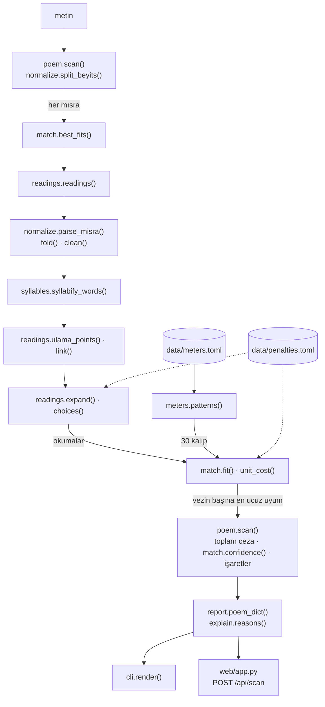
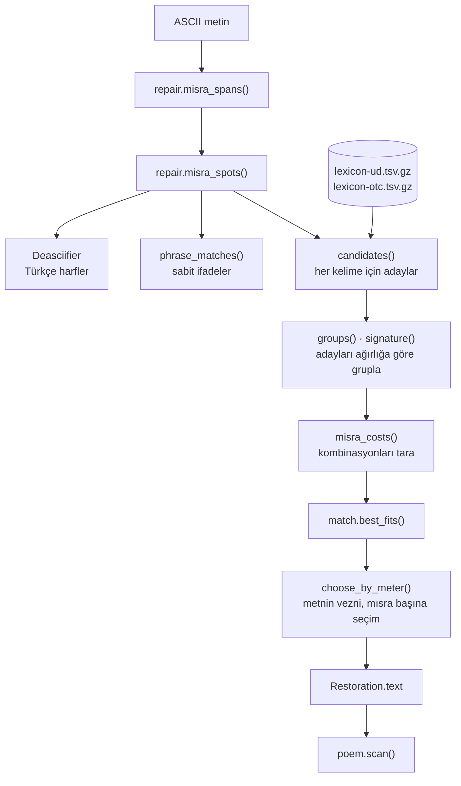

# aruz

Latin harfli Divan şiirinin aruz veznini bulan, her heceyi tek tek tartan ve verdiği her kararı gerekçesiyle gösteren bir araç.

**Türkçe** · [English](README.en.md)

[](#kurulum)
[](LICENSE)


Bu aracı, Latin harfleriyle yazılmış bir mısra, beyit ya da bütün bir gazel verildiğinde veznini kendisi bulsun diye yazdım. Her mısrayı hecelerine ayırıyorum, her heceyi açık (`.`) ya da kapalı (`-`) diye işaretliyorum ve ortaya çıkan diziyi kütüphanedeki 20 vezne tek tek oturtmaya çalışıyorum. En az ruhsatla oturan vezni seçiyorum, heceleri tef'ilelerin altına diziyorum ve kullandığım her ruhsatı (imâle, zihaf, med, ulama) mısranın kaçıncı hecesinde kullandığımla birlikte yazıyorum. Her işaret, neden öyle olduğunu da söyleyebiliyor.

Aracı komut satırından ya da tek sayfalık bir web arayüzünden kullanabilirsiniz. Web arayüzü Türkçe ve İngilizce; komut satırı çıktısı Türkçe.

## İçindekiler

1. [Ne yapıyor?](#ne-yapıyor)
2. [Aruz nedir?](#aruz-nedir)
3. [Kurulum](#kurulum)
4. [Kullanım](#kullanım)
5. [Algoritma: metinden vezne](#algoritma-metinden-vezne)
   - [Akışın tamamı](#akışın-tamamı)
   - [Adım 1: Metni normalize ediyorum](#adım-1-metni-normalize-ediyorum)
   - [Adım 2: Kelimeleri hecelere ayırıyorum](#adım-2-kelimeleri-hecelere-ayırıyorum)
   - [Adım 3: Ağırlıkları ve okumaları çıkarıyorum](#adım-3-ağırlıkları-ve-okumaları-çıkarıyorum)
   - [Adım 4: Okumaları kalıplarla karşılaştırıyorum](#adım-4-okumaları-kalıplarla-karşılaştırıyorum)
   - [Adım 5: Şiirin tamamı için tek vezin seçiyorum](#adım-5-şiirin-tamamı-için-tek-vezin-seçiyorum)
   - [Neden imâle ve zihaf birer dal değil](#neden-imâle-ve-zihaf-birer-dal-değil)
   - [Ceza tablosu](#ceza-tablosu)
   - [Bir hecenin yolculuğu](#bir-hecenin-yolculuğu)
6. [Akıllı metin onarımı](#akıllı-metin-onarımı)
7. [Açıklama modu](#açıklama-modu)
8. [Vezin kütüphanesi](#vezin-kütüphanesi)
9. [Doğruluk](#doğruluk)
10. [Veri kaynakları ve lisanslar](#veri-kaynakları-ve-lisanslar)
11. [Bilinen sınırlamalar](#bilinen-sınırlamalar)
12. [Proje yapısı](#proje-yapısı)
13. [Geliştirme ve katkı](#geliştirme-ve-katkı)
14. [Lisans](#lisans)
15. [Teşekkür ve kaynakça](#teşekkür-ve-kaynakça)

## Ne yapıyor?

- Mısrayı hecelere ayırıyor: `be ni can dan u san dır dı ...`
- Her heceyi açık (`.`) ya da kapalı (`-`) olarak işaretliyor.
- 20 vezinlik kütüphaneden (değişkenleriyle 30 kalıp) metne en iyi uyanı buluyor ve heceleri tef'ilelerin altına diziyor.
- Kullandığı her ruhsatı yazıyor: imâle, zihaf, med, ulama, uzun okunan izafet ve bağlaç. Her birinin mısranın kaçıncı hecesinde olduğunu da gösteriyor.
- Bir ceza puanı, bir güven yüzdesi ve en yakın iki rakip vezni veriyor.
- Bütün bir gazeli tek vezinle okuyor ve vezne zor uyan beyitleri işaretliyor.
- Her işaretin ve her ruhsatın nedenini açıklıyor: komut satırında `--explain`, web arayüzünde işaretin üzerine gelince ya da dokununca açılan kısa notlar.
- Türkçe harfleri ve şapkaları eksik yazılmış metni taramadan önce onarıyor. Bir kelimenin birden çok yazılışı mümkünse hangisinin doğru olduğuna vezin karar veriyor.
- Sonucu JSON olarak da veriyor. Web arayüzünü besleyen HTTP API de aynı veriyi döndürüyor.

Kısa bir örnek:

```sh
uv run aruz "Hüsn olmasa ışkı zâhir olmaz"
```

```text
  vezin  Mef'ûlü Mefâilün Feûlün
         Hezec-i müseddes-i ahreb-i makbûz-ı mahzûf
  güven %99,3   ceza 0

  Hüsn olmasa ışkı zâhir olmaz
  Mef'ûlü      Mefâilün      Feûlün
  hüs nol ma   sa ış kı zâ   hi rol maz
  -   -   .    .  -  .  -    .  -   -
  ulama hüs-nol 1. hece   ulama hi-rol 8. hece

  en yakın diğer vezinler
    Fâilâtün Mefâilün Fe'ilün               ceza 5
    Mefâîlün Mefâîlün Mefâîlün Mefâîlün     ceza 8
```

Fuzûlî'nin bu mısrası iki ulamayla, başka hiçbir ruhsata gerek kalmadan Mef'ûlü Mefâilün Feûlün kalıbına oturuyor: `hüsn olmasa` okunurken `hüs-nol-ma-sa`, `zâhir olmaz` okunurken `zâ-hi-rol-maz` oluyor.

## Aruz nedir?

### Hece sayısı değil, hecenin ağırlığı

Aruz, Arap şiirinde doğmuş, Fars şiiri üzerinden Türk şiirine geçmiş bir ölçü sistemi. Halk şiirindeki hece ölçüsünde önemli olan, mısradaki hecelerin sayısıdır. Aruzda ise hecelerin ağırlığı ve sırası önemlidir. Her hece ya kısadır ya uzun. Aruz kitapları kısa heceye açık hece, uzun heceye kapalı hece der. Ben de araçta bu iki işareti kullanıyorum:

| hece türü | işaret | ne zaman | örnek |
| --- | --- | --- | --- |
| açık hece | `.` | kısa bir ünlüyle biter | be, ni, u |
| kapalı hece | `-` | ünsüzle biter | can, dan, maz |
| kapalı hece | `-` | uzun ünlü (â, î, û) taşır, ünlüyle bitse bile | fâ, yâ, rî |
| medli hece | `- .` | uzun ünlüden sonra bir ünsüzle ya da iki ünsüzle biter; bir buçuk hece sayılır | yâr, dost, cevr |

Medli hece, kapalı bir hecenin ardına yarım bir açık hece eklenmiş gibi sayılır. Şair isterse onu düz bir kapalı hece olarak da okuyabilir. Araç bu iki okumayı da hesaba katıyor.

### Tef'ileler

Aruz kalıpları tef'ile denen küçük parçalardan kurulur. Tef'ile adları ezberlemek için türetilmiş kelimelerdir ve her adın kendi okunuşu o tef'ilenin hece dizisini verir: me-fâ-î-lün, yani `. - - -`. Kütüphanede kullandığım 15 tef'ile şunlar:

| tef'ile | ağırlık | tef'ile | ağırlık | tef'ile | ağırlık |
| --- | --- | --- | --- | --- | --- |
| Mefâîlün | `. - - -` | Fâilâtün | `- . - -` | Fâilün | `- . -` |
| Mefâîlü | `. - - .` | Fâilâtü | `- . - .` | Fe'ilün | `. . -` |
| Mefâilün | `. - . -` | Fe'ilâtün | `. . - -` | Fa'lün | `- -` |
| Feûlün | `. - -` | Fe'ilâtü | `. . - .` | Mef'ûlü | `- - .` |
| Feûl | `. -` | Müstef'ilün | `- - . -` | Müfte'ilün | `- . . -` |

### Vezin, beyit, mısra, gazel

Bir vezin, tef'ilelerin sabit bir sırasıdır. "Mefâîlün Mefâîlün Mefâîlün Mefâîlün" on altı hecelik bir dizidir: `. - - -` dört kez. Vezinlerin uzun adları neyi anlattığını söyler. Örneğin Remel-i müsemmen-i mahzûf: remel bahrinden, beyitte sekiz tef'ile (mısrada dört), son tef'ilesi kısaltılmış (Fâilâtün yerine Fâilün).

Beyit iki mısradan oluşur. Gazel beyitlerden oluşur ve ilk beytinden son beytine kadar tek bir vezinle yazılır. Araç da bütün bir gazeli tek vezinle okuyor.

### Türkçe neden zorlanıyor?

Arapçada ve Farsçada uzun ünlüler var, Türkçede yok. Osmanlı şairleri Türkçe kelimeleri bu yabancı kalıplara sığdırmak için onları uzatıp kısaltmak zorunda kaldılar. Taramayı zorlaştıran şeylerin çoğu bu uyumsuzluktan geliyor. Bu esnekliklere ruhsat deniyor:

- **İmâle:** kısa (açık) bir hecenin uzun okunması. Türkçe kelimelerde, özellikle kelime sonunda çok yaygın: `be-nî`.
- **Zihaf:** uzun (kapalı) bir hecenin kısa okunması. Seyrek görülür, kusur sayılır.
- **Med:** medli bir hecenin bir buçuk hece sayılması: `yâr` → `- .`
- **Ulama:** ünsüzle biten bir kelimenin, ünlüyle başlayan sonraki kelimeye bağlanması. Hece sınırları değişir: `yâr usanmaz` → `yâ-ru-san-maz`.
- İzafet ve bağlaç (`-i`, `u / ü`) ünlüleri vezne göre kısa ya da uzun okunabilir.
- Mısranın son hecesi her zaman kapalı sayılır.

Aşağıdaki mısrada bunların birkaçı birden var. Yazıldığı gibi tartılınca üç hece kalıba uymuyor, vezne göre okununca uyuyor:

| | Mefâîlün | Mefâîlün | Mefâîlün | Mefâîlün |
| --- | --- | --- | --- | --- |
| heceler | be ni can dan | u san dır dı | ce fâ dan yâ | ru san maz mı |
| yazıldığı gibi | `. . - -` | `. - - .` | `. - - -` | `. - - .` |
| vezne göre | `. - - -` | `. - - -` | `. - - -` | `. - - -` |

`ni` ve `dı` imâleyle uzuyor, `yâr usanmaz` ulamayla `yâ-ru` oluyor, son hece `mı` kural gereği kapalı sayılıyor. Algoritmanın bu sonuca nasıl vardığını [aşağıda adım adım](#algoritma-metinden-vezne) anlatıyorum.

## Kurulum

### Gereksinimler

| | sürüm | neden |
| --- | --- | --- |
| Python | 3.11 ya da üstü | kod `tomllib` kullanıyor, o da 3.11 ile geldi |
| Git | herhangi | deasciifier bağımlılığı GitHub'dan, sabitlenmiş bir commit'ten kuruluyor |
| uv | önerilir | bağımlılıkları `uv.lock` dosyasındaki sürümlerle birebir kurar |

### 1. uv'yi kurun

En kısa yol:

```sh
pip install uv
```

Ya da uv'nin resmi kurulum betiklerinden biri:

```powershell
powershell -ExecutionPolicy ByPass -c "irm https://astral.sh/uv/install.ps1 | iex"
```

```sh
curl -LsSf https://astral.sh/uv/install.sh | sh
```

> `pip install uv` sonrasında `uv` komutu bulunamıyorsa (Windows'ta Python'un `Scripts` klasörü PATH'te değilse böyle olur), bu README'deki her komutta `uv` yerine `python -m uv` yazın: `python -m uv sync`, `python -m uv run aruz ...` gibi. Ben de kendi makinemde böyle çalıştırıyorum.

### 2. Kodu indirin

```sh
git clone https://github.com/lilbatus/aruz-olcusu.git
cd aruz-olcusu
```

Git ile çalışmak istemiyorsanız GitHub sayfasındaki **Code > Download ZIP** ile de indirebilirsiniz. Bir sonraki adım için Git'in yine de kurulu olması gerekiyor.

### 3. Bağımlılıkları kurun

```sh
uv sync
```

Bu komut proje klasöründe bir `.venv` sanal ortamı oluşturuyor, `aruz` paketini düzenlenebilir kipte kuruyor ve şu bağımlılıkları `uv.lock` dosyasındaki sürümlerle ekliyor:

- çalışma için: `rich` (terminal çıktısı), `fastapi` ve `uvicorn` (web arayüzü), `turkish-deasciifier` (Türkçe harf onarımı)
- geliştirme için: `pytest`, `httpx2` (web testleri)

### 4. Deneyin

```sh
uv run aruz "Hüsn olmasa ışkı zâhir olmaz"
uv run pytest
```

İlk komut yukarıdaki örnek çıktıyı vermeli, ikincisinde bütün testler geçmeli.

### uv olmadan, pip ile

```sh
python -m venv .venv
```

Sanal ortamı etkinleştirin. Windows'ta:

```powershell
.venv\Scripts\activate
```

macOS ve Linux'ta:

```sh
source .venv/bin/activate
```

Sonra:

```sh
pip install -e .
pip install --group dev
aruz "Hüsn olmasa ışkı zâhir olmaz"
pytest
```

`--group` seçeneği pip 25.1 ve sonrasında var. Sanal ortam etkinken `uv run` yazmanıza gerek yok; `aruz` ve `aruz-web` komutları doğrudan çalışıyor.

### Sorun giderme

| belirti | çözüm |
| --- | --- |
| `uv` komutu bulunamıyor | `uv` yerine `python -m uv` yazın |
| `turkish-deasciifier` kurulurken Git hatası | Git'i kurun; bu paket PyPI'dan değil, GitHub'dan kuruluyor |
| `aruz-web` açılmıyor, 8000 portu dolu | `uv run uvicorn aruz.web.app:app --port 8080` ile başka bir port kullanın ve `http://127.0.0.1:8080` adresini açın |
| Windows'ta boru (`\|`) ile verilen metin bozuk taranıyor ya da çıktıyı dosyaya yönlendirince hata alıyorsunuz | Python'u UTF-8 kipinde çalıştırın: PowerShell'de `$env:PYTHONUTF8 = "1"`, cmd'de `set PYTHONUTF8=1`. Ya da metni `--file` ile verin, JSON çıktısını `--json` ile alın; ikisi de her zaman UTF-8 |
| Windows'ta API örneğinde Türkçe karakterler bozuluyor | [HTTP API](#http-api) bölümündeki PowerShell örneğini kullanın; gövdeyi UTF-8 bayt olarak gönderiyor |

## Kullanım

### Komut satırı

| seçenek | kısa | ne yapar |
| --- | --- | --- |
| `METİN` | | beyit ya da mısra; mısraları ` / ` ya da satır sonuyla ayırın |
| `--file DOSYA` | `-f` | bütün bir gazeli dosyadan okur; beyitlerin arasında boş satır olmalı |
| `--json` | | sonucu JSON olarak yazar |
| `--explain` | | her hecenin neden açık ya da kapalı sayıldığını bir tabloyla açıklar |
| `--repair` | | Türkçe harfleri ya da şapkaları eksik metni taramadan önce onarır |
| `--help` | `-h` | yardım metnini gösterir |

Örnekler:

```sh
uv run aruz "Hüsn olmasa ışkı zâhir olmaz"
uv run aruz "Beni candan usandırdı cefâdan yâr usanmaz mı / Felekler yandı âhımdan murâdım şem'i yanmaz mı"
uv run aruz --file examples/fuzuli-olmasun.txt
uv run aruz --explain "Beni candan usandırdı cefâdan yâr usanmaz mı"
uv run aruz --repair "Haddeden gecmis nezaket yal u bal olmus sana"
uv run aruz --json "Hüsn olmasa ışkı zâhir olmaz"
uv run aruz --repair --json "Haddeden gecmis nezaket yal u bal olmus sana"
```

Metin ve `--file` verilmezse araç metni standart girdiden okuyor:

```sh
cat examples/fuzuli-olmasun.txt | uv run aruz
```

Windows'ta boru kullanacaksanız önce UTF-8 kipini açın (bkz. [Sorun giderme](#sorun-giderme)) ya da doğrudan `--file` kullanın.

#### Girdi nasıl yazılmalı

| yazım | nasıl okunuyor |
| --- | --- |
| `Beni candan ... / Felekler ...` | ` / ` ya da satır sonu mısraları ayırır |
| boş satır | dosyada beyitleri ayırır; boş satır yoksa satırlar ikişer ikişer beyit sayılır |
| `â î û` | uzun ünlü |
| `ā ī ū` | şapkaya çevrilir: `cefā` → `cefâ` |
| `ô ê` | düz `o`, `e` olur |
| `ʿ ʾ ' ’ ‘ ´ ʼ` ve ters tırnak | ayın ya da hemze; ünsüz sayılır ve `'` olarak tutulur: `maʿnâ` → `ma'nâ` |
| `ḥ ṣ ż ṭ` | harfin altındaki nokta düşer: `ḥüsn` → `hüsn` |
| `dil-i`, `bâde-yi` | tireden sonra gelen `i ı u ü yi yı yu yü` izafet sayılır |
| `zâr u`, `Leylâ vü` | ayrı yazılmış `u ü vu vü` bağlaç sayılır |
| `bî-rahm`, `gül-gûn` | tire kelimeleri ayırır |
| noktalama, rakam | yok sayılır |
| büyük harf | `I` → `ı`, `İ` → `i` olarak küçültülür |

#### Çıktıyı okumak

Fuzûlî'nin beyti için çıktı şöyle:

```sh
uv run aruz "Beni candan usandırdı cefâdan yâr usanmaz mı / Felekler yandı âhımdan murâdım şem'i yanmaz mı"
```

```text
  vezin  Mefâîlün Mefâîlün Mefâîlün Mefâîlün
         Hezec-i müsemmen-i sâlim
  güven %99,9   ceza 1,2

  Beni candan usandırdı cefâdan yâr usanmaz mı
  Mefâîlün        Mefâîlün       Mefâîlün       Mefâîlün
  be ni can dan   u san dır dı   ce fâ dan yâ   ru san maz mı
  .  -  -   -     . -   -   -    .  -  -   -    .  -   -   -
  imâle ni 2. hece   imâle dı 8. hece   ulama yâ-ru 12. hece

  Felekler yandı âhımdan murâdım şem'i yanmaz mı
  Mefâîlün         Mefâîlün       Mefâîlün        Mefâîlün
  fe lek ler yan   dı â hım dan   mu râ dım şem   'i yan maz mı
  .  -   -   -     .  - -   -     .  -  -   -     .  -   -   -
  ruhsat yok

  en yakın diğer vezinler
    Mefâîlün Mefâîlün Feûlün           ceza 16
    Mef'ûlü Mefâîlü Mefâîlü Feûlün     ceza 16
```

| satır | anlamı |
| --- | --- |
| `vezin  Mefâîlün ...` | bulunan vezin, tef'ileleriyle |
| `Hezec-i müsemmen-i sâlim` | vezin adı |
| `güven %99,9   ceza 1,2` | güven yüzdesi ve bütün metnin toplam ceza puanı |
| soluk renkli mısra | taranan mısranın kendisi |
| tef'ile başlıkları | her sütunun hangi tef'ileye düştüğü; değişkenli vezinlerde gerçekten eşleşen değişken yazılır |
| hece satırı | heceler, ulamadan sonraki sınırlarıyla (`yâ ru`) |
| işaret satırı | hecenin vezinde nasıl okunduğu; imâleli bir hece burada `-` görünür. Ruhsat kullanılan heceler terminalde vurgu rengiyle gösterilir |
| `~` | medli bir hecenin ikinci yarısı (yarım açık hece) |
| `imâle ni 2. hece ...` | kullanılan ruhsatlar ve mısradaki hece numaraları |
| `ruhsat yok` | mısra hiçbir ruhsat olmadan oturdu |
| `en yakın diğer vezinler` | ceza puanına göre sıradaki iki vezin; cezası eşit olanlar kütüphanedeki sırayla gelir |

İkinci mısranın hiçbir ruhsata ihtiyacı yok. Rakip vezinlerin 16 puanı, iki mısranın da o vezinlere hiç oturmamasından geliyor: oturmayan her mısra 8 puan.

#### Açıklamalı çıktı: `--explain`

`--explain`, işaretlerin altına her hece için bir gerekçe tablosu ekliyor. Bir hecede birden çok kural işlediyse hepsi sırayla yazılıyor.

<details>
<summary><code>uv run aruz --explain "Beni candan usandırdı cefâdan yâr usanmaz mı"</code> çıktısının tamamı</summary>

```text
  vezin  Mefâîlün Mefâîlün Mefâîlün Mefâîlün
         Hezec-i müsemmen-i sâlim
  güven %99,8   ceza 1,2

  Beni candan usandırdı cefâdan yâr usanmaz mı
  Mefâîlün        Mefâîlün       Mefâîlün       Mefâîlün
  be ni can dan   u san dır dı   ce fâ dan yâ   ru san maz mı
  .  -  -   -     . -   -   -    .  -  -   -    .  -   -   -
  imâle ni 2. hece   imâle dı 8. hece   ulama yâ-ru 12. hece

   1  be   .  açık hece    “be” kısa bir ünlüyle bitiyor. Kısa ünlüyle biten hece aruzda açık (.) sayılır.
   2  ni   -  açık hece    “ni” kısa bir ünlüyle bitiyor. Kısa ünlüyle biten hece aruzda açık (.) sayılır.
              imâle        “ni” normalde açıktır (.), ama vezin burada kapalı (-) bir hece istiyor. Kısa hece uzatılarak okunur.
   3  can  -  kapalı hece  “can” ünsüzle bitiyor. Ünsüzle biten hece aruzda kapalı (-) sayılır.
   4  dan  -  kapalı hece  “dan” ünsüzle bitiyor. Ünsüzle biten hece aruzda kapalı (-) sayılır.
   5  u    .  açık hece    “u” kısa bir ünlüyle bitiyor. Kısa ünlüyle biten hece aruzda açık (.) sayılır.
   6  san  -  kapalı hece  “san” ünsüzle bitiyor. Ünsüzle biten hece aruzda kapalı (-) sayılır.
   7  dır  -  kapalı hece  “dır” ünsüzle bitiyor. Ünsüzle biten hece aruzda kapalı (-) sayılır.
   8  dı   -  açık hece    “dı” kısa bir ünlüyle bitiyor. Kısa ünlüyle biten hece aruzda açık (.) sayılır.
              imâle        “dı” normalde açıktır (.), ama vezin burada kapalı (-) bir hece istiyor. Kısa hece uzatılarak okunur.
   9  ce   .  açık hece    “ce” kısa bir ünlüyle bitiyor. Kısa ünlüyle biten hece aruzda açık (.) sayılır.
  10  fâ   -  uzun ünlü    “fâ” uzun bir ünlü (â, î, û) taşıyor. Uzun ünlülü hece, ünlüyle bitse de kapalı (-) sayılır.
  11  dan  -  kapalı hece  “dan” ünsüzle bitiyor. Ünsüzle biten hece aruzda kapalı (-) sayılır.
  12  yâ   -  ulama        “yâr” ünsüzle bitiyor, sonraki kelime ünlüyle başlıyor. Ünsüz sonraki heceye bağlanır (yâ-ru) ve bu hece kapalı (-) okunur.
              uzun ünlü    “yâ” uzun bir ünlü (â, î, û) taşıyor. Uzun ünlülü hece, ünlüyle bitse de kapalı (-) sayılır.
  13  ru   .  açık hece    “ru” kısa bir ünlüyle bitiyor. Kısa ünlüyle biten hece aruzda açık (.) sayılır.
  14  san  -  kapalı hece  “san” ünsüzle bitiyor. Ünsüzle biten hece aruzda kapalı (-) sayılır.
  15  maz  -  kapalı hece  “maz” ünsüzle bitiyor. Ünsüzle biten hece aruzda kapalı (-) sayılır.
  16  mı   -  son hece     “mı” ünlüyle bittiği için normalde açıktır (.), ama mısranın son hecesi. Aruzda son hece her zaman kapalı (-) sayılır.

  en yakın diğer vezinler
    Mefâîlün Mefâîlün Feûlün           ceza 8
    Mef'ûlü Mefâîlü Mefâîlü Feûlün     ceza 8
```

</details>

Tek bir mısra verildiğinde rakiplerin cezası 8 oluyor, çünkü artık bir değil, tek mısra var. Güvenin %99,9'dan %99,8'e inmesinin nedeni de bu: kıyaslanan farklar küçülüyor.

#### Onarımlı çıktı: `--repair`

Türkçe harfleri ve şapkaları olmadan yazılmış bir satırı önce onarıp sonra tarıyor. Onarılan metin en üstte yazılıyor:

```sh
uv run aruz --repair "Haddeden gecmis nezaket yal u bal olmus sana"
```

```text
  onarılan metin
  Haddeden geçmiş nezâket yâl ü bâl olmuş sana

  vezin  Fâilâtün Fâilâtün Fâilâtün Fâilün
         Remel-i müsemmen-i mahzûf
  güven %99,9   ceza 0

  Haddeden geçmiş nezâket yâl ü bâl olmuş sana
  Fâilâtün         Fâilâtün        Fâilâtün       Fâilün
  had de den geç   miş ne zâ ket   yâ lü bâ lol   muş sa na
  -   .  -   -     -   .  -  -     -  .  -  -     -   .  -
  ulama bâ-lol 11. hece

  en yakın diğer vezinler
    Mefâîlün Mefâîlün Mefâîlün Mefâîlün     ceza 8
    Mefâîlün Mefâîlün Feûlün                ceza 8
```

Terminalde onarılan harfler vurgu rengiyle, vezinle bile karar verilemeyen kelimeler altı çizili gösteriliyor. Onarımın nasıl çalıştığını [Akıllı metin onarımı](#akıllı-metin-onarımı) bölümünde anlatıyorum.

#### Bütün bir gazel

`examples/fuzuli-olmasun.txt`, Fuzûlî'nin "olmasun yâ Rab" redifli gazelinden altı beyit içeriyor. Dosyada beyitler boş satırla ayrılmış:

```sh
uv run aruz --file examples/fuzuli-olmasun.txt
```

Araç on iki mısranın hepsini tek vezinle okuyor: Hezec-i müsemmen-i sâlim, toplam ceza 11,3, güven %99,8. Altıncı beyit vezne zor uyduğu için işaretleniyor:

```text
  beyit 6   vezne zor uyuyor
  Cefâ vü cevr ile mu'tâdem anlarsuz nolur hâlüm
  Mefâîlün       Mefâîlün       Mefâîlün         Mefâîlün
  ce fâ vü cev   ri le mu' tâ   de man lar suz   no lur hâ lüm
  .  -  -  -     .  -  -   -    .  -   -   -     .  -   -  -
  uzun bağlaç vü 3. hece   ulama cev-ri 4. hece   imâle le 6. hece   ulama de-man 9. hece

  Cefâsına had ü cevrine pâyân olmasun yâ Rab
  Mefâîlün      Mefâîlün       Mefâîlün       Mefâîlün
  ce fâ sı na   ha dü cev ri   ne pâ yân ol   ma sun yâ rab
  .  -  -  -    .  -  -   -    .  -  -   -    .  -   -  -
  imâle sı 3. hece   imâle na 4. hece   uzun bağlaç dü 6. hece   imâle ri 8. hece
```

İkinci mısranın cezası 4,4 ve bu, işaretleme eşiği olan 2,5'in üstünde. Neden bu kadar yüksek çıktığını [Adım 5](#adım-5-şiirin-tamamı-için-tek-vezin-seçiyorum) içinde hesaplıyorum.

<details>
<summary>Gazelin tam çıktısı</summary>

```text
  vezin  Mefâîlün Mefâîlün Mefâîlün Mefâîlün
         Hezec-i müsemmen-i sâlim
  güven %99,8   ceza 11,3

  beyit 1
  Menüm tek hîç kim zâr u perîşân olmasun yâ Rab
  Mefâîlün         Mefâîlün      Mefâîlün       Mefâîlün
  me nüm tek hîç   ~ kim zâ ru   pe rî şân ol   ma sun yâ rab
  .  -   -   -     . -   -  -    .  -  -   -    .  -   -  -
  med hîç 4. hece   uzun bağlaç ru 7. hece

  Esîr-i derd-i ışk u dâğ-ı hicrân olmasun yâ Rab
  Mefâîlün      Mefâîlün      Mefâîlün        Mefâîlün
  e sî ri der   di ış ku dâ   ğı hic rân ol   ma sun yâ rab
  . -  -  -     .  -  -  -    .  -   -   -    .  -   -  -
  uzun izafet ri 3. hece   uzun bağlaç ku 7. hece

  beyit 2
  Dem-â-dem cevrlerdür çekdügüm bî-rahm bütlerden
  Mefâîlün         Mefâîlün        Mefâîlün         Mefâîlün
  de mâ dem cevr   ~ ler dür çek   dü güm bî rahm   ~ büt ler den
  .  -  -   -      . -   -   -     .  -   -  -      . -   -   -
  ulama de-mâ 1. hece   med cevr 4. hece   med rahm 11. hece

  Bu kâfirler esîri bir müselmân olmasun yâ Rab
  Mefâîlün        Mefâîlün      Mefâîlün        Mefâîlün
  bu kâ fir ler   e sî ri bir   mü sel mân ol   ma sun yâ rab
  .  -  -   -     . -  -  -     .  -   -   -    .  -   -  -
  imâle ri 7. hece

  beyit 3
  Görüp endîşe-i katlümde ol mâhı budur derdüm
  Mefâîlün       Mefâîlün       Mefâîlün      Mefâîlün
  gö rüp en dî   şe i kat lüm   de ol mâ hı   bu dur der düm
  .  -   -  -    .  - -   -     .  -  -  -    .  -   -   -
  uzun izafet i 6. hece   imâle hı 12. hece

  Ki bu endîşeden ol meh peşîmân olmasun yâ Rab
  Mefâîlün      Mefâîlün        Mefâîlün       Mefâîlün
  ki bu en dî   şe den ol meh   pe şî mân ol   ma sun yâ rab
  .  -  -  -    .  -   -  -     .  -  -   -    .  -   -  -
  imâle bu 2. hece

  beyit 4
  Çıkarmak etseler tenden çeküp peykânın ol servün
  Mefâîlün        Mefâîlün         Mefâîlün        Mefâîlün
  çı kar mak et   se ler ten den   çe küp pey kâ   nı nol ser vün
  .  -   -   -    .  -   -   -     .  -   -   -    .  -   -   -
  ulama nı-nol 13. hece

  Çıkan olsun dil-i mecrûh peykân olmasun yâ Rab
  Mefâîlün        Mefâîlün        Mefâîlün       Mefâîlün
  çı kan ol sun   di li mec rûh   ~ pey kân ol   ma sun yâ rab
  .  -   -  -     .  -  -   -     . -   -   -    .  -   -  -
  uzun izafet li 6. hece   med rûh 8. hece

  beyit 5
  Demen kim adli yoh yâ zulmü çoh her hâl ile olsa
  Mefâîlün        Mefâîlün        Mefâîlün        Mefâîlün
  de men kim ad   li yoh yâ zul   mü çoh her hâ   li le ol sa
  .  -   -   -    .  -   -  -     .  -   -   -    .  -  -  -
  ulama hâ-li 12. hece   imâle le 14. hece

  Gönül tahtına andan özge sultân olmasun yâ Rab
  Mefâîlün        Mefâîlün       Mefâîlün        Mefâîlün
  gö nül tah tı   na an dan öz   ge sul tân ol   ma sun yâ rab
  .  -   -   -    .  -  -   -    .  -   -   -    .  -   -  -
  imâle tı 4. hece

  beyit 6   vezne zor uyuyor
  Cefâ vü cevr ile mu'tâdem anlarsuz nolur hâlüm
  Mefâîlün       Mefâîlün       Mefâîlün         Mefâîlün
  ce fâ vü cev   ri le mu' tâ   de man lar suz   no lur hâ lüm
  .  -  -  -     .  -  -   -    .  -   -   -     .  -   -  -
  uzun bağlaç vü 3. hece   ulama cev-ri 4. hece   imâle le 6. hece   ulama de-man 9. hece

  Cefâsına had ü cevrine pâyân olmasun yâ Rab
  Mefâîlün      Mefâîlün       Mefâîlün       Mefâîlün
  ce fâ sı na   ha dü cev ri   ne pâ yân ol   ma sun yâ rab
  .  -  -  -    .  -  -   -    .  -  -   -    .  -   -  -
  imâle sı 3. hece   imâle na 4. hece   uzun bağlaç dü 6. hece   imâle ri 8. hece

  en yakın diğer vezinler
    Mefâîlün Mefâîlün Feûlün     ceza 96
    Mef'ûlü Mefâilün Feûlün      ceza 96
```

</details>

#### JSON çıktısı: `--json`

`--json`, komut satırının ve web arayüzünün gösterdiği verinin tamamını yazıyor. Aşağıdaki örnekte `feet`, `licenses` ve `syllables` listelerinin yalnızca ilk elemanlarını bıraktım; `tips` ve `i18n` alanlarını çıkardım.

<details>
<summary><code>uv run aruz --json "Hüsn olmasa ışkı zâhir olmaz"</code> (kısaltılmış)</summary>

```json
{
  "meter": {
    "id": "hezec-6-ahreb-makbuz",
    "name": "Hezec-i müseddes-i ahreb-i makbûz-ı mahzûf",
    "feet": "Mef'ûlü Mefâilün Feûlün",
    "penalty": 0.0
  },
  "confidence": 0.993,
  "alternatives": [
    {"id": "hafif-6-mahbun", "name": "Hafîf-i müseddes-i mahbûn-ı mahzûf", "feet": "Fâilâtün Mefâilün Fe'ilün", "penalty": 5.0},
    {"id": "hezec-8-salim", "name": "Hezec-i müsemmen-i sâlim", "feet": "Mefâîlün Mefâîlün Mefâîlün Mefâîlün", "penalty": 8.0}
  ],
  "beyits": [
    {
      "index": 1,
      "flagged": false,
      "misras": [
        {
          "text": "Hüsn olmasa ışkı zâhir olmaz",
          "fit": {
            "pattern": "Mef'ûlü Mefâilün Feûlün",
            "penalty": 0.0,
            "feet": [
              {
                "name": "Mef'ûlü",
                "units": [
                  {"text": "hüs", "mark": "-", "license": "ulama", "tail": false, "syllable": 1},
                  {"text": "nol", "mark": "-", "license": null, "tail": false, "syllable": 2},
                  {"text": "ma", "mark": ".", "license": null, "tail": false, "syllable": 3}
                ]
              }
            ],
            "licenses": [
              {
                "kind": "ulama",
                "name": "ulama",
                "syllable": 1,
                "text": "hüs-nol",
                "tip": {
                  "name": "ulama",
                  "text": "“hüsn” ünsüzle bitiyor, sonraki kelime ünlüyle başlıyor. Ünsüz sonraki heceye bağlanır (hüs-nol) ve bu hece kapalı (-) okunur."
                }
              }
            ],
            "syllables": [
              {
                "position": 1,
                "text": "hüs",
                "word": "hüsn",
                "mark": "-",
                "reasons": [
                  {"code": "ulama", "syllable": "hüs", "word": "hüsn", "position": 1, "before": "-", "after": "-", "detail": "hüs-nol", "name": "ulama", "text": "“hüsn” ünsüzle bitiyor, sonraki kelime ünlüyle başlıyor. Ünsüz sonraki heceye bağlanır (hüs-nol) ve bu hece kapalı (-) okunur."},
                  {"code": "closed_consonant", "syllable": "hüs", "word": "hüsn", "position": 1, "before": null, "after": "-", "detail": "", "name": "kapalı hece", "text": "“hüs” ünsüzle bitiyor. Ünsüzle biten hece aruzda kapalı (-) sayılır."}
                ]
              }
            ]
          }
        }
      ]
    }
  ]
}
```

</details>

### Web arayüzü

```sh
uv run aruz-web
```

Sonra tarayıcıda `http://127.0.0.1:8000` adresini açın. Sayfada şunları yapabilirsiniz:

- Bir mısra, beyit ya da bütün bir gazel yapıştırıp **Tara** düğmesine basın (ya da Ctrl+Enter, Mac'te Cmd+Enter). Sonuç, metnin altında yumuşak bir geçişle beliriyor.
- **Akıllı metin onarımı** anahtarı onarımı açıp kapatıyor. Varsayılan olarak açık; seçiminiz tarayıcıda hatırlanıyor.
- Sağ üstteki **TR / EN** ile bütün sayfanın dilini değiştirin. Girdiniz ve sonuç yerinde kalıyor, açıklama notları da dahil her metin anında değişiyor. İlk ziyarette sayfa tarayıcınızın dilini izliyor (Türkçe ya da İngilizce değilse Türkçe açılıyor).
- Herhangi bir `.` ya da `-` işaretinin, ruhsat etiketlerinin, ceza puanının, güven yüzdesinin, bulunan vezinin ve rakip vezinlerin üzerine gelin: kısa bir not o kararın nedenini anlatıyor. Ceza ve güven notlarındaki sayılar o anki sonuçtan geliyor.
- Onarılan harflerin altı ince bir çizgiyle, kararı belirsiz kalan kelimelerin altı noktalı çizgiyle çiziliyor. Onarılmış bir kelimeye tıklayınca sıradaki aday biçime geçiliyor ve tarama yeniden yapılıyor.
- Klavyeyle de kullanılabiliyor: Tab ile işaretler ve onarılmış kelimeler arasında gezinin, Enter ya da boşluk onarılmış kelimenin biçimini değiştiriyor, Escape notu kapatıyor.
- Telefonda bir işarete ya da kelimeye ilk dokunuş notu açıyor; onarılmış bir kelimeye ikinci dokunuş biçimini değiştiriyor. Tara düğmesi ve onarım anahtarı dokununca her zamanki gibi çalışıyor; onların notu uzun basınca açılıyor.
- Notlar yaklaşık 120 ms sonra kısa bir solma ve hafif bir kaymayla açılıyor, aynı anda tek bir not açık kalıyor ve ekranın dışına taşmıyor. İşletim sisteminizde hareket azaltma açıksa kayma yapılmıyor.

### HTTP API

Web arayüzü tek bir uç noktayla konuşuyor; aynı uç noktayı kendi programlarınızdan da kullanabilirsiniz.

| yöntem | yol | ne yapar |
| --- | --- | --- |
| `GET` | `/` | web sayfası |
| `POST` | `/api/scan` | metni tarar, sonucu JSON olarak döndürür |

İstek gövdesi:

| alan | tür | varsayılan | anlamı |
| --- | --- | --- | --- |
| `text` | metin | zorunlu | taranacak mısra, beyit ya da gazel |
| `repair` | mantıksal | `false` | taramadan önce metni onar |
| `choices` | nesne | `{}` | onarımda kelime seçimleri: `{"kelime sırası": aday sırası}` |

Yanıtın üst düzey alanları:

| alan | içerik |
| --- | --- |
| `meter` | bulunan vezin: `id`, `name`, `feet`, `penalty` |
| `confidence` | 0 ile 1 arasında güven |
| `alternatives` | en yakın iki vezin, `meter` ile aynı biçimde |
| `beyits` | her beyit için `index`, `flagged` ve mısralar; her mısrada `text` ve `fit` (oturmadıysa `null`). `fit` içinde `pattern`, `penalty`, `feet[].units[]`, `licenses[]` ve her hece için gerekçeleriyle `syllables[]` |
| `tips` | ceza, güven, vezin ve rakipler için açıklama notları, `tr` ve `en` olarak |
| `repair` | yalnızca `repair: true` ile: onarılan metin, parçaları ve her onarılan kelimenin adayları, seçimi, kaynağı ve notu |

Boş metin gönderilirse yanıt `400` ve `{"detail": "Metin boş. Bir beyit ya da mısra girin."}` oluyor.

macOS ve Linux'ta curl ile:

```sh
curl -s -X POST http://127.0.0.1:8000/api/scan \
  -H "Content-Type: application/json" \
  -d '{"text": "Haddeden gecmis nezaket yal u bal olmus sana", "repair": true}'
```

Windows PowerShell'de gövdeyi UTF-8 bayt olarak gönderip yanıtı da UTF-8 olarak çözmek gerekiyor; yoksa Windows PowerShell 5.1 Türkçe karakterleri bozuyor:

```powershell
$body = '{"text": "Hüsn olmasa ışkı zâhir olmaz"}'
$response = Invoke-WebRequest -Uri http://127.0.0.1:8000/api/scan -Method Post -ContentType "application/json; charset=utf-8" -Body ([Text.Encoding]::UTF8.GetBytes($body)) -UseBasicParsing
$result = [Text.Encoding]::UTF8.GetString($response.RawContentStream.ToArray()) | ConvertFrom-Json
$result.meter
```

`choices` alanı web arayüzündeki tıklamanın karşılığı. Kelime sırası, metindeki bütün kelimeler 0'dan sayılarak bulunuyor; aday sırası, yanıttaki `repair.words[].candidates` listesindeki sıra. curl örneğindeki satırda kelimeler `Haddeden` (0), `gecmis` (1), `nezaket` (2) diye gidiyor ve `nezaket`'in adayları `["nezaket", "nezâket"]`. `{"2": 0}` gönderirseniz şapkasız biçim seçiliyor, satır `Haddeden geçmiş nezaket yâl ü bâl olmuş sana` oluyor ve aynı vezinde ceza 1,0'a çıkıyor (`za` hecesinde imâle).

### Python'dan kullanmak

```python
from aruz.poem import scan

poem = scan("Beni candan usandırdı cefâdan yâr usanmaz mı\nFelekler yandı âhımdan murâdım şem'i yanmaz mı")
print(poem.best.meter.name)
print(poem.best.meter.label)
print(round(poem.best.cost, 2), round(poem.confidence, 3), poem.flagged)
print([a.meter.label for a in poem.alternatives])
for fit in poem.best.fits:
    print(fit.pattern.label, round(fit.cost, 2), [(lic.kind, lic.text) for lic in fit.licenses])
```

```text
Hezec-i müsemmen-i sâlim
Mefâîlün Mefâîlün Mefâîlün Mefâîlün
1.2 0.999 []
['Mefâîlün Mefâîlün Feûlün', "Mef'ûlü Mefâîlü Mefâîlü Feûlün"]
Mefâîlün Mefâîlün Mefâîlün Mefâîlün 1.2 [('imale', 'ni'), ('imale', 'dı'), ('ulama', 'yâ-ru')]
Mefâîlün Mefâîlün Mefâîlün Mefâîlün 0.0 []
```

Onarım için:

```python
from aruz.repair import restore

restoration = restore("Haddeden gecmis nezaket yal u bal olmus sana")
print(restoration.text)
for spot in restoration.spots:
    if spot.text != spot.original:
        print(spot.original, "->", spot.text, spot.source, spot.by_meter)
```

```text
Haddeden geçmiş nezâket yâl ü bâl olmuş sana
gecmis -> geçmiş lexicon False
nezaket -> nezâket lexicon True
yal -> yâl phrase False
u -> ü phrase False
bal -> bâl phrase False
olmus -> olmuş lexicon False
```

JSON'a hazır sözlük için `aruz.report.poem_dict(scan(metin))` kullanın; `--json` çıktısıyla aynı.

## Algoritma: metinden vezne

Aracın çekirdeği beş adımlık bir akış: metni normalize ediyorum, heceliyorum, olası okumaları çıkarıyorum, bu okumaları kalıplarla karşılaştırıyorum ve şiirin tamamı için karar veriyorum. Her adımı ayrı bir modüle koydum; bir adımın çıktısı bir sonrakinin girdisi oluyor. Aşağıda hepsini aynı mısra üzerinden, aracın gerçek ara çıktılarıyla anlatıyorum:

> Beni candan usandırdı cefâdan yâr usanmaz mı (Fuzûlî)

### Akışın tamamı



Yol kısaca şu. `poem.scan()` metni beyitlere ve mısralara bölüyor ve her mısrayı `match.best_fits()`'e gönderiyor. `best_fits()` önce `readings.readings()` ile mısranın olası bütün okumalarını çıkarıyor. Bunun için mısrayı `normalize.parse_misra()` ile kelimelere, `syllables.syllabify_words()` ile hecelere ayırıyor, ulama yapılabilecek yerleri buluyor ve her hecenin ağırlık seçeneklerini `choices()` ile açıyor. Sonra her okumayı `meters.patterns()`'in verdiği 30 kalıpla `match.fit()` içinde karşılaştırıyor ve her vezin için en ucuz uyumu saklıyor. `scan()` bu sonuçları bütün mısralar için topluyor, en ucuz vezni seçiyor, güveni hesaplıyor ve zor uyan beyitleri işaretliyor. `report.poem_dict()` sonucu JSON'a çevirirken `explain.reasons()` ile her hecenin gerekçesini ekliyor. Komut satırı da web arayüzü de bu aynı sözlüğü gösteriyor.

### Adım 1: Metni normalize ediyorum

Kod: [`src/aruz/normalize.py`](src/aruz/normalize.py)

Transkripsiyonlar birbirine benzemiyor. Biri `cefâ` yazıyor, biri `cefā`; biri ayını `ʿ` ile gösteriyor, biri `'` ile, biri hiç göstermiyor. İlk iş olarak `fold()` ile metni karşılaştırılabilir tek bir biçime getiriyorum:

1. Türkçe büyük harfleri doğru küçültüyorum: `I` → `ı`, `İ` → `i`. Python'un `lower()` fonksiyonu bunu bilmiyor; `IŞIK` kelimesini `işik` yapıyor.
2. Metni Unicode NFD ile harflere ve işaretlere ayırıyorum. Makronu şapkaya çeviriyorum, ayın ve hemze için kullanılan bütün işaretleri `'` yapıyorum.
3. Şapkayı, çengeli (ç, ş), kısa işaretini (ğ) ve iki noktayı (ö, ü) tutuyorum; harfin altındaki noktalar gibi kalan bütün işaretleri atıyorum.
4. Metni NFC ile yeniden birleştiriyorum ve `ô`, `ê` harflerini düz `o`, `e` yapıyorum.

| girdi | `fold()` çıktısı |
| --- | --- |
| `IŞIK İçin` | `ışık için` |
| `cefā` | `cefâ` |
| `dīn ū` | `dîn û` |
| `maʿnâ`, `ma’nâ`, `maʾnâ` | `ma'nâ` |
| `ḥüsn ṣabr żulm` | `hüsn sabr zulm` |
| `çeşm-i gönül ağlar` | `çeşm-i gönül ağlar` (değişmiyor) |

Sonra `clean()` noktalama işaretlerini ve rakamları boşluğa çeviriyor; harfler, `'` ve `-` kalıyor. `parse_misra()` kelimeleri tirelerden de bölüyor ve her kelimeye bir tür veriyor:

- Tireden sonra gelen `i ı u ü yi yı yu yü`: **izafet** (`izafet`)
- Tek başına yazılmış ve mısranın ilk kelimesi olmayan `u ü vu vü`: **bağlaç** (`conjunction`)
- Geri kalan her şey: **düz kelime** (`plain`)

`dil-i şeydâ bâde-yi gül-gûn` şöyle ayrılıyor:

| kelime | tür |
| --- | --- |
| dil | düz |
| i | izafet |
| şeydâ | düz |
| bâde | düz |
| yi | izafet |
| gül | düz |
| gûn | düz |

Bu türler önemli, çünkü izafet ve bağlaç ünlüsü vezne göre kısa ya da uzun okunabiliyor ve önlerindeki ünsüzle her zaman ulama yapıyor. `gûn` tireden sonra geldiği halde izafet sayılmıyor, çünkü izafet eklerinden biri değil.

Metni beyitlere `split_beyits()` ayırıyor. Boş satırlar blokları ayırıyor; her bloktaki satırlar ve ` / ` ile ayrılmış parçalar mısra oluyor ve mısralar ikişer ikişer beyit sayılıyor:

| girdi (`\n` satır sonu demek) | beyitler |
| --- | --- |
| `a b\nc d\n\ne f\ng h` | `[a b, c d]`, `[e f, g h]` |
| `a b / c d` | `[a b, c d]` |
| `a\nb\nc\nd` | `[a, b]`, `[c, d]` |

Örnek mısramız bu adımdan yedi düz kelime olarak çıkıyor: `beni candan usandırdı cefâdan yâr usanmaz mı`.

### Adım 2: Kelimeleri hecelere ayırıyorum

Kod: [`src/aruz/syllables.py`](src/aruz/syllables.py)

Türkçede her hecede tek bir ünlü var. Ben de önce kelimedeki ünlülerin yerini buluyorum (`a e ı i o ö u ü â î û`). Sonra her iki ünlünün arasında kaç ünsüz olduğuna bakıyorum. Sonuncusu dışındaki ünsüzleri önceki hecede bırakıyorum; son ünsüz sonraki heceyi başlatıyor:

| iki ünlü arasındaki ünsüz | kural | örnek |
| --- | --- | --- |
| 0 | heceler iki ünlünün arasından ayrılır | şâ-ir |
| 1 | ünsüz sonraki heceye geçer | be-ni, ce-fâ-dan |
| 2 | biri önceki, biri sonraki heceye | can-dan, u-san-dır-dı |
| 3 | ilk ikisi önceki heceye | dost-lar |

Kelime sonundaki ünsüzlerin hepsi son hecede kalıyor: `dost`, `kand`. Kesme işaretini, yani ayını ve hemzeyi, ünsüz sayıyorum: `ma'-nâ`, `nef-'î`. Böylece `'aşk` gibi bir kelime ünsüzle başlamış oluyor. Bir sonraki adımda bunun ulamayı engellediğini göreceksiniz.

Her heceyi `Syllable(onset, vowel, coda, word)` olarak saklıyorum: baştaki ünsüzler, ünlü, sondaki ünsüzler ve hecenin hangi kelimeye ait olduğu. Ağırlıkla ilgili bütün kararlar bu dört alandan çıkıyor: `coda` doluysa hece kapalı, ünlü `â î û`'dan biriyse hece uzun ünlülü, `coda` iki ünsüzse ya da uzun ünlünün ardında bir ünsüz varsa hece medli.

Örnek mısranın 16 hecesi:

| # | hece | onset | ünlü | coda | kelime |
| --- | --- | --- | --- | --- | --- |
| 1 | be | b | e | | beni |
| 2 | ni | n | i | | beni |
| 3 | can | c | a | n | candan |
| 4 | dan | d | a | n | candan |
| 5 | u | | u | | usandırdı |
| 6 | san | s | a | n | usandırdı |
| 7 | dır | d | ı | r | usandırdı |
| 8 | dı | d | ı | | usandırdı |
| 9 | ce | c | e | | cefâdan |
| 10 | fâ | f | â | | cefâdan |
| 11 | dan | d | a | n | cefâdan |
| 12 | yâr | y | â | r | yâr |
| 13 | u | | u | | usanmaz |
| 14 | san | s | a | n | usanmaz |
| 15 | maz | m | a | z | usanmaz |
| 16 | mı | m | ı | | mı |

### Adım 3: Ağırlıkları ve okumaları çıkarıyorum

Kod: [`src/aruz/readings.py`](src/aruz/readings.py)

Okuma dediğim şey, mısranın bir heceleme biçimiyle bir ağırlık dizisinin birlikte seçilmiş hali. Ağırlık dizisinin her elemanına birim (`Unit`) diyorum. Bir hecenin ağırlığı her zaman belli değil, bu yüzden belirsiz olduğu her yerde dallanıyorum ve her dalın bir bedeli var.

#### Her hecenin seçenekleri: `choices()`

Her hece için kuralları bu sırayla deniyorum; ilk uyan kural kazanıyor:

| sıra | durum | seçenekler ve bedelleri |
| --- | --- | --- |
| 1 | mısranın son hecesi | yalnızca `-` |
| 2 | izafet ya da bağlaç ünlüsü, açık ve kısa | `.` (0) ya da `-` (izafet 0,1, bağlaç 0,2) |
| 3 | medli, uzun ünlü + `n` ile bitiyor (`cân`, `dîn`) | `-` (0) ya da `- .` (0,8) |
| 4 | medli (uzun ünlü + ünsüz ya da iki ünsüz) | `- .` (0) ya da `-` (medsiz okuma, 0,3) |
| 5 | uzun ünlülü ya da kapalı | yalnızca `-` |
| 6 | geri kalan her şey (açık, kısa ünlülü) | yalnızca `.` |

Üçüncü satır klasik aruz kitaplarından geliyor: uzun ünlüden sonra `n` gelirse med yapılmaz. Şairler buna her zaman uymamış, bu yüzden yasaklamıyorum, bedelini yükseltiyorum.

Medli bir hece iki birim üretiyor (`-` ve `.`). Bu iki birimi sabit (`fixed`) olarak işaretliyorum ki sonraki adımda imâle ya da zihafla değiştirilemesinler. Medli bir hece ya iki yarısıyla birlikte okunur ya da hiç med yapılmaz.

#### Ulama

`ulama_points()` ünsüzle biten bir kelimenin ardından ünlüyle başlayan bir kelime gelen yerleri buluyor. `link()` bu yerlerde soldaki son ünsüzü sağdaki ilk heceye taşıyor:

| yazılış | ulamasız | ulamalı | ne değişiyor |
| --- | --- | --- | --- |
| `yâr usanmaz` | yâr u san maz | yâ ru san maz | medli `yâr` düz uzun `yâ` oluyor |
| `gönül alır` | gö nül a lır | gö nü la lır | kapalı `nül` açık `nü` oluyor |
| `gül-i ra'nâ` | | gü li ra' nâ | izafet olduğu için ulama zorunlu |
| `dil 'aşk` | dil 'aşk | | yazılmış ayın ulamayı engelliyor |

İzafet ve bağlaçtan önceki ulama zorunlu: `gül-i` her zaman `gü-li` okunuyor ve bu ayrı bir ruhsat olarak listelenmiyor. Geri kalan ulamalar isteğe bağlı ve bedava (`ulama = 0`). Şairler ulamayı serbestçe kullanıyor, bu yüzden ona ceza vermiyorum. Yine de her ulama ayrı bir okuma, çünkü hangi kalıbın oturabileceğini değiştiriyor.

Bir mısrada k tane isteğe bağlı ulama noktası varsa 2^k farklı heceleme çıkıyor. Her birini `link()` ile kuruyorum ve `expand()` ile hecelerin seçeneklerini hece hece açıyorum. Her adımda okumaları bedele göre sıralayıp en ucuz 512 tanesini tutuyorum (`beam_width`, bir ışın araması). Bu bir emniyet sınırı; gerçek mısralar bunun çok altında kalıyor. Test setindeki 124 mısrada okuma sayısının medyanı 6, en yükseği 72.

#### Örnek mısranın okumaları

Örnek mısrada iki ulama noktası var: `candan | usandırdı` ve `yâr | usanmaz`. İkisi de isteğe bağlı, yani dört heceleme var. `yâr` medli olduğu için, ulama yapılmayan hecelemelerde iki seçeneği oluyor: `- .` (med) ya da `-` (medsiz, 0,3). Ulama yapılınca `r` sonraki kelimeye geçiyor ve `yâ` düz bir uzun hece oluyor. Toplam altı okuma çıkıyor:

| # | ulama | yâr | ağırlıklar | birim | okuma bedeli |
| --- | --- | --- | --- | --- | --- |
| 1 | yok | med | `. . - - . - - . . - - - . . - - -` | 17 | 0 |
| 2 | yâ-ru | | `. . - - . - - . . - - - . - - -` | 16 | 0 |
| 3 | da-nu | med | `. . - . . - - . . - - - . . - - -` | 17 | 0 |
| 4 | da-nu, yâ-ru | | `. . - . . - - . . - - - . - - -` | 16 | 0 |
| 5 | yok | medsiz | `. . - - . - - . . - - - . - - -` | 16 | 0,3 |
| 6 | da-nu | medsiz | `. . - . . - - . . - - - . - - -` | 16 | 0,3 |

Bu tabloda hiç imâle ya da zihaf yok. Onlar okuma değil; okumayı bir kalıba yerleştirirken ödenen bedeller.

Ulamanın ve izafetin ağırlığa etkisi küçük örneklerde de görülüyor:

| girdi | olası ağırlık dizileri |
| --- | --- |
| `dost gelür` | `- . . -` (med) ve `- . -` (medsiz) |
| `şeb ü rûz` | `. . -` ve `. - -` (bağlaç kısa ya da uzun) |
| `gül-i ra'nâ` | `. . - -` ve `. - - -` (izafet kısa ya da uzun) |

### Adım 4: Okumaları kalıplarla karşılaştırıyorum

Kod: [`src/aruz/meters.py`](src/aruz/meters.py), [`src/aruz/match.py`](src/aruz/match.py)

#### Kalıplar veri dosyasında

Vezinleri kodda değil, [`src/aruz/data/meters.toml`](src/aruz/data/meters.toml) dosyasında tutuyorum. Dosyada üç bölüm var: tef'ilelerin ağırlıkları, kaynaklar ve vezinler. Bir vezinde ilk ve son tef'ilenin kabul gören değişkenleri de yazılıyor:

```toml
[feet]
"Fâilâtün" = "-.--"
"Fe'ilâtün" = "..--"
"Fe'ilün" = "..-"
"Fa'lün" = "--"

[[meter]]
id = "remel-8-mahbun"
name = "Remel-i müsemmen-i mahbûn-ı mahzûf"
feet = ["Fe'ilâtün", "Fe'ilâtün", "Fe'ilâtün", "Fe'ilün"]
first = ["Fâilâtün"]
last = ["Fa'lün"]
sources = ["wiki", "cafer"]
```

Bu dosyadan bir parça; tamamında 15 tef'ile ve 20 vezin var. `patterns()` her vezin için ilk ve son tef'ile seçeneklerinin bütün birleşimlerini kuruyor. Bu vezin dört kalıp veriyor:

- Fe'ilâtün Fe'ilâtün Fe'ilâtün Fe'ilün
- Fe'ilâtün Fe'ilâtün Fe'ilâtün Fa'lün
- Fâilâtün Fe'ilâtün Fe'ilâtün Fe'ilün
- Fâilâtün Fe'ilâtün Fe'ilâtün Fa'lün

20 vezin böylece 30 kalıba açılıyor. Hangi değişkenin oturduğu çıktıdaki tef'ile başlıklarında görünüyor. Test setinden üç mısra:

| mısra | oturan kalıp | ceza |
| --- | --- | --- |
| Yine ol mâhı menüm aldı karârum bu gece | Fe'ilâtün Fe'ilâtün Fe'ilâtün Fe'ilün | 0 |
| Gamdan öldüm demedüm hâl-i dil-i zârı sana | Fâilâtün Fe'ilâtün Fe'ilâtün Fe'ilün | 0,1 |
| Dilerin hüsni gibi hulkı güzel cânânı | Fe'ilâtün Fe'ilâtün Fe'ilâtün Fa'lün | 0,6 |

#### Bir okumayı bir kalıba yerleştirmek: `fit()`

`fit()` önce uzunluğa bakıyor: okumanın birim sayısı kalıbın konum sayısına eşit değilse o okuma o kalıba oturamaz. Eşitse birimleri kalıpla tek tek karşılaştırıyor ve her uyuşmazlık için `unit_cost()`'tan bir bedel alıyor:

| durum | sonuç | bedel |
| --- | --- | --- |
| birim kalıbın istediği ağırlıkta | uyuyor | 0 |
| medli bir hecenin yarısı uymuyor | bu okuma bu kalıba oturamaz | |
| kalıp `-` istiyor, hece `.`; kelimede â, î, û ya da ' var | imâle | 1,6 |
| kalıp `-` istiyor, hece `.`; hece kelimenin son hecesi | imâle | 0,6 |
| kalıp `-` istiyor, hece `.`; hece kelimenin içinde | imâle | 1,0 |
| kalıp `.` istiyor, hece `-`; hece kapalı (ünsüzle bitiyor) | zihaf | 4,0 |
| kalıp `.` istiyor, hece `-`; hece açık ama uzun ünlülü | zihaf | 2,5 |

Bedelleri böyle sıralamamın nedeni şu. İmâle Türkçe kelimelerde, özellikle kelime sonunda çok yaygın ve doğal; en ucuzu orası. Arapça ve Farsça kelimelerin uzun ünlüleri zaten belli, onlarda imâle daha seyrek. Bir kelimenin alıntı olduğunu sözlük olmadan bilemediğim için yazılmış şapkayı ya da ayını bunun kaba bir işareti olarak kullanıyorum. Zihafı iyi şairler neredeyse hiç kullanmıyor, bazı eleştirmenler kusur sayıyor; en pahalısı o, kapalı hecede daha da pahalı.

Kalıbın son konumunu hiç karşılaştırmıyorum. Mısranın son hecesi kural gereği her zaman kapalı sayıldığı için okumanın son birimi zaten `-`.

`best_fits()` her vezin için bütün okumaları o vezinin bütün kalıplarıyla deniyor ve en ucuz uyumu saklıyor. Bir okumanın toplam bedeli, okuma bedeli (med, izafet, bağlaç seçimleri) ile yerleştirme bedelinin (imâle, zihaf) toplamı.

#### Örnek mısra, Mefâîlün ×4 kalıbında

İkinci okumayı kalıbın altına koyunca yalnızca iki konum uyuşmuyor:

| | Mefâîlün | Mefâîlün | Mefâîlün | Mefâîlün |
| --- | --- | --- | --- | --- |
| heceler | be ni can dan | u san dır dı | ce fâ dan yâ | ru san maz mı |
| okuma | `. . - -` | `. - - .` | `. - - -` | `. - - -` |
| kalıp | `. - - -` | `. - - -` | `. - - -` | `. - - -` |
| bedel | ni: imâle 0,6 | dı: imâle 0,6 | | |

`ni` de `dı` da kelimenin son hecesi ve iki kelimede de uzun ünlü ya da ayın yok; bu yüzden ikisi de en ucuz imâle olan 0,6'yı ödüyor. Son hece `mı` okumada zaten `-`. Toplam 1,2.

Altı okumanın bu kalıptaki sonucu:

| # | okuma | Mefâîlün ×4 altında |
| --- | --- | --- |
| 1 | ulamasız, med | oturmuyor: 17 birim, kalıpta 16 konum var |
| 2 | yâ-ru | **1,2**: ni ve dı'da imâle |
| 3 | da-nu, med | oturmuyor: 17 birim |
| 4 | da-nu, yâ-ru | 1,8: ni, da ve dı'da imâle |
| 5 | ulamasız, medsiz | 1,5: medsiz okuma 0,3 + ni ve dı'da imâle |
| 6 | da-nu, medsiz | 2,1 |

2 ile 5 aynı ağırlık dizisine sahip; tek fark `yâr u` parçasının nasıl okunduğu. Ulama bedava, medsiz okuma 0,3; bu yüzden 2 kazanıyor ve araç bu mısrada bir ulama yazıyor.

Bu mısra 20 vezinden yalnızca üçüne oturabiliyor:

| vezin | en ucuz uyum |
| --- | --- |
| Hezec-i müsemmen-i sâlim | 1,2 |
| Remel-i müsemmen-i meşkûl | 15,6 (dört zihaf, üç imâle) |
| Recez-i müsemmen-i sâlim | 21,8 |

Kalan 17 vezinde hiçbir okuma kalıbın uzunluğunu tutturamıyor ya da medli bir heceyi bölmek zorunda kalıyor.

### Adım 5: Şiirin tamamı için tek vezin seçiyorum

Kod: [`src/aruz/poem.py`](src/aruz/poem.py)

Bir gazel baştan sona tek vezinle yazıldığı için her mısra için ayrı ayrı vezin seçmiyorum. Bunun yerine her vezin için bütün mısraların en ucuz uyumlarını topluyorum. Bir mısra o vezne hiç oturmuyorsa 8 puan sayıyorum (`unmatched`). Toplamı en düşük olan vezin kazanıyor, sonraki iki vezin rakip olarak listeleniyor. Böylece rahat oturan mısralar, iki vezne de oturabilen belirsiz mısralar adına karar veriyor.

Örnek beyitte:

| vezin | 1. mısra | 2. mısra | toplam |
| --- | --- | --- | --- |
| Hezec-i müsemmen-i sâlim | 1,2 | 0 | **1,2** |
| Hezec-i müseddes-i mahzûf | oturmuyor (8) | oturmuyor (8) | 16 |
| Hezec-i müsemmen-i ahreb-i mekfûf-ı mahzûf | oturmuyor (8) | oturmuyor (8) | 16 |

İkinci mısranın (`Felekler yandı âhımdan murâdım şem'i yanmaz mı`) tek bir okuması var ve Mefâîlün ×4'e hiçbir ruhsat olmadan oturuyor. `şem'i` kelimesindeki ayın ulamayı engellediği için orada dallanma olmuyor.

#### Güven

Güveni en iyi vezinle en yakın iki rakibinin mısra başına ortalama cezasından hesaplıyorum. a₁ en iyi vezinin, a₂ ve a₃ rakiplerin ortalaması, T de sıcaklık (`confidence_temperature = 1`) olsun:

$$
\text{güven} = \frac{1}{1 + e^{-(a_2 - a_1)/T} + e^{-(a_3 - a_1)/T}}
$$

Bu bir softmax. Her 1 puanlık fark rakibin payını yaklaşık e ≈ 2,7 kat küçültüyor. Örnek beyitte ortalamalar 0,6, 8 ve 8:

$$
\frac{1}{1 + 2e^{-7{,}4}} \approx 0{,}9988
$$

Araç bunu %99,9 olarak yazıyor. Güven kalibre edilmiş bir olasılık değil; en iyi vezni en yakın iki rakibiyle kıyaslıyor. Hiçbir vezin oturmazsa üçünün cezası eşit oluyor ve güven üçte bire düşüyor.

#### Zor uyan beyitler

Bir beytin herhangi bir mısrası seçilen vezne hiç oturmuyorsa ya da cezası 2,5'i (`gazel_bad_fit`) geçiyorsa beyti işaretliyorum. Fuzûlî'nin gazelinde mısra cezaları şöyle:

| beyit | 1. mısra | 2. mısra |
| --- | --- | --- |
| 1 | 0,2 | 0,3 |
| 2 | 0 | 1,6 |
| 3 | 1,7 | 0,6 |
| 4 | 0 | 0,1 |
| 5 | 0,6 | 1,0 |
| 6 | 0,8 | **4,4** |

Toplam 11,3. Altıncı beytin ikinci mısrası, `Cefâsına had ü cevrine pâyân olmasun yâ Rab`, dört ruhsatla oturuyor: `Cefâsına` kelimesinde iki imâle (1,6 + 1,6), uzun okunan bağlaç `ü` (0,2) ve `cevrine` kelimesinin içinde bir imâle (1,0). `Cefâsına` kelimesindeki iki imâle aslında Türkçe ekin (`-sı-na`) üzerinde. Ama kelime `â` taşıdığı için yabancı kelime bedelini ödüyor. Yabancı kelime sezgisinin kaba kaldığı yerlerden biri bu; [Bilinen sınırlamalar](#bilinen-sınırlamalar) bölümünde de yazdım.

Rakiplerin 96 puanı 12 × 8'den geliyor: on iki mısranın hiçbiri o vezinlere oturmuyor.

### Neden imâle ve zihaf birer dal değil

Her heceyi hem `.` hem `-` olarak denesem, 16 heceli bir mısra için 2^16 = 65.536 ağırlık dizisi çıkardı; med ve ulama bunu daha da büyütürdü. Bunun yerine yalnızca gerçekten belirsiz olan yerlerde dallanıyorum (med, ulama, izafet, bağlaç) ve imâleyle zihafı karşılaştırma sırasında konum başına bir bedel olarak hesaplıyorum. Test setinde bu, bir mısra için en fazla 72 okuma × 30 kalıp karşılaştırması demek.

Aynı mısrayı ikinci kez de taramıyorum: `best_fits()` mısra metnine göre önbellekte tutuluyor (`lru_cache`, 4096 mısra). Bu özellikle onarımda işe yarıyor. Onarım aynı mısranın onlarca yazılışını tarıyor; web arayüzünde bir kelimenin biçimini değiştirdiğinizde de değişmeyen mısralar yeniden hesaplanmıyor. 62 beyitlik test setinin tamamı benim makinemde boş önbellekle 0,1 saniyenin altında taranıyor.

### Ceza tablosu

Bütün bedeller ve eşikler [`src/aruz/data/penalties.toml`](src/aruz/data/penalties.toml) dosyasında. Bir bedeli değiştirmek için kodu değil, yalnızca bu dosyayı düzenlemek yetiyor.

| anahtar | değer | ne işe yarıyor | nerede kullanılıyor |
| --- | --- | --- | --- |
| `imale` | 1.0 | kelime içinde kısa hecenin uzun okunması | `match.unit_cost()` |
| `imale_word_final` | 0.6 | kelimenin son hecesinde imâle | `match.unit_cost()` |
| `imale_foreign` | 1.6 | â, î, û ya da ' taşıyan kelimede imâle | `match.unit_cost()` |
| `zihaf` | 2.5 | açık ama uzun ünlülü hecenin kısa okunması | `match.unit_cost()` |
| `zihaf_closed` | 4.0 | kapalı hecenin kısa okunması | `match.unit_cost()` |
| `med_skipped` | 0.3 | medli hecenin düz kapalı hece olarak okunması | `readings.choices()` |
| `med_after_n` | 0.8 | uzun ünlü ve `n` ile biten hecede med (`cân`, `dîn`) | `readings.choices()` |
| `ulama` | 0.0 | isteğe bağlı her ulama | `readings.readings()` |
| `izafet_long` | 0.1 | izafet ünlüsünün uzun okunması | `readings.choices()` |
| `conjunction_long` | 0.2 | bağlacın (`u / ü`) uzun okunması | `readings.choices()` |
| `unmatched` | 8.0 | bir vezne hiç oturmayan mısranın cezası | `poem.scan()`, `repair.choose_by_meter()` |
| `confidence_temperature` | 1.0 | güven hesabındaki softmax sıcaklığı | `match.confidence()` |
| `gazel_bad_fit` | 2.5 | mısra cezası bunu geçerse beyit işaretlenir | `poem.scan()` |
| `beam_width` | 512 | hece hece büyürken tutulan en fazla okuma | `readings.expand()`, `readings.readings()` |
| `repair_rare_form` | 0.15 | onarımda daha seyrek bir biçimi seçmenin bedeli | `repair.misra_costs()` |
| `repair_min_share` | 0.1 | en sık biçimin bu oranından seyrek biçimler aday olmaz | `repair.candidates()` |
| `repair_uncertain_ratio` | 0.25 | ikinci biçim en az bu oranda sıksa kelime belirsiz sayılır | `repair.contested()` |
| `repair_max_ambiguous` | 6 | bir mısrada birlikte aranan en fazla belirsiz kelime | `repair.misra_costs()` |
| `repair_izafet_min` | 3 | izafet ünlüsünde ses uyumunun önüne geçmek için gereken en az korpus sayısı | `repair.izafet_from_corpus()` |

Bu değerleri test setini toplamadan önce, aruz kurallarından yola çıkarak elle belirledim; test setine göre ayarlamadım. Sonradan eklediğim tek kural `med_after_n` oldu; kaynaklardan birinden geldi ve sonucu değiştirmedi.

### Bir hecenin yolculuğu

Bütün bu parçaların birbirine nasıl bağlandığını görmek için tek bir heceyi, örnek mısranın ikinci hecesi `ni`'yi, metinden ekrandaki nota kadar izleyelim:

1. `normalize.fold()` metni değiştirmiyor; `parse_misra()` `beni` kelimesini düz kelime olarak çıkarıyor.
2. `syllables.syllabify("beni")` iki hece veriyor; ikincisi `Syllable(onset="n", vowel="i", coda="", word=0)`.
3. `readings.choices()` bu hece için kuralları sırayla deniyor: son hece değil, izafet ya da bağlaç değil, medli değil, uzun ünlülü ya da kapalı değil. Geriye tek seçenek kalıyor: `.`. Altı okumanın hepsinde `ni` açık.
4. `match.fit()` ikinci okumayı Mefâîlün ×4 kalıbına yerleştiriyor. İkinci konum `-` istiyor, `ni` ise `.`.
5. `match.unit_cost()` birimin sabit olmadığını görüyor. Kalıp `-` istediği için bu bir imâle. `beni` kelimesinde â, î, û ya da ' yok; `ni` kelimenin son hecesi. Bedel 0,6.
6. `fit()` uyuma `License("imale", 1, "ni")` ekliyor (1, sıfırdan sayılan hece sırası).
7. `match.best_fits()` bu uyumu Hezec-i müsemmen-i sâlim için en ucuz uyum olarak saklıyor; `poem.scan()` de bütün mısraları toplayınca bu vezni seçiyor.
8. `explain.reasons()` heceye iki gerekçe yazıyor: önce hecenin kendi türü (`open_short_vowel`, `.`), sonra imâle (`imale`, `.` → `-`).
9. `explain.describe()` [`strings.py`](src/aruz/strings.py) içindeki `REASON_TEXTS["imale"]` şablonunu dolduruyor: “ni” normalde açıktır (.), ama vezin burada kapalı (-) bir hece istiyor. Kısa hece uzatılarak okunur.
10. `report.misra_dict()` bunu `fit.licenses[]` ve `fit.syllables[1].reasons[]` içine, iki dildeki metinleriyle (`i18n`) birlikte koyuyor.
11. Komut satırı `imâle ni 2. hece` yazıyor; web arayüzü `ni`'nin altındaki `-` işaretinin üzerine gelince aynı cümleyi gösteriyor.

## Akıllı metin onarımı

Kod: [`src/aruz/repair.py`](src/aruz/repair.py), [`src/aruz/lexicon.py`](src/aruz/lexicon.py)

İnternetteki transkripsiyonların çoğu Türkçe harfler ve şapkalar olmadan yazılmış: `Haddeden gecmis nezaket yal u bal olmus sana`. Bu satırı yazıldığı gibi tararsam ağırlıklar yanlış çıkıyor, çünkü Nedîm `nezâket` yazmış ve `zâ` uzun. Onarım açıkken metni taramadan önce düzeltiyorum:

```text
Haddeden gecmis nezaket yal u bal olmus sana
Haddeden geçmiş nezâket yâl ü bâl olmuş sana
```

Fark taramada da görünüyor. Onarılmamış satır Remel-i müsemmen-i mahzûf'a 1,6 cezayla oturuyor (`za` ve `ya` hecelerinde imâle); onarılmış satır aynı vezne 0 cezayla oturuyor ve tek ruhsatı bedava bir ulama (`bâ-lol`).



### 1. Türkçe harfler

Her mısrayı önce Deniz Yüret'in deasciifier algoritmasından geçiriyorum. Algoritma `c/ç`, `s/ş`, `g/ğ`, `i/ı`, `o/ö` ve `u/ü` arasındaki seçimi çevredeki harflere bakarak yapıyor. Örnek satır bu adımdan `Haddeden geçmiş nezaket yal u bal olmuş sana` olarak çıkıyor. Yalnızca tamamen ASCII yazılmış kelimeleri değiştiriyorum. Zaten Türkçe bir harf ya da şapka taşıyan kelimeye hiç dokunmuyorum; yazan kişi orada bir karar vermiş demektir.

### 2. Her kelime için adaylar

`candidates()` her kelime için aday biçimleri şu sırayla arıyor; ilk uyan kaynak kazanıyor:

| sıra | kaynak | ne zaman | sonuç |
| --- | --- | --- | --- |
| 1 | `typed` | kelimede zaten Türkçe harf ya da şapka var | yazıldığı gibi kalıyor |
| 2 | `phrase` | kelime sabit bir ifadenin parçası | ifadedeki biçim |
| 3 | `rule` | tireden sonra `i` ya da `yi`, ayrı yazılmış `u` ya da `vu`, `mi` ya da `mu` | kurala göre seçilen ünlü; öteki ünlü ikinci aday |
| 4 | `lexicon` | kelimenin kendisi sözlükte var | sözlükteki biçimler, sıklığa göre |
| 5 | `stem` | kelime yok ama en az dört harflik bir kökü işaretli biçimiyle var | kökün işaretli biçimi + ekin deasciifier hali |
| 6 | `deasciifier` | hiçbiri | deasciifier'ın tahmini |

Web arayüzünde onarılan bir kelimenin üzerine gelince bu kaynak da yazıyor ("Biçim, Osmanlıca metinlerden kurulan sözlükten geldi." gibi).

### 3. Sözlük

Sözlük, transkribe edilmiş Osmanlıca metinlerden sayılmış biçimlerden oluşuyor. İki gzip'li TSV dosyası var (`key`, `form`, `count`, `kind`); program açılınca ikisini bellekte birleştiriyorum ve sayıları topluyorum. Anahtar, kelimenin şapkasız, kesmesiz, küçük harfli ASCII hali. Üç tür satır var:

| tür | içerik | satır sayısı |
| --- | --- | --- |
| `form` | kelime biçimleri | 205.692 (174.329 farklı anahtar) |
| `lemma` | kökler (UD ağaç bankalarından) | 6.329 |
| `izafet` | bir kelimeden sonra izafetin nasıl yazıldığı | 10.033 |

En sık biçimin %10'undan (`repair_min_share`) seyrek biçimleri aday yapmıyorum. Deasciifier'ın tahminini de, listede yoksa, sıfır sayıyla sona ekliyorum:

| yazılan | sözlükte | eşikten sonra kalan |
| --- | --- | --- |
| `nezaket` | nezaket 131, nezâket 22 | ikisi de (eşik 13,1) |
| `sana` | sana 3484, şana 41, şâna 20, şan'a 13, san'a 8 | yalnızca sana (eşik 348,4) |
| `olmus` | olmuş 6214, ölmüş 195 | yalnızca olmuş (eşik 621,4) |

Sözlükte olmayan çekimli kelimelerde kök yedeği devreye giriyor. `lexicon.stem()` kelimenin baştan en uzun, en az dört harflik ve işaretli biçimi olan kökünü arıyor:

| yazılan | bulunan kök | sonuç |
| --- | --- | --- |
| `kafirlerimiz` | kâfir | kâfirlerimiz |
| `divanelerimiz` | dîvân | dîvânelerimiz |
| `sultanlarimizin` | sultân | sultânlarımızın |

Aday biçimi yazana uydurmak için `merge()` kullanıyorum: büyük harfler ve kişinin yazdığı kesme işaretleri korunuyor, sözlükten gelen ayın ekleniyor.

| sözlük biçimi | yazılan | sonuç |
| --- | --- | --- |
| nezâket | Nezaket | Nezâket |
| ma'nâ | mana | ma'nâ |
| şem | sem' | şem' |
| ışk | ISK | IŞK |
| işk | Isk | İşk |

### 4. Küçük kelimeler

**Bağlaç.** `vu` her zaman `vü` oluyor. `u` ise önceki kelimenin son ünlüsüne uyuyor: kalın ünlüden (a, ı, o, u, â, û) sonra `u`, ince ünlüden sonra `ü`. Örnekler: `âh u`, `sabr u`, `derd ü`, `sîm ü`, `Leylâ vü`, `bende vü`.

**İzafet.** İzafet ünlüsünü önce korpustan okuyorum: önceki kelimeden sonra izafet en az üç kez yazılmışsa ve iki ünlü berabere değilse çoğunluğu seçiyorum. Korpus sessizse ses uyumuna dönüyorum (`a` ya da `e` ile biten kelimeden sonra `i` olduğu gibi kalıyor):

| kelime | korpusta | sonuç | ses uyumu olsaydı |
| --- | --- | --- | --- |
| hâl | i: 1900, ı: 41 | hâl-i | hâl-ı |
| dâğ | ı: 157 | dâğ-ı | dâğ-ı |
| cân | ı: 105 | cân-ı | cân-ı |

`hâl-i` örneği korpusun neden önce geldiğini gösteriyor: ses uyumu burada yanlış sonuç verirdi.

**Soru eki.** `mı / mi / mu / mü` dörtlü ünlü uyumunu izliyor: `usanmaz mı`, `gelir mi`, `olur mu`, `gelür mü`, `gördün mü`.

**Sabit ifadeler.** [`phrases.toml`](src/aruz/data/phrases.toml) içindeki kısa bir liste bütün bu kurallardan önce geliyor. Her girdinin kaynağı dosyada yazılı:

| ifade | kaynak |
| --- | --- |
| yâl ü bâl | Nedîm, "olmuş sana" redifli gazelin ilk mısrası |
| Leylâ vü Mecnûn | Ekrem Câfer, Fuzûlî Şiirinin Vezni, s. 174 |
| Beng ü Bâde | Ekrem Câfer, Fuzûlî Şiirinin Vezni, s. 185 |
| Hüsn ü Aşk | Şeyh Gâlib'in mesnevisinin adı (TDV İslâm Ansiklopedisi) |

Bir ifade ancak bütün kelimeleri ASCII yazılmışsa ve aralarında boşluktan başka bir şey yoksa uygulanıyor.

### 5. Anahtar fikir: bırakın vezin seçsin

Sözlük `nezaket` ile `nezâket`'in ikisinin de gerçek yazılışlar olduğunu biliyor. Kaynaklarında şapkasız biçim daha sık: 131'e karşı 22. Yalnızca sayan bir onarıcı `nezaket`'i seçerdi. Ama iki biçim aynı ağırlıkta değil ve satırın bir vezni var:

| aday | ağırlıklar | Nedîm'in satırında (Fâilâtün ×3, Fâilün) |
| --- | --- | --- |
| nezaket | `. . -` | 1,0: `za` altındaki konum uzun, imâle gerekiyor |
| nezâket | `. - -` | 0 |

Bunu genel bir yönteme şöyle çevirdim:

1. **Adayları ağırlığa göre grupluyorum.** `signature()` bir biçimin her hecesi için dört şeye bakıyor: kapalı mı, uzun ünlülü mü, iki ünsüzle mi bitiyor, ünsüzle mi başlıyor. Bunlar ağırlığı ve ulamayı belirleyen özellikler. İmzası aynı olan biçimler vezin için birbirinin yerine geçebilir; örneğin `dâğ` ile `dâg` aynı grupta. Vezin yalnızca gruplar arasında seçim yapıyor; grup içinde sıklık karar veriyor.
2. **Her mısrada kombinasyonları tarıyorum.** `misra_costs()` birden fazla grubu olan kelimeleri alıyor ve grup seçimlerinin bütün birleşimlerini kuruyor. Her birleşim için satırı yeniden yazıp `best_fits()` ile tarıyor. En sık grubun dışında bir grup seçmek 0,15 (`repair_rare_form`) tutuyor. Bir mısrada altıdan fazla belirsiz kelime varsa (`repair_max_ambiguous`), ilk iki grubu sıklıkça birbirine en yakın olan altısını arıyorum.
3. **Önce bütün metnin veznini seçiyorum.** Her vezin için, her mısranın en ucuz birleşiminin (vezin cezası + seçim bedeli) toplamını alıyorum; en ucuz vezin kazanıyor. Bu, normal taramadaki gibi bütün şiir için tek vezin demek.
4. **Sonra her mısrada o vezne en ucuz birleşimi seçiyorum.** Her kelimeyi ayrıca tek tek deniyorum: öteki kelimeler sabitken bu kelimenin her grubu vezin cezasını ne yapıyor? Tek bir grup en düşük cezayı veriyorsa kelimeyi "vezin seçti" (`by_meter`) diye işaretliyorum.

Örnek satırda yalnızca `nezaket`'in iki grubu var. İki birleşim çıkıyor:

| birleşim | Remel-i müsemmen-i mahzûf cezası | seçim bedeli | toplam |
| --- | --- | --- | --- |
| nezaket | 1,0 (`za`'da imâle) | 0 | 1,0 |
| nezâket | 0 | 0,15 | **0,15** |

`nezâket` kazanıyor ve vezin seçtiği için işaretleniyor. 0,15'lik seçim bedeli en ucuz imâlenin (0,6) çok altında. Böylece bir ruhsatı ortadan kaldıran biçim neredeyse her zaman kazanıyor, bedel çoğunlukla yalnızca eşitlikleri bozuyor. Vezin farksızsa, örneğin ünsüzden önce `cân` ile `can`, sıklık karar veriyor.

### 6. Belirsiz kalan kelimeler

İki yaygın biçim kaldıysa ve vezin ikisini ayıramıyorsa, sık olanı tutuyorum ve kelimeyi belirsiz olarak işaretliyorum. "Yaygın", ikinci biçimin en sık biçimin en az %25'i (`repair_uncertain_ratio`) kadar görülmesi demek. Örnek: `Haddeden gecmis nezaket yal u bal olmus yar`. Sözlükte `yar` 979, `yâr` 420 kez geçiyor. Kelime mısranın son hecesi ve son hece zaten her zaman kapalı sayılıyor; vezin ikisini ayıramıyor. 420, 979'un %25'inden büyük olduğu için kelime belirsiz kalıyor: `yar` seçiliyor ve web arayüzünde altı noktalı çizgiyle çiziliyor.

### 7. Seçimi siz de değiştirebilirsiniz

Web arayüzünde onarılmış bir kelimeye tıklayınca sıradaki aday biçime geçiliyor. Bu seçim API'ye `choices` olarak gidiyor; o kelime sabitleniyor (`by_user`) ve vezin araması onu değiştirmiyor. Kural kaynaklı kelimeler (izafet, bağlaç, soru eki) vezin aramasına hiç girmiyor, ama onların da ikinci adayına tıklayarak geçebilirsiniz.

### 8. Onarım doğruluğu

Onarımı da aynı 62 beyitle ölçtüm. Her beytin bütün Türkçe harflerini ve şapkalarını sildim (`Perîşân` → `Perisan`; kesme ve tireler kalıyor), sonra onardım ve sonucu baskıdaki metinle kelime kelime karşılaştırdım. Bir kelime ancak büyük harfleri dahil baskıdaki gibi geri geldiyse doğru sayılıyor.

```sh
uv run python scripts/restore_accuracy.py
```

| kip | bütün kelimeler (788) | işaret taşıyan kelimeler (493) |
| --- | --- | --- |
| yalnızca deasciifier | 386 (%49,0) | 104 (%21,1) |
| sözlük, vezinsiz | 509 (%64,6) | 224 (%45,4) |
| sözlük + vezin | 613 (%77,8) | 324 (%65,7) |

Vezinle seçim, bütün kelimelerde 13, işaret taşıyan kelimelerde 20 puan ekliyor. Kalan hataların çoğu iki gruba giriyor:

- **Baskı farklı yazmış.** Fuzûlî beyitleri Azerbaycan Türkçesine yakın bir baskıdan (`oldugum`, `etdügümdendür`, `çoh`). Kimi baskı `dâg` yazıyor kimi `dâğ`, kimi `Ferhâd-i` kimi `Ferhâd-ı`. Onarım daha yaygın olan yazılışı döndürüyor ve bunlar hata sayılıyor.
- **Vezin iki biçimi ayıramıyor.** `öldüm` ile `oldum`, `la'l` ile `lâl`, `bâde` ile `ba'de` satırda aynı ağırlıkta. Daha sık olan kazanıyor.

Test satırlarını sözlüğün dışında tuttum. Test setindeki 124 mısradan birini alıntılayan her kaynak cümleyi ya da satırı attım (OTC'de bir satır eşleşti). OTC'de üç kereden az görülen biçimleri almadım. İlk denemeden sonra hataları tek tek okudum ve dört genel sorunu düzelttim:

1. Yinelenen adaylar bir kelimenin sayısını bölüyordu.
2. Özel adlardaki modern kesme işaretleri (`Huda'dur`) sözlüğe sızıyordu.
3. İzafet ünlüsü korpustan okunmak yerine tahmin ediliyordu.
4. Soru eki ses uyumunu yok sayıyordu.

Bu düzeltmeler son satırı %77,2'den %77,8'e çıkardı. Test setinden hiçbir kelime ya da ifade hiçbir veri dosyasına eklenmedi.

## Açıklama modu

Kod: [`src/aruz/explain.py`](src/aruz/explain.py), metinler [`src/aruz/strings.py`](src/aruz/strings.py)

Her hece işareti ve her ruhsat etiketi, aracın o karara neden vardığını söyleyebiliyor. Gerekçeler düz yazı değil, veri: her hece için bir ya da birkaç gerekçe kodu kaydediyorum. Her kodun yanında hece, kelime, mısradaki sıra ve kuraldan önceki ve sonraki ağırlık var. Cümleler `strings.py` içindeki şablonlar; bu bağlamdan dolduruluyor. Sayfanın kendisinde hiç açıklama metni yok.

| kod | Türkçe adı | İngilizce adı | ne zaman |
| --- | --- | --- | --- |
| `open_short_vowel` | açık hece | open syllable | hece kısa ünlüyle bitiyor: `.` |
| `closed_consonant` | kapalı hece | closed syllable | hece ünsüzle bitiyor: `-` |
| `long_vowel` | uzun ünlü | long vowel | hecede â, î ya da û var: `-` |
| `final_syllable_rule` | son hece | final syllable | açık bir son hece `-` sayılıyor |
| `med` | med | med | medli hece `- .` okunuyor |
| `med_skipped` | medsiz okuma | without med | medli hece tek bir `-` okunuyor |
| `izafet` | izafet | izafet | izafet ünlüsü, vezne göre `.` ya da `-` |
| `conjunction` | bağlaç | conjunction | `u / ü` bağlacı, `.` ya da `-` |
| `ulama` | ulama | ulama | son ünsüz sonraki kelimeye geçti |
| `imale` | imâle | imâle | kısa hece uzun okundu |
| `zihaf` | zihaf | zihaf | uzun hece kısa okundu |

Bir hecenin gerekçeleri hep aynı sırayla geliyor: varsa önce ulama, sonra hecenin kendi türü, en son imâle ya da zihaf. Örnek mısradan üç hece:

| hece | gerekçeler |
| --- | --- |
| 2: `ni` | `open_short_vowel`, `imale` |
| 12: `yâ` | `ulama` (`yâ-ru`), `long_vowel` |
| 16: `mı` | `final_syllable_rule` |

Hecenin kendi türünü `classify()` belirliyor ve [Adım 3](#adım-3-ağırlıkları-ve-okumaları-çıkarıyorum)'teki kuralları aynı sırayla izliyor. Bu yüzden açıklama, kararı veren kodla çelişemiyor. Testler test setindeki her hecenin en az bir gerekçesi olduğunu ve her ruhsatın açıklandığını denetliyor.

API yanıtında gerekçeler `fit.syllables[].reasons` içinde, iki dildeki metinleriyle (`i18n`) birlikte geliyor. Komut satırında `--explain` aynı gerekçeleri her mısranın altında bir tablo olarak yazıyor.

## Vezin kütüphanesi

Kütüphane [`src/aruz/data/meters.toml`](src/aruz/data/meters.toml) dosyasında. Her kalıbı eklemeden önce yayımlanmış bir kaynakla karşılaştırdım: Türkçe Vikipedi'nin yaygın aruz kalıpları listesi, Ekrem Câfer'in Fuzûlî'nin vezinleri üzerine çalışması ve turkedebiyati.org'un aruz sayfası. Dosyadaki her vezin, onu doğrulayan kaynakları da kaydediyor.

| vezin | tef'ileler |
| --- | --- |
| Hezec-i müsemmen-i sâlim | Mefâîlün Mefâîlün Mefâîlün Mefâîlün |
| Hezec-i müseddes-i mahzûf | Mefâîlün Mefâîlün Feûlün |
| Hezec-i müsemmen-i ahreb-i mekfûf-ı mahzûf | Mef'ûlü Mefâîlü Mefâîlü Feûlün |
| Hezec-i müsemmen-i ahreb | Mef'ûlü Mefâîlün Mef'ûlü Mefâîlün |
| Hezec-i müseddes-i ahreb-i makbûz-ı mahzûf | Mef'ûlü Mefâilün Feûlün |
| Remel-i müsemmen-i mahzûf | Fâilâtün Fâilâtün Fâilâtün Fâilün |
| Remel-i müseddes-i mahzûf | Fâilâtün Fâilâtün Fâilün |
| Remel-i müsemmen-i mahbûn-ı mahzûf | (Fâilâtün / Fe'ilâtün) Fe'ilâtün Fe'ilâtün (Fe'ilün / Fa'lün) |
| Remel-i müseddes-i mahbûn-ı mahzûf | (Fâilâtün / Fe'ilâtün) Fe'ilâtün (Fe'ilün / Fa'lün) |
| Remel-i müsemmen-i meşkûl | Fe'ilâtü Fâilâtün Fe'ilâtü Fâilâtün |
| Muzâri-i müsemmen-i ahreb | Mef'ûlü Fâilâtün Mef'ûlü Fâilâtün |
| Muzâri-i müsemmen-i ahreb-i mekfûf-ı mahzûf | Mef'ûlü Fâilâtü Mefâîlü Fâilün |
| Müctess-i müsemmen-i mahbûn-ı mahzûf | Mefâilün Fe'ilâtün Mefâilün (Fe'ilün / Fa'lün) |
| Hafîf-i müseddes-i mahbûn-ı mahzûf | (Fâilâtün / Fe'ilâtün) Mefâilün (Fe'ilün / Fa'lün) |
| Recez-i müsemmen-i sâlim | Müstef'ilün Müstef'ilün Müstef'ilün Müstef'ilün |
| Recez-i murabba-ı sâlim | Müstef'ilün Müstef'ilün |
| Mütekârib-i müsemmen-i sâlim | Feûlün Feûlün Feûlün Feûlün |
| Mütekârib-i müsemmen-i maksûr | Feûlün Feûlün Feûlün Feûl |
| Münserih-i müsemmen | Müfte'ilün Fâilün Müfte'ilün Fâilün |
| Serî-i müseddes | Müfte'ilün Müfte'ilün Fâilün |

Fâilâtün Fe'ilâtün Fe'ilâtün Fe'ilün ile Fe'ilâtün Fe'ilâtün Fe'ilâtün Fe'ilün, ilk tef'ilesi farklı aynı vezin. Onları tek bir girdi ve bir değişken olarak sakladım. Her mısranın tef'ile sütunları, gerçekten oturan değişkeni gösteriyor.

### Yeni bir vezin eklemek

`meters.toml` dosyasına bir `[[meter]]` bloğu eklemek yetiyor. Kütüphanedeki gerçek bir girdi:

```toml
[[meter]]
id = "mutekarib-8-maksur"
name = "Mütekârib-i müsemmen-i maksûr"
feet = ["Feûlün", "Feûlün", "Feûlün", "Feûl"]
sources = ["wiki", "cafer"]
```

- `id`: kısa, ASCII bir kimlik; test korpusu ve JSON çıktısı bunu kullanıyor.
- `name`: vezin adı, çıktıda olduğu gibi gösteriliyor.
- `feet`: tef'ileler; her biri `[feet]` tablosunda tanımlı olmalı. Yoksa önce oraya ağırlığıyla ekleyin.
- `first`, `last`: isteğe bağlı; ilk ve son tef'ilenin kabul gören değişkenleri.
- `sources`: `[sources]` tablosundaki anahtarlar. Kaynaksız vezin eklemiyorum.

Eklediğiniz vezni testler kendiliğinden denetliyor: `tests/test_match.py`, her vezin için kalıbını `ta` (açık) ve `tan` (kapalı) hecelerinden kuruyor ve aracın onu 0 cezayla bulduğunu doğruluyor.

## Doğruluk

Test seti [`tests/data/corpus.toml`](tests/data/corpus.toml). İçinde 62 beyit var: Fuzûlî (27), Nâbî (15), Nedîm (6), Bâkî (5), Şeyh Gâlib (5) ve Nef'î (4). Beyitler 20 vezinden 16'sına dağılıyor. Her beyit, veznini açıkça veren yayımlanmış bir kaynaktan geliyor: dergi makaleleri, Nâbî'nin gazelleri üzerine bir yüksek lisans tezi ve bir başvuru sayfası. Her girdide kaynak ile sayfa ya da beyit numarası yazılı. Veznini bir kaynakta doğrulayamadığım beyitleri dışarıda bıraktım. Bu README'de kullandığım "Beni candan usandırdı" beyti de bunlardan biri.

```sh
uv run python scripts/accuracy.py
```

| düzey | doğru |
| --- | --- |
| beyit (iki mısra birlikte) | 62 / 62 (%100) |
| mısra (her mısra tek başına) | 123 / 124 (%99,2) |

Tek ıska Nedîm'in `Bu şehr-i Sıtanbul ki bî-misl ü bahâdır` mısrası. Transkribe edildiği haliyle kütüphanedeki hiçbir kalıba oturmuyor. Beytinin içinde veznine öteki mısra karar veriyor ve beyit zor uyan beyit olarak işaretleniyor; olması gereken de bu.

Bu sayılara bağlamıyla bakmak gerekiyor. Ceza değerlerini test setini toplamadan önce, kurallardan yola çıkarak elle belirledim; test setine göre ayarlamadım. Yine de kanonik şairlerden 62 beyit kolay bir sınav: bu şairler vezni pek bozmuyor ve satırların çoğu kaynakların alıntılamayı sevdiği matla beyitleri. Daha az bilinen şairlerde, transkripsiyonu düzensiz uzun gazellerde ve tek mısralarda doğruluğun daha düşük olmasını bekleyin.

Onarımın doğruluğu [Akıllı metin onarımı](#8-onarım-doğruluğu) bölümünde.

## Veri kaynakları ve lisanslar

| parça | kaynak | lisans |
| --- | --- | --- |
| deasciifier | Deniz Yüret'in turkish-mode'u (algoritma ve örüntü tablosu), Python'a aktaran Emre Sevinç; `d43b371` commit'ine sabitlenmiş bağımlılık olarak kuruluyor | algoritma ve örüntüler için MIT (© 2006, 2010 Deniz Yüret); Python aktarımı kamu malı |
| `src/aruz/data/lexicon-ud.tsv.gz` | Universal Dependencies ağaç bankaları UD_Ottoman_Turkish-BOUN (Özateş vd. 2024) ve UD_Ottoman_Turkish-DUDU (Enes Yılandiloğlu), sürüm r2.18 | CC BY-SA 4.0 |
| `src/aruz/data/lexicon-otc.tsv.gz` | BUCOLIN'in Hugging Face'teki OTC-Corpus'u, revizyon `c8a8e82` | CC BY-NC 4.0, yalnızca ticari olmayan kullanım |
| `src/aruz/data/phrases.toml` | elle yazıldı; her girdinin kaynağı dosyada | proje dosyası |

İki sözlük ayrı dosyalarda duruyor, çünkü lisansları tek bir dosyada birleşemez: paylaşım şartı (share-alike) ile ticari olmayan kullanım şartı çatışıyor. İkisini yalnızca program çalışırken bellekte birleştiriyorum. Ticari kullanım için `lexicon-otc.tsv.gz` dosyasını çıkarın; onarım daha düşük kapsamla, yalnızca UD sözlüğüyle çalışmaya devam ediyor. Kesin revizyonlar ve verideki bütün değişiklikler [`src/aruz/data/NOTICE.md`](src/aruz/data/NOTICE.md) dosyasında.

İki dosya da sabitlenmiş revizyonlardan yeniden kurulabiliyor:

```sh
uv run python scripts/build_lexicon.py
```

Script yaklaşık 90 MB indiriyor ve indirdiklerini sistemin geçici klasöründe (`aruz-lexicon`) saklıyor. Bilimsel transkripsiyon harflerini buradaki yazıma çeviriyor (ā → â, ḥ → h, ʿ → ' gibi), test setini alıntılayan satırları atıyor ve sayıları yazıyor. Aynı girdiyle çıktı bayt bayt aynı oluyor.

## Bilinen sınırlamalar

- **Tarayıcının sözlüğü yok.** Tek başına bir kelimenin Türkçe mi, Arapça ya da Farsça mı olduğunu ayıramıyor; `can`'ın aslında `cân` olduğunu da bilemiyor. Şapkasız bir transkripsiyonda uzun ünlüler kısa kalıyor. Tarayıcı vezni yine de bulabiliyor, ama gerçekte olmayan imâlelerin bedelini ödeyerek. Onarım, sözlükteki kelimeler için bu boşluğu dolduruyor.
- **Yabancı kelime sezgisi kaba.** İmâle bedeli kelimenin tamamına bakıyor: kelimede â, î, û ya da ' varsa, imâle Türkçe bir ekin üzerinde olsa bile yüksek bedel ödeniyor (`Cefâsına`).
- **Onarım kaynaklarını izliyor.** Sözlük geç dönem Osmanlı düzyazısından ve modern transkripsiyonlardan sayıldı; en sık biçimi çoğu zaman modern biçim. Baskıya özgü yazılışlar standart biçimde geri geliyor. Ayın yalnızca kelimenin içine eklenebiliyor, başına hiçbir zaman.
- **Kütüphane sabit.** Kütüphane dışındaki bir vezinle yazılmış şiir, yüksek bir cezayla en yakın vezne zorlanıyor. Kâmil, 24 rubai kalıbı ve daha seyrek remel ve hezec türleri bu kapsamda. Araç düzyazı için bile her zaman bir vezin döndürüyor; cezaya ve işaretlere bakın.
- **Yazım gelenekleri değişiyor.** Baskılar farklı: Azerbaycan Türkçesine yakın `men`, `oldugum`, düşen `ğ`, `ne olur` için `nolur` gibi kaynaşmalar. `Sıtanbul` gibi kaynaşmış ya da konuşma diline ait biçimler elle düzeltilmiş bir transkripsiyon isteyebilir.
- **Ayın ve hemze** ulamayı ancak yazılırsa engelliyor. Yazılmamışlarsa araç, şairin yapmayacağı bir ulamayı önerebilir.
- **Med kuralları basitleştirilmiş.** Uzun ünlü ve `n`'den sonraki med cezalı, ama hangi harflerin med'e izin verdiğine dair daha ince kurallar modellenmedi.
- **Güven göreli.** En iyi vezni sonraki ikisiyle kıyaslıyor; kalibre edilmiş bir olasılık değil. Hiçbir şey oturmadığında bütün adaylar eşitleniyor ve güven üçte bire iniyor.
- **Tek mısra beyitten daha belirsiz.** Elinizdeyse bütün beyti verin.
- **Komut satırı çıktısı yalnızca Türkçe.** İngilizce yalnızca web arayüzünde var.

## Proje yapısı

```text
README.md                Türkçe README
README.en.md             İngilizce README
LICENSE                  AGPL-3.0 lisans metni
pyproject.toml           paket tanımı, bağımlılıklar, aruz ve aruz-web komutları
uv.lock                  sabitlenmiş bağımlılık sürümleri
docs/scan.svg            README'nin başındaki terminal görüntüsü
examples/
  fuzuli-olmasun.txt     altı beyitlik örnek gazel
scripts/                 doğruluk raporları, sözlük kurucu, metin tablosu, görüntü üretici
src/aruz/
  normalize.py           harf katlama, kelime türleri, beyit ve mısra bölme
  syllables.py           heceleme
  readings.py            ağırlıklar; med, ulama, izafet ve bağlaç dalları
  meters.py              vezin kütüphanesi ve değişken açılımı
  match.py               yerleştirme, imâle ve zihaf bedelleri, güven
  poem.py                bütün şiir için tek vezin, işaretler
  explain.py             her hece için gerekçe kodları, not metinleri
  lexicon.py             Osmanlıca sözlüklerde arama
  repair.py              metin onarımı: deasciifier, sözlük, kurallar, vezinle seçim
  report.py              komut satırı ve web'in paylaştığı JSON biçimi
  strings.py             kullanıcının gördüğü bütün metinler, Türkçe ve İngilizce; terim sözlükçesi
  cli.py                 rich ile terminal çıktısı
  web/
    app.py               FastAPI uygulaması
    index.html           tek sayfalık arayüz
  data/
    meters.toml          tef'ileler, kaynaklar, vezinler
    penalties.toml       bütün bedeller ve eşikler
    phrases.toml         sabit ifadeler
    lexicon-ud.tsv.gz    UD sözlüğü (CC BY-SA 4.0)
    lexicon-otc.tsv.gz   OTC sözlüğü (CC BY-NC 4.0)
    NOTICE.md            üçüncü taraf verilerinin lisans ve değişiklik kaydı
tests/                   pytest testleri
  data/corpus.toml       kaynaklı test korpusu
```

## Geliştirme ve katkı

Testleri çalıştırmak için:

```sh
uv run pytest
```

| script | ne yapıyor |
| --- | --- |
| `scripts/accuracy.py` | test korpusunu tarıyor; beyit ve mısra doğruluğunu ve ıskaları yazıyor |
| `scripts/restore_accuracy.py` | korpusu ASCII'ye çevirip onarıyor; üç kipte kelime doğruluğunu yazıyor |
| `scripts/build_lexicon.py` | iki sözlüğü sabitlenmiş revizyonlardan yeniden kuruyor |
| `scripts/screenshot.py` | README'nin başındaki `docs/scan.svg` görüntüsünü gerçek bir taramadan üretiyor |
| `scripts/strings_table.py` | arayüzdeki bütün metinleri Türkçe ve İngilizce yan yana bir Markdown tablosu olarak yazıyor |

Kodu yazarken uyduğum kurallar, katkılar için de geçerli:

- Kodda yorum satırı yok. İsimler ve küçük fonksiyonlar ne yaptıklarını kendileri anlatsın istedim.
- Tanımlayıcılar, dosya ve test adları ve commit mesajları İngilizce. Kullanıcıya görünen metinler ise `strings.py` içinde.
- Kullanıcının gördüğü her metin `src/aruz/strings.py` içinde, Türkçe ve İngilizce aynı anahtarlarla duruyor. `tests/test_strings.py` iki dilin anahtarları farklıysa, boş bir değer varsa, aruz terimleri sözlükçedeki yazımdan saparsa ya da `index.html` içinde sabit bir metin kaldıysa başarısız oluyor. Aruz terimleri (vezin, imâle, zihaf, med, ulama, izafet, tef'ile adları) iki dilde de terim olarak kalıyor.
- Vezinler, bedeller ve sabit ifadeler kodda değil, TOML veri dosyalarında duruyor.
- Test korpusuna beyit eklerken veznini açıkça veren yayımlanmış bir kaynak ve sayfa ya da beyit numarası şart.
- Test korpusundaki hiçbir kelime ya da ifade sözlüklere veya `phrases.toml`'a girmemeli; yoksa onarım doğruluğu şişer.
- Bir bedeli değiştiren katkıya iki doğruluk scriptinin önceki ve sonraki çıktısını da ekleyin.

Hata bildirimleri ve öneriler için GitHub'da bir [issue](https://github.com/lilbatus/aruz-olcusu/issues) açabilir, değişiklikleriniz için pull request gönderebilirsiniz.

## Lisans

Kaynak kod GNU Affero Genel Kamu Lisansı'nın 3. sürümüyle, yalnızca bu sürümle (SPDX: `AGPL-3.0-only`) yayınlanıyor. Tam metin [LICENSE](LICENSE) dosyasında.

Kısaca: kodu kullanabilir, inceleyebilir, değiştirebilir ve dağıtabilirsiniz. Değiştirilmiş ya da değiştirilmemiş bir kopyasını dağıtırsanız kaynak kodunu da aynı lisansla vermeniz gerekiyor. Değiştirdiğiniz bir sürümü ağ üzerinden başkalarının kullanımına açarsanız (örneğin web arayüzünü bir sunucuda yayınlarsanız), o kullanıcılara da değiştirilmiş kaynak kodunu sunmanız gerekiyor. Bağlayıcı olan, lisans metninin kendisi.

Sözlük verileri bu lisansın kapsamında değil, kendi lisanslarıyla geliyor:

- `src/aruz/data/lexicon-ud.tsv.gz`: CC BY-SA 4.0
- `src/aruz/data/lexicon-otc.tsv.gz`: CC BY-NC 4.0, yalnızca ticari olmayan kullanım

Ayrıntılar [`NOTICE.md`](src/aruz/data/NOTICE.md) dosyasında.

Telif hakkı (C) 2026 [lilbatus](https://github.com/lilbatus)

## Teşekkür ve kaynakça

Bu araç başkalarının emeği olmadan olmazdı:

- Türkçe harf onarımı için turkish-mode deasciifier algoritmasını ve örüntü tablosunu yazan Deniz Yüret'e ve onu Python'a aktaran Emre Sevinç'e.
- UD_Ottoman_Turkish-BOUN (Özateş vd. 2024) ve UD_Ottoman_Turkish-DUDU (Enes Yılandiloğlu) ağaç bankalarının hazırlayıcılarına.
- OTC-Corpus için BUCOLIN'e.
- Vezinlerin ve test beyitlerinin büyük kısmını doğruladığım "Fuzûlî Şiirinin Vezni" çalışması için Ekrem Câfer'e ve çevirmeni Günay Kâzım Çatalkaya'ya.
- Test korpusundaki beyitleri ve vezinlerini aldığım makale ve tezlerin bütün yazarlarına.

<details>
<summary>Kaynakça</summary>

**Vezin kaynakları** (`meters.toml`)

- Aruz, Türkçe Vikipedi. https://tr.wikipedia.org/wiki/Aruz
- Ekrem Câfer, Fuzûlî Şiirinin Vezni, çev. Günay Kâzım Çatalkaya, Divan Edebiyatı Araştırmaları Dergisi 9 (2012), 167-194. https://dergipark.org.tr/tr/download/article-file/53698
- Aruz Ölçüsü (Aruz Vezni), turkedebiyati.org. https://www.turkedebiyati.org/aruz-vezni-olcusu/

**Test korpusu kaynakları** (`tests/data/corpus.toml`)

- Ekrem Câfer, Fuzûlî Şiirinin Vezni (yukarıda).
- Ali Rıza Özuygun, Lokman Gözcü, Fuzûlî'nin "Olmasun Yâ Rab" Redifli Gazelinin Şerhi ve Yapısalcılık Açısından İncelenmesi, Sosyal Bilimler Araştırmaları Dergisi I (2014), 20-35. https://dergipark.org.tr/en/download/article-file/802330
- Hanzade Güzeloğlu, Hayâlî ve Bâkî'de "Tapşurdum" Redifli Gazellerin Mukayesesi, Karadeniz 33 (2017), 159-182. https://dergipark.org.tr/tr/download/article-file/283405
- Aruz Ölçüsü (Aruz Vezni), turkedebiyati.org (yukarıda).
- Muhammet Raşit Memiş, Gelenek-Yenilik Bağlamında Nedîm'in "Oldu Hep" Redifli Gazelinin Şerhi. https://dergipark.org.tr/tr/download/article-file/2151333
- Akif Yakışır, Nedim'in "Yazmış" Redifli Gazelinin Üslûp Açısından İncelenmesi, Kastamonu Sosyal Bilimler Dergisi 1/1 (2025), 165-176. https://dergipark.org.tr/tr/download/article-file/4789905
- Bülent Yayla, Nâbî'nin 30 Gazelinin (1-30) Şerhi, Yüksek Lisans Tezi, Afyon Kocatepe Üniversitesi. https://acikerisim.aku.edu.tr/xmlui/bitstream/handle/11630/4945/10078735.pdf
- Ali Rıza Özuygun, Şeyh Gâlib'in "Hasretiz" Redifli Gazelinin Şerhi ve Yapısal Açıdan İncelenmesi, Trakya Üniversitesi Sosyal Bilimler Dergisi. https://dergipark.org.tr/en/download/article-file/321335
- Muhammet Emin Altınışık, Tîgî'nin Tahmisi, Erzincan Üniversitesi Sosyal Bilimler Enstitüsü Dergisi ÖS-III (2016), 247-256 (Nef'î'nin nazîresi, Akkuş 1993 neşrinden). https://dergipark.org.tr/tr/download/article-file/261803

**Sabit ifadelerin kaynakları** (`phrases.toml`)

- Nedim Divanı, haz. Muhsin Macit, T.C. Kültür ve Turizm Bakanlığı (2012): "olmuş sana" redifli gazelin ilk mısrası.
- Ekrem Câfer, Fuzûlî Şiirinin Vezni, s. 174 ve s. 185.
- TDV İslâm Ansiklopedisi, "HÜSN ü AŞK" maddesi.

**Veri ve yazılım**

- turkish-deasciifier, Python aktarımı. https://github.com/emres/turkish-deasciifier
- UD_Ottoman_Turkish-BOUN. https://github.com/UniversalDependencies/UD_Ottoman_Turkish-BOUN
- UD_Ottoman_Turkish-DUDU. https://github.com/UniversalDependencies/UD_Ottoman_Turkish-DUDU
- OTC-Corpus, BUCOLIN. https://huggingface.co/datasets/BUCOLIN/OTC-Corpus

</details>
